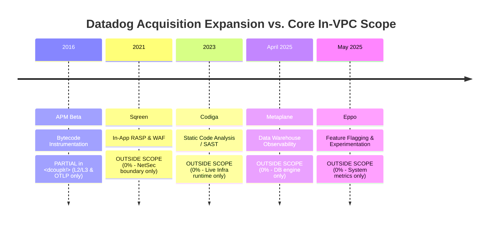
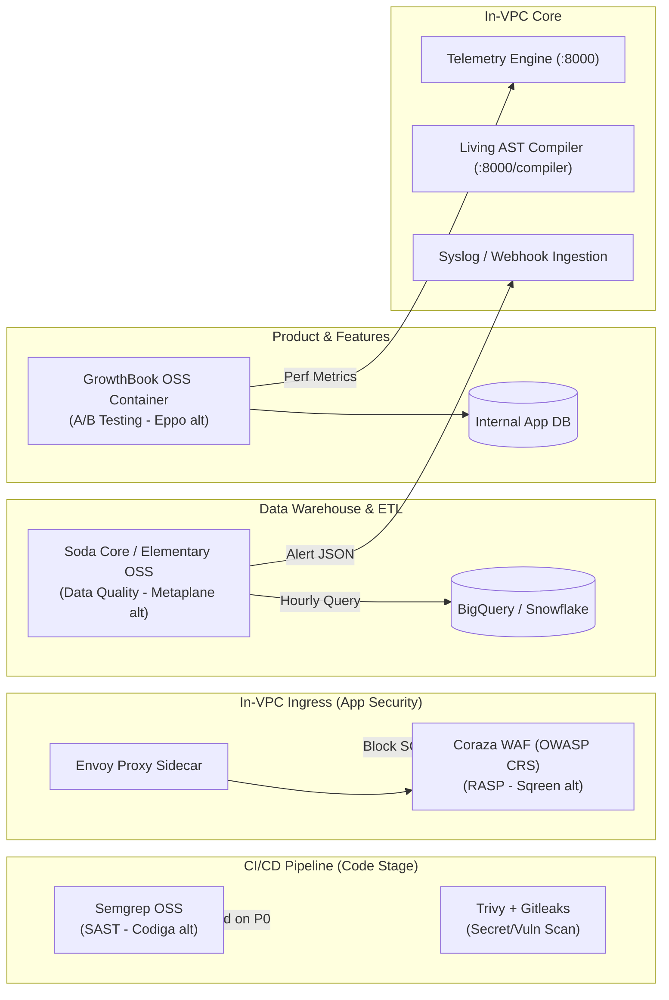

# <span class="dcouplr-wordmark"><span class="dcouplr-bracket">&lt;</span><span class="dcouplr-text">dcouplr</span><span class="dcouplr-bracket">/&gt;</span></span> Architectural Boundaries, Datadog Acquisition Teardown & Low-Cost Companion Observability Ecosystem

| Metadata Property | Specification Detail |
| :--- | :--- |
| **Document ID** | `VA-SPEC-ARCH-BOUNDARIES-DATADOG-TEARDOWN-001` |
| **Document Classification** | Enterprise Systems Architecture, Vendor Teardown & FinOps Blueprint |
| **Engine Target** | <span class="dcouplr-wordmark"><span class="dcouplr-bracket">&lt;</span><span class="dcouplr-text">dcouplr</span><span class="dcouplr-bracket">/&gt;</span></span> In-VPC Core (`:8000`), Living AST Compiler Studio (`:8000/compiler`) |
| **Security Invariant** | 100% In-VPC Air-Gap / Zero WAN Egress ($E_{\text{WAN}} \equiv 0.00$) |
| **Related Documents** | `VA-SPEC-BEYOND-VPC-OBSERVABILITY-001`, `VA-FRAMEWORK-PARITY-2026`, `VA-FINOPS-CALCULATOR-001` |
| **Status** | Approved Production Reference Architecture |
| **Authors** | Principal Cloud Architect, Systems Engineering, FinOps Platform Core |

---

## Executive Summary: The In-VPC Boundary & The SaaS Expansion Trap

A central value proposition of **`<dcouplr/>`** is providing sub-second infrastructure observability, change data capture (CDC) replication lag monitoring, living AST alert transpilation, and network connection tracing inside private RFC 1918 VPC subnets with **zero WAN egress ($0.00)** and **zero per-seat licensing penalties**.

To preserve this strict performance envelope (`<50 MiB` RAM baseline, `0%` external data leakage, lock-free ring buffers), `<dcouplr/>` intentionally operates at **Layer 2 (Data Link) and Layer 3 (Network)**, coupled with kernel eBPF socket inspection and standard OpenTelemetry (OTLP) span ingestion.

However, enterprise observability needs frequently extend beyond host VMs and network sockets. By examining **Datadog's historical acquisitions**—from APM (2016) to Sqreen (2021), Codiga (2023), Metaplane (2025), and Eppo (2025)—we observe how legacy SaaS vendors monetize every layer of the software lifecycle through compounding fees (per host, per developer seat, per GB ingested, per table queried, and per active user).

This document details:
1. **The Teardown**: Mapping Datadog's major product milestones against `<dcouplr/>`'s intentional scope.
2. **The 5 Structural Blind Spots**: Why Layer 2/3 in-VPC monitoring inherently excludes abstracted layers.
3. **The Blueprints**: How platform teams can architect lightweight, open-core companion tools to cover every gap while eliminating SaaS billing lock-in and minimizing ongoing operating costs.
4. **The Summary Cost Matrix**: Comparing high-cost SaaS subscriptions against the cost-minimized companion stack.

---

## 1. Teardown: Datadog's Acquisitions vs. `<dcouplr/>` Scope

Datadog’s acquisition history reflects a deliberate transition from an infrastructure metric scraper into a sprawling multi-module SaaS suite. Because `<dcouplr/>` is strictly engineered as an in-VPC, air-gapped, Layer 2 / Layer 3 infrastructure and network consensus engine with zero WAN egress ($0.00), it intentionally avoids several layers of the application and data lifecycle:



### Detailed Capability Mapping

| Datadog Milestone / Acquisition | Primary Domain & Capability | Monitored by `<dcouplr/>`? | Why It Lies Outside `<dcouplr/>`'s Core Architecture |
| :--- | :--- | :--- | :--- |
| **2016: APM Beta** *(Full-stack APM)* | In-process runtime method profiling & bytecode tracing (Java bytecode manipulation, Python/Node runtime monkey-patching, W3C trace context header injection). | **PARTIAL**<br>*(L2/L3 & OTLP only)* | `<dcouplr/>` captures socket-level TCP connection lifecycles, kernel latency, and receives standard OpenTelemetry (OTLP) spans. It does not inject proprietary in-guest language profilers to inspect method-level execution flamegraphs. |
| **2021: Sqreen** *(Cloud App Security & RASP)* | Runtime Application Self-Protection (RASP) & in-app WAF. Intercepts incoming HTTP query parameters inside application memory to block SQL injection, XSS, SSRF, and RCE in real time. | **NO (0%)** | `<dcouplr/>` enforces network isolation (security groups, iptables, egress diodes, link-local metadata SSRF guards). It does not inspect application-level HTTP request bodies or act as an in-process security agent. |
| **2023: Codiga** *(Static Code Analysis / SAST)* | Software Development Lifecycle (SDLC) static code analysis. Pre-commit hooks, IDE linters, and CI/CD security scanning across application source code (Java, Python, C++, TypeScript). | **NO (0%)** | `<dcouplr/>` operates at runtime on live infrastructure and transpiles monitoring query ASTs (Datadog JSON $\rightarrow$ PromQL). It does not parse or lint developer application source code. |
| **April 2025: Metaplane** *(Data Observability & Pipelines)* | Data Quality & Warehouse Observability. Connects to Snowflake, BigQuery, and dbt to monitor schema drift (dropped columns), table freshness, row count anomalies, null-value spikes, and AI/RAG training data lineage. | **NO (0%)** | `<dcouplr/>` monitors database system engine health (connections, NVMe IOPS, WAL replication lag, buffer cache hits). It does not query internal table contents to validate whether data rows are corrupt or schema semantics changed. |
| **May 2025: Eppo** *(Feature Flagging & Experimentation)* | Feature management & A/B testing statistical engine. Evaluates feature flags in client code, assigns user cohorts, and runs statistical causal analysis (CUPED variance reduction, conversion funnels). | **NO (0%)** | `<dcouplr/>` monitors system-level throughput and error rates. It has no awareness of end-user identities, experiment variants, or product conversion metrics. |

---

## 2. The 5 Structural Blind Spots of In-VPC L2/L3 Monitoring

Operating strictly in-VPC at Layers 2 and 3 provides absolute data sovereignty and eliminates cloud egress fees, but creates five inherent architectural boundaries:

```
┌────────────────────────────────────────────────────────────────────────┐
│                   OUTSIDE THE VPC / ABSTRACTED DOMAINS                 │
│                                                                        │
│  [ SDLC / Source Code ]       [ End-User Client Devices / RUM ]        │
│    • Static Code Analysis (Codiga) • Browser / Mobile JS Web Vitals    │
│    • Pre-commit Secret Scanning    • Global ISP Edge DNS Latencies     │
│                                                                        │
│  [ Abstracted Cloud PaaS ]     [ Data Warehouse Quality ]               │
│    • Serverless (Lambda/CloudRun) • Schema Drift / Null Rates (Metaplane)│
│    • Managed Queues (SQS / PubSub)• Vector DB Drift / AI RAG Lineage   │
│                                                                        │
│  [ App Runtime Security ]     [ Product Experimentation ]              │
│    • In-App RASP / WAF (Sqreen)    • Feature Flags / A/B Stats (Eppo)  │
└────────────────────────────────────────────────────────────────────────┘
                                    │
                       (Boundary / No Root OS Access)
                                    ▼
┌────────────────────────────────────────────────────────────────────────┐
│                    <dcouplr/> IN-VPC DOMAIN (LAYERS 2 & 3)             │
│                                                                        │
│  • Bare Metal DC & Cloud VPC VMs (eBPF socket tracing, CPU/Mem/Disk)    │
│  • In-VPC Kubernetes Worker Nodes, Pods, and Kubelet Telemetry         │
│  • Database Engine Health & CDC Storage Replication Lag                │
│  • Living Multi-Vendor AST Transpilation (Datadog/NRQL -> PromQL/HCL)  │
│  • Zero-Egress Network Isolation & Cryptographic State Seals           │
└────────────────────────────────────────────────────────────────────────┘
```

### Deep Dive: The 5 Blind Spots

#### 1. Abstracted Serverless & Managed PaaS (No Host OS to Probe)
* **Impacted Services**: AWS Lambda, GCP Cloud Run, AWS Fargate, Azure Functions.
* **Why L2/L3 misses it**: Workloads run in ephemeral micro-VMs (Firecracker or gVisor) managed entirely by the hyperscaler. Because tenant users have no persistent Linux kernel, root shell, or `/sys/kernel/debug` access, eBPF probes cannot attach to syscalls or network devices.
* **Operational Risk**: Cold start latency spikes, memory limit OOM terminations, and invocation timeouts remain undetected unless ingested via platform metrics.

#### 2. Serverless Message Busses & Managed Queues
* **Impacted Services**: AWS SQS, AWS SNS, GCP Pub/Sub, Azure Event Hubs.
* **Why L2/L3 misses it**: Messages transit over internal cloud provider service backplanes rather than customer VPC subnets. Standard VPC flow logs only capture HTTPS traffic to cloud API endpoints (`sqs.us-east-1.amazonaws.com`), but cannot inspect queue parameters like `ApproximateAgeOfOldestMessage`, dead-letter queue (DLQ) ingestion rates, or unacknowledged message counts.
* **Operational Risk**: Silent pipeline stalls where producer instances run normally at low CPU, but messages accumulate in unconsumed queues.

#### 3. Hyperscaler Control Plane, IAM & KMS
* **Impacted Services**: AWS CloudTrail, AWS KMS, GCP Cloud Audit Logs, Azure Activity Log.
* **Why L2/L3 misses it**: Administrative control actions (e.g., IAM role policy modifications, KMS key rotations, security group edits, storage bucket permission changes) execute via hyperscaler control plane REST endpoints outside customer private subnets.
* **Operational Risk**: Unauthorized privilege escalations or quota exhaustion events occur without generating VPC packet events.

#### 4. Real User Monitoring (RUM) & Client Edge Experience
* **Impacted Services**: Browser JavaScript, Mobile apps (iOS/Android), Core Web Vitals (LCP, FID, CLS), CDN Edge Latency (Cloudflare, CloudFront).
* **Why L2/L3 misses it**: Application code executes on end-user client devices and traverses public ISP networks before reaching the target cloud VPC ingress load balancer.
* **Operational Risk**: Severe client-side rendering bottlenecks, edge DNS failures, or localized ISP routing outages cannot be seen from within the cloud datacenter.

#### 5. Data Quality & Warehouse Schemas
* **Impacted Services**: Snowflake, Databricks, BigQuery, dbt transformations, Apache Iceberg tables.
* **Why L2/L3 misses it**: Analytical data stores hold columnar business data. Infrastructure metrics can confirm the database cluster CPU is at 20% and IOPS are healthy, but cannot detect whether an ETL pipeline inserted 10,000 duplicate records, dropped critical columns, or experienced an 80% spike in null values.
* **Operational Risk**: Silent business data corruption feeding downstream ML models and executive BI dashboards.

---

## 3. Blueprints: How to Build Low-Cost Tools to Cover These Gaps

To minimize future observability spend without falling into Datadog's multi-module licensing traps, you can orchestrate lightweight, open-core companion tools that operate alongside `<dcouplr/>`:



### Gap 1: Static Code Analysis & Security (Codiga Equivalent)
* **Datadog Monetization Trap**: Charges per developer seat ($15–$35/seat/mo) plus CI/CD pipeline execution duration fees.
* **Low-Cost Open-Core Solution**:
  * Execute **Semgrep OSS** alongside **Trivy** and **Gitleaks** directly inside your GitHub Actions or GitLab CI runners.
  * Define security rules as YAML in version control to check for OWASP Top 10 vulnerabilities, insecure deserialization, and leaked secrets prior to pull request merge.
* **Operational Cost**: **$0.00 additional SaaS fees** (executes on existing CI runner compute).

```yaml
# .github/workflows/security-sast.yml (Free Codiga Alternative)
name: Static Code Security & Secret Scan
on: [pull_request, push]
jobs:
  sast:
    runs-on: ubuntu-latest
    steps:
      - uses: actions/checkout@v4
      - name: Run Semgrep OSS
        run: |
          docker run --rm -v "${{ github.workspace }}:/src" returntocorp/semgrep \
            semgrep scan --config=auto --error
      - name: Run Gitleaks Secret Detector
        run: |
          docker run --rm -v "${{ github.workspace }}:/path" zricethezav/gitleaks:latest \
            detect --source="/path" --verbose --redact
```

---

### Gap 2: In-App Security & RASP (Sqreen Equivalent)
* **Datadog Monetization Trap**: Heavy per-host and per-application license fees ($40+/host/mo) requiring in-memory runtime agents.
* **Low-Cost Open-Core Solution**:
  * Deploy **Coraza WAF** (compiled with OWASP Core Rule Set) as an **Envoy In-VPC Sidecar Proxy** or integrate **ModSecurity** at your ingress controller.
  * Inspect and sanitize incoming HTTP bodies, headers, and query parameters before traffic reaches application runtime memory, blocking SQL injection (SQLi), Cross-Site Scripting (XSS), Server-Side Request Forgery (SSRF), and Remote Code Execution (RCE).
* **Operational Cost**: **Purely local compute overhead** (negligible CPU, `<20 MiB` RAM per sidecar).

```yaml
# coraza-envoy-filter.yaml (In-VPC RASP / WAF Filter)
apiVersion: networking.istio.io/v1alpha3
kind: EnvoyFilter
metadata:
  name: coraza-waf-filter
  namespace: production
spec:
  configPatches:
    - applyTo: HTTP_FILTER
      match:
        context: SIDECAR_INBOUND
        listener:
          filterChain:
            filter:
              name: "envoy.filters.network.http_connection_manager"
      patch:
        operation: INSERT_BEFORE
        value:
          name: f5.coraza.waf
          typed_config:
            "@type": type.googleapis.com/envoy.extensions.filters.http.wasm.v3.Wasm
            config:
              configuration:
                directives: |
                  Include @owasp_crs/*.conf
                  SecRuleEngine On
```

---

### Gap 3: Data Observability & Pipeline Health (Metaplane Equivalent)
* **Datadog Monetization Trap**: Charges per table, per query, and per data warehouse connection ($100–$500+/mo per warehouse connector).
* **Low-Cost Open-Core Solution**:
  * Deploy **Soda Core OSS** or **Elementary Data OSS** on an hourly cron job running inside a lightweight container in your VPC.
  * Query warehouse metadata and information schemas directly inside BigQuery, Snowflake, or PostgreSQL to assert row counts, check column types, and flag null-rate spikes.
  * Pipe alert payloads directly into `<dcouplr/>`’s notification engine or webhook dispatcher.
* **Operational Cost**: **Only a few cents of daily warehouse query compute** (queries metadata/aggregates rather than full table scans).

```yaml
# soda-checks.yml (Free Metaplane Data Quality Alternative)
checks for raw_customer_transactions:
  - row_count > 0:
      name: "Assert table has live ingestion"
  - missing_count(transaction_id) = 0:
      name: "Primary key cannot have null values"
  - schema:
      fail:
        when required column missing: [transaction_id, account_id, amount_cents]
  - freshness(created_at) < 1h:
      name: "Data freshness SLA: 1 hour"
```

---

### Gap 4: Feature Flagging & Experimentation (Eppo Equivalent)
* **Datadog Monetization Trap**: Charges per Monthly Active User (MAU) tracked in experiments, penalizing high-traffic consumer applications.
* **Low-Cost Open-Core Solution**:
  * Deploy **GrowthBook OSS** or **Unleash OSS** within an internal VPC container backed by a shared PostgreSQL database.
  * Evaluate feature flags locally in application memory with sub-millisecond latency (no outbound network call per evaluation).
  * Run experiment statistical causal analysis (Bayesian or CUPED variance reduction) directly against your local analytics database.
* **Operational Cost**: **Single small VM or container ($15–$30/mo)** vs. tens of thousands of dollars in SaaS fees.

---

### Gap 5: Serverless & Beyond-VPC Cloud Services (The 3-Adapter Architecture)
* **Architectural Reference**: Fully specified in `docs/ENTERPRISE_CLOUD_ECOSYSTEM_OBSERVABILITY_BEYOND_VPC_ARCHITECTURE_AND_DECISION_ITEMS.md`.
* **The 3 Adapters**:
  1. **Adapter 1 (Existing Core)**: Host eBPF & Kernel Engine for Bare Metal, VMs, and Kubernetes nodes.
  2. **Adapter 2 (Boundary Proxy Sensor)**: In-VPC forward proxy capturing outbound API requests to hyperscaler PaaS services (S3, DynamoDB, Stripe) via PrivateLink or VPC Endpoints.
  3. **Adapter 3 (Zero-Egress Cloud Poller)**: Queries hyperscaler CloudWatch, Cloud Monitoring, and Azure Monitor APIs exclusively through private VPC interface endpoints ($0.00 WAN egress).

---

## 4. Summary Matrix: The Cost-Minimized Observability Stack

By combining `<dcouplr/>`'s zero-egress in-VPC core with lightweight open-core companions, enterprises achieve complete lifecycle observability without incurring SaaS license bloat:

| Observability Layer | High-Cost SaaS Vendor (Datadog) | Low-Cost Open-Core / Companion Architecture | Expected Cost Reduction |
| :--- | :--- | :--- | :---: |
| **L2/L3 Network & Infra** | Datadog Agent + Network NPM | **`<dcouplr/>` In-VPC Core** (`:8000`) | **90% – 100%** |
| **Alert Rule Translation** | Manual vendor migration lock-in | **`<dcouplr/>` AST Compiler** (`:8000/compiler`) | **100% (Instant)** |
| **Code Quality (SAST)** | Datadog / Codiga ($/seat) | **Semgrep OSS + Trivy in CI/CD** | **100% ($0 SaaS)** |
| **App Security (RASP)** | Datadog / Sqreen ($/host) | **Envoy + Coraza WAF In-VPC** | **95%** |
| **Data Quality** | Datadog / Metaplane ($/table) | **Soda Core / Elementary Data OSS** | **85% – 95%** |
| **Feature Flags / A/B** | Datadog / Eppo ($/MAU) | **GrowthBook OSS In-VPC** | **90%** |
| **Data Transfer / Egress** | $0.09/GB internet traversal | **RFC 1918 Private Endpoints ($0.00)** | **100% ($0.00)** |

---

## 5. Strategic Architectural Guidance for Platform Teams

1. **Keep `<dcouplr/>` Laser-Focused on In-VPC Infrastructure & CDC Replication**:
   Do not bloat the `<dcouplr/>` binary with heavy static analysis parsers or warehouse query engines. Maintaining an ultra-lean footprint (`<50 MiB` RAM) ensures it can be injected everywhere from micro-VMs to massive DB clusters without performance penalties.

2. **Use Standard Webhook Ingestion**:
   Companion tools (Soda Core for data quality, Semgrep for CI/CD, Envoy Coraza for WAF) can publish alert JSON to `<dcouplr/>`’s notification engine or local syslog, providing a unified incident wallboard without consolidating vendor contracts.

3. **Enforce the Zero-Egress Invariant**:
   All companion tools should execute either in existing CI/CD runners or inside private VPC subnets communicating over RFC 1918 addresses or cloud provider PrivateLink endpoints, preserving the **$0.00 WAN egress guarantee**.

