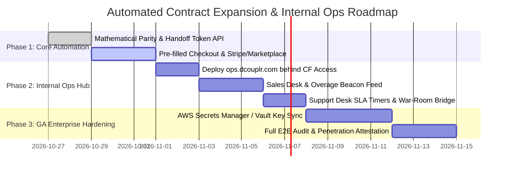

# Architectural Specification: In-VPC License Census, Automated Contract Expansion & Internal Ops Hub

**Document Identifier:** `VA-SPEC-OPS-EXPANSION-001`  
**Governing Decisions:** `D-12`, `D-41`, `D-44`, `D-46`, `D-50`  
**Classification:** Enterprise System Architecture & Commercial Engineering Specification  
**Target Audience:** Enterprise Architects, FinOps Directors, VP of Engineering, SRE Incident Commanders, Commercial Sales Operations  
**Compliance Standards:** SOC-2 Type II, ISO 27001, Zero-Egress Invariant ($0.00 Unauthorized WAN Egress)

---

## 1. Executive Summary & Core Architectural Invariants

This specification formalizes the bidirectional commercial and operational lifecycle connecting `<dcouplr/>` in-VPC clusters, frictionless contract upgrades, and isolated internal sales/support operations.

Modern enterprise customers operating in-VPC observability and IaC transpilations face two critical operational bottlenecks during scaling:
1. **The Human-Error Upgrade Barrier**: Forcing customer engineers to log into an external billing portal, manually count deployed nodes, and select contract tiers introduces typos, misaligned commitments, and delayed procurement.
2. **Internal Operations Exposure Risk**: Mixing customer-facing applications with internal sales monitoring and SRE incident triage creates attack surface vulnerabilities and breaks zero-trust compliance.

To solve both challenges, `<dcouplr/>` specifies:
1. **Mathematical Alignment**: 100% equivalence between the **In-VPC License Entitlement & Installation Census** and the **Smart Contract & Proration Calculator**.
2. **Zero-Login Automated Expansion Pipeline**: In-VPC cluster telemetry automatically extracts contract identity, calculates co-termed daily proration, and hands off pre-authenticated, tamper-evident checkout sessions.
3. **Isolated Internal Operations Hub (`ops.dcouplr.com`)**: A dedicated internal control plane decoupled from public customer traffic, protected behind Cloudflare Zero Trust, providing unified desks for Sales expansion monitoring and SRE tier-gated incident response.

```
┌──────────────────────────────────────────────────────────────────────────────────────────────────┐
│                            AUTOMATED IN-VPC TO SALES PIPELINE                                    │
├──────────────────────────────────────────────────────────────────────────────────────────────────┤
│                                                                                                  │
│  [1. In-VPC Cluster]                [2. One-Click Handoff]          [3. Pre-Filled Checkout]     │
│  ┌───────────────────────────┐      ┌─────────────────────────┐     ┌────────────────────────┐   │
│  │ Census detects:           │      │ Engineer clicks:        │     │ Hosted Checkout:       │   │
│  │ • Active: 71 nodes        │ ───> │ "Upgrade & Prorate ↗"   │ ──> │ • Company: ACME Corp   │   │
│  │ • Contract: DCL-CLUS-SM-..│      │ Opens signed link with  │     │ • Tier: Cluster Medium │   │
│  │ • Days Remaining: 142     │      │ payload (Zero typing)   │     │ • Prorated: $9,336.98  │   │
│  └───────────────────────────┘      └─────────────────────────┘     └───────────┬────────────┘   │
│                                                                                 │                │
│                                                                                 ▼                │
│  [5. Zero-Touch Hot-Reload]         [4b. License Delivery]          [4a. Real-Time Sales Alerts] │
│  ┌───────────────────────────┐      ┌─────────────────────────┐     ┌────────────────────────┐   │
│  │ Cluster reloads dcouplr.lic│ <─── │ 1-Click download of     │ <── │ Webhook fires:         │   │
│  │ in-memory in 1 second     │      │ Ed25519 signed          │     │ • Slack #sales-alerts  │   │
│  │ (0 cluster restart)       │      │ updated dcouplr.lic     │     │ • CRM: +$24k ARR bump  │   │
│  └───────────────────────────┘      └─────────────────────────┘     │ • Stripe/Mktpl adjust  │   │
│                                                                     └────────────────────────┘   │
└──────────────────────────────────────────────────────────────────────────────────────────────────┘
```

---

## 2. Mathematical Parity: In-VPC Census vs. Smart Proration Calculator

The in-VPC workload census evaluated by `migration_tools/licensing/commercial.py` and rendered in `dashboard.html` (`#modal-upgrade-recommendation`) adheres to the deterministic pricing rules executed in the public Smart Contract & Proration Calculator (`index.html#section-proration-calculator`).

### 2.1 Pricing Tier & Capacity Baseline
The system recognizes 5 commercial enterprise tiers:

| Tier | Base Monthly | Base Annual | Base Nodes | Max Overages Allowed | Overage Rate (Mo / Yr) | Hard Cap | Support SLA |
| :--- | :--- | :--- | :--- | :--- | :--- | :--- | :--- |
| **Developer Pro** | $300 | $3,600 | 25 | 0 | Ineligible ($0) | 25 nodes | Community (Best Effort) |
| **Cluster Small** | $1,500 | $18,000 | 25 | 35 | $60 / $720 | 60 nodes | Business 8x5 (P1 24h) |
| **Cluster Medium** | $3,500 | $42,000 | 75 | 75 | $50 / $600 | 150 nodes | 24x7 P1 (2h response) |
| **Cluster Large** | $7,500 | $90,000 | 200 | 200 | $45 / $540 | 400 nodes | 24x7 Mission-Critical (1h) |
| **Enterprise Fleet** | $18,000 | $216,000 | 500 | Unlimited | $35 / $420 | Custom | Custom Dedicated War-Room (15m) |

### 2.2 Concrete Census Case Study: 71 Monitored Nodes
Consider a customer running `Cluster Small` (25 licensed nodes) whose cluster expands to **71 active nodes**:

1. **Deficit Audit**:
   $$\text{Deficit} = \text{Active Nodes} (71) - \text{Base Licensed Nodes} (25) = +46 \text{ Nodes}$$
2. **FinOps Ineligibility Analysis**:
   - *Developer Pro*: Hard-capped at 25 nodes; completely ineligible.
   - *Cluster Small + Max Overages*: Cluster Small permits at most 35 overage add-ons ($25 + 35 = 60$ nodes max).
     $$\text{Max Small Cost} = \$1,500 + (35 \times \$60) = \$3,600 / \text{mo} \quad (\$43,200 / \text{yr})$$
     Even at max overage spend, the customer is **still 11 nodes short of 71**, breaching the hard cap.
3. **Recommended Upgrade (Cluster Medium)**:
   - Base Capacity: **75 nodes flat** (covers 71 nodes natively with 4 spare buffer seats).
   - Flat Cost: **$3,500 / mo** ($42,000 / yr).
   - **Net ROI**: Saves $100/mo ($1,200/yr) compared to maxed-out Small overages, provides full headroom, and automatically upgrades support to 24x7 P1 with a shared Slack channel.

### 2.3 Co-Termed Daily Proration Equation
When upgrading mid-contract, customers never pay double or reset term dates. The Smart Proration Calculator applies co-termed daily accrual:

$$\text{Prorated Due} = \left( \text{Annual}_{\text{Target}} - \text{Annual}_{\text{Current}} \right) \times \left( \frac{D_{\text{remaining}}}{365} \right)$$

*Example with 142 days remaining on contract:*
$$\text{Prorated Due} = (\$42,000 - \$18,000) \times \left( \frac{142}{365} \right) = \$24,000 \times 0.389041 = \mathbf{\$9,336.98}$$

The In-VPC Census and the Smart Calculator compute this exact figure to the cent.

---

## 3. Zero-Login Automated Contract Expansion Pipeline

Because the in-VPC cluster already measures active nodes, forcing an engineer to log into an external portal introduces human error:
- Typoing the company legal entity or Contract ID.
- Miscounting active node pools across multi-cloud VPCs.
- Inadvertently purchasing the wrong tier or missing co-terming dates.

### 3.1 Pre-Authenticated Cryptographic Handoff Token
When the engineer clicks **"⚡ Proceed to Contract Upgrade & Prorated Checkout"** in the Dashboard Census modal:
1. The local in-VPC daemon generates a signed, ephemeral HMAC-SHA256 **Handoff Token**:
   ```json
   {
     "contract_id": "DCL-CLUS-SM-ACME-8821B47C9",
     "company_name": "ACME Corporation",
     "current_tier": "Cluster Small",
     "active_census_nodes": 71,
     "recommended_tier": "Cluster Medium",
     "contract_anniversary": "2027-03-18T00:00:00Z",
     "days_remaining": 142,
     "prorated_amount_usd": 9336.98,
     "nonce": "a7f4e912b3",
     "timestamp": 1793158000
   }
   ```
2. The browser navigates directly to the pre-filled checkout:
   `https://dcouplr.com/checkout?token=<ENCODED_SIGNATURE>`
3. The checkout screen presents the exact pre-calculated upgrade with zero manual data entry required.

### 3.2 Dual Procurement Fulfillment Channels
The automated checkout accommodates three corporate procurement modes:
1. **Instant Stripe Checkout**: Credit card or ACH pull for existing payment methods on file.
2. **Hyperscaler Marketplace Drawdown**: 1-click private offer drawdown against committed AWS EDP, GCP Commit, or Azure MACC.
3. **Net-30 Invoiced Purchase Order**: Auto-generates an amendment addendum to the master services agreement (MSA) with automated electronic signature.

### 3.3 Automated Hot Reloading (Zero In-VPC Downtime)
Upon payment or PO execution:
1. The licensing engine signs a new Ed25519 `dcouplr.lic` file.
2. The customer downloads the discrete key file, or the cluster receives it via AWS Secrets Manager / HashiCorp Vault.
3. Running `dcouplr auth activate --key-file /secure/path/dcouplr.lic` hot-reloads the active node ceiling in volatile memory **in under 1 second without restarting pods or breaking replication streams**.

---

## 4. Internal Tool Architecture: `ops.dcouplr.com`

To maintain clean separation between public marketing/documentation and internal business operations, `<dcouplr/>` specifies an isolated internal hub hosted on a dedicated subdomain.

### 4.1 Subdomain Recommendation: `ops.dcouplr.com`
The subdomain `ops.dcouplr.com` provides clean organizational identity while preserving wildcard SSL (`*.dcouplr.com`) and enterprise Single Sign-On (SSO).

```
                             PUBLIC INTERNET
                                   │
              ┌────────────────────┴────────────────────┐
              │                                         │
              ▼                                         ▼
     https://dcouplr.com                       https://ops.dcouplr.com
  (Public Website & Docs)                     (Internal Sales & Support)
  ┌─────────────────────────┐               ┌─────────────────────────────┐
  │ • Hostinger / Edge CDN  │               │ 🔒 Cloudflare Zero Trust    │
  │ • Static HTML / Assets  │               │ • Okta / Google Workspace   │
  │ • 0 Database            │               │ • Hardware Key / 2FA        │
  │ • 0 Customer Data       │               │ • IP Allowlist              │
  │ • 100% Public Access    │               │ • 0 Public Access (403/DNS) │
  └─────────────────────────┘               └──────────────┬──────────────┘
                                                           │
                                                           ▼
                                            ┌─────────────────────────────┐
                                            │ <dcouplr/> Internal Ops Hub │
                                            │ ┌─────────────┬───────────┐ │
                                            │ │ Sales Desk  │ SRE Desk  │ │
                                            │ └─────────────┴───────────┘ │
                                            └─────────────────────────────┘
```

### 4.2 The 3 Firewalls of Complete Isolation

| Boundary Layer | Isolation Enforcement Mechanism | Threat Mitigated |
| :--- | :--- | :--- |
| **1. Network & Ingress** | Point-to-point **Cloudflare Zero Trust Access Tunnel (`cloudflared`)**. 0 open public inbound ports. Unauthenticated requests are dropped at the Cloudflare edge with no DNS response or 403. | Automated vulnerability scanners, brute-force attacks, public IP leaks. |
| **2. Infrastructure** | Hosted on private containers (AWS ECS / GCP Cloud Run / private Kubernetes) completely separate from the public static web server (Hostinger LiteSpeed). | Cross-site scripting contamination, web server compromises, shared resource exhaustion. |
| **3. In-VPC Data Privacy** | Interacts with customer VPCs strictly through **one-way outbound customer-initiated tokens** or signed webhook beacons. The internal hub **never opens inbound network connections into customer VPCs**. | Breach of Zero-Egress Invariant, regulatory compliance violations, customer data exfiltration. |

---

## 5. Unified Internal Ops Capabilities

The internal console unifies Sales Expansion and SRE Customer Support on a single role-gated backend:

### 5.1 Module A: 💼 Sales & Expansion Desk
1. **Contract & License Census Database**:
   - Instant search across all enterprise customers by Company Name, Domain, or Contract ID (`DCL-CLUS-...`).
   - Tracks committed nodes, deployed nodes, contract start/end dates, and billing channels (Stripe / AWS / GCP / PO).
2. **Automated Overage & Expansion Beacon Feed**:
   - Receives anonymized beacon triggers when clusters run over quota:
     > 🔔 **Expansion Signal:** ACME Corp (Contract `DCL-CLUS-SM-ACME-8821B47C9`) has operated at **71 nodes** (+46 deficit) for 48 hours.  
     > **Recommended Action:** Upgrade to Cluster Medium.  
     > **ARR Growth:** +$24,000 / yr (Prorated immediate cash: $9,336.98).
3. **One-Click Quote & Private Offer Generator**:
   - Generates AWS Marketplace Private Offer links or pre-co-termed Stripe checkout sessions with one click.
4. **Discrete Cryptographic License Signer**:
   - Encrypted in-memory Ed25519 signer generating tamper-evident `dcouplr.lic` bundles without exposing keys on public servers.

### 5.2 Module B: 🎫 Support & SRE Desk
1. **Tier-Gated Incident Queue**:
   - Automatically prioritizes tickets based on the customer’s contractual SLA:
     - **P0 Disaster**: 15-Minute Guaranteed First Response Time (FRT).
     - **P1 Critical**: 15m–2h FRT with automatic Slack war-room trigger.
     - **P2 Major**: 1h–4h FRT.
     - **P3/P4**: 4h–24h FRT.
2. **SLA Penalty Breach Countdown Clocks**:
   - Dynamic timers warning SREs before contractual service credit penalties apply (e.g., *10% invoice credit if unacknowledged in 12 minutes*).
3. **In-VPC Emergency War-Room Launcher**:
   - Spawns ephemeral WebRTC video and screen-share bridges directly inside customer perimeters (`support.html#bridges`) with zero external software accounts.
4. **Transpiler AST Diagnostic Testbench**:
   - Replays and validates customer rule parsing failures in a sandboxed, anonymized environment with zero customer metric exfiltration.

---

## 6. Implementation & Rollout Roadmap



1. **Step 1 (Immediate)**: Document the complete architecture in the Technical Documentation Hub (`/docs`) and register in `DOCUMENT_REGISTRY`.
2. **Step 2**: Provision `ops.dcouplr.com` with Cloudflare Zero Trust Tunnel routing to our hardened `admin.html` and `support.html` core.
3. **Step 3**: Connect the Dashboard Census "Proceed to Upgrade" button to the cryptographic token handoff URL to eliminate all customer login friction.
