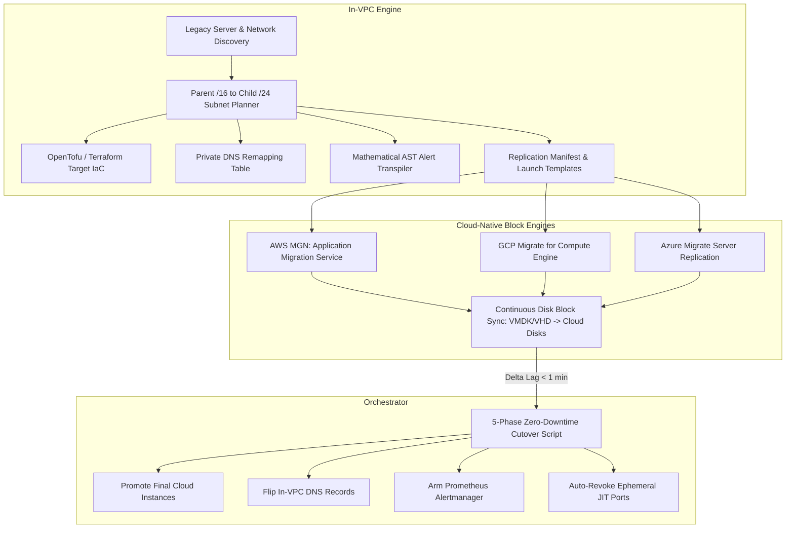

# 🚀 `<dcouplr/>` Cloud-Native Block Replication Orchestration Specification

**Document ID:** `VA-SPEC-ORCH-001`  
**Classification:** Enterprise Systems Architecture & Hyperscaler Workload Acquisition Blueprint  
**Version:** 1.0.0 Approved Strategic Architecture  
**Date:** 2026-10-25  
**Target Entities:** AWS (AWS MGN), Google Cloud (GCP Migrate), Microsoft Azure (Azure Migrate)  
**Security Standard:** In-VPC Zero-Egress Hermetic Interoperability  

---

## 1. Executive Summary & Architectural Philosophy

### 1.1 The Brain vs. The Muscle
In enterprise cloud migrations, the technical challenge splits naturally into two distinct domains:
* **The "Muscle" (Data Plane - Block Replication):** Streaming gigabytes or terabytes of raw operating system disk blocks (VMDK, VHD, QCOW2) across the network, kernel change block tracking (CBT), and VSS snapshot drivers. Cloud hyperscalers have already invested hundreds of millions of dollars building reliable, hardened cloud-native replication engines for this task.
* **The "Brain" (Control Plane - `<dcouplr/>`):** Designing the destination VPC/subnet topology, remapping hardcoded legacy IPs to In-VPC Private DNS (`*.mesh.internal`), transpiling proprietary observability alerts (Datadog/Nagios $\to$ Prometheus/Grafana), and coordinating zero-downtime cutover sequences.



### 1.2 Preservation of Architectural Decision D-05
As codified in **Decision D-05** (`ProjectAssistant/phase-4/04-decisions.md`):
> *"Exclude low-level VM disk block conversions (VMDK/QCOW2 binary bitstreams) from the compiler core. Virtual machine disk conversion is systems virtualization I/O; confining the compiler to declarative logic, policy, and telemetry avoids fatal engineering dilution."*

By **orchestrating** proven cloud-native replication engines instead of rewriting hypervisor disk drivers from scratch, `<dcouplr/>` delivers complete, turnkey end-to-end migration while keeping its codebase lightweight, deterministic, and 100% zero-egress.

---

## 2. Hyperscaler Target Engine Matrix

`<dcouplr/>` standardizes orchestration across the three primary hyperscalers:

| Provider | Replication Engine | Agent Installer Package | Target Launch Artifact | Configuration API |
| :--- | :--- | :--- | :--- | :--- |
| **AWS** | **AWS Application Migration Service (AWS MGN)** | `AwsReplicationAgentInstaller.exe` (Win) / `aws-replication-installer-init.py` (Linux) | EC2 Launch Templates (`LaunchTemplateData`) + MGN Launch Settings | `aws mgn update-launch-configuration` |
| **Google Cloud** | **Migrate to Virtual Machines (v4 / M4CE)** | `m4ce-agent.msi` (Win) / `m4ce-agent.deb` / `m4ce-agent.rpm` (Linux) | Compute Engine Target Instance Template + Migration Group JSON | `gcloud vms migration-groups` |
| **Microsoft Azure** | **Azure Migrate: Server Migration** | Azure Site Recovery Mobility Service (`ASR_Deployment_Tool.exe`) | Azure Virtual Network & Subnet Allocation JSON | `az migrate vm create-replication` |

---

## 3. The 3-Tier Integration Architecture

### Tier 1: Manifest & Launch Template Synthesis
When `<dcouplr/>` analyzes a source VPC or legacy baremetal cluster (`POST /v1/telemetry/topology/lift-and-shift`), it automatically generates the provider-specific replication launch templates alongside the OpenTofu IaC:

```json
{
  "source_cluster_id": "dc-onprem-core-01",
  "target_cloud": "AWS",
  "target_region": "us-east-1",
  "target_supernet_cidr": "10.200.0.0/16",
  "servers": [
    {
      "source_hostname": "bare-metal-kvm-01",
      "source_ip": "172.16.1.15",
      "operating_system": "linux",
      "target_subnet_cidr": "10.200.10.0/24",
      "target_private_ip": "10.200.10.15",
      "target_instance_type": "m6i.xlarge",
      "target_dns_fqdn": "bare-metal-kvm-01.mesh.internal",
      "target_security_group_tags": ["mesh-private-app"],
      "aws_mgn_launch_template": {
        "NetworkInterfaces": [
          {
            "DeviceIndex": 0,
            "SubnetId": "var.subnet_app_private_id",
            "PrivateIpAddress": "10.200.10.15",
            "AssociatePublicIpAddress": false,
            "Groups": ["var.sg_mesh_internal_id"]
          }
        ],
        "InstanceType": "m6i.xlarge"
      }
    }
  ]
}
```

### Tier 2: Ephemeral Just-In-Time (JIT) Agent Push
Cloud provider agents must be installed inside the guest OS. `<dcouplr/>` automates this without leaving persistent management ports open:
1. **Private CIDR Lockdown:** Ingress ports (WinRM 5985/5986, SSH 22) are bound strictly to the in-VPC migration runner CIDR (`10.200.0.0/16`). Zero exposure to `0.0.0.0/0`.
2. **One-Command Agent Bootstrap:**
   - **Windows:** PowerShell script triggered over WinRM executing the provider installer with temporary, short-lived IAM session credentials.
   - **Linux:** Bash script over SSH executing the installer package.
3. **Automated Exit Trap:** If agent bootstrap completes or aborts, `<dcouplr/>`'s cutover engine guarantees management ports are immediately revoked:
   ```bash
   cleanup() {
     echo "[Security Teardown] Automatically revoking JIT WinRM & SSH ports..."
     tofu apply -auto-approve -var="enable_migration_mgmt_ports=false" >/dev/null 2>&1 || true
   }
   trap cleanup EXIT
   ```

### Tier 3: Synchronized 5-Phase Cutover Execution
Replication tools replicate blocks, but only `<dcouplr/>` coordinates the live application traffic switch:

```
[Phase 1: Pre-Flight Health] --> Verify target cloud subnets respond 200 OK
[Phase 2: Final Delta Sync]   --> Trigger replication freeze & promote final cloud instances
[Phase 3: Route Reflector]    --> Switch In-VPC Private DNS (*.mesh.internal) to new cloud IPs
[Phase 4: Telemetry Arming]   --> Load transpiled Prometheus Alertmanager rules (0 alert gaps)
[Phase 5: Security Teardown]  --> Revoke JIT management ports & isolate legacy source VPC
```

---

## 4. API Endpoints & Data Contracts

### 4.1 Schema Definitions (`migration_tools/core/models.py`)

```python
class ReplicationEngineTarget(str, Enum):
    AWS_MGN = "AWS_MGN"
    GCP_MIGRATE = "GCP_MIGRATE"
    AZURE_MIGRATE = "AZURE_MIGRATE"

class ServerReplicationMapping(BaseModel):
    source_hostname: str
    source_ip: str
    operating_system: str
    target_subnet_cidr: str
    target_private_ip: str
    target_instance_type: str
    target_dns_fqdn: str
    launch_template_json: Dict[str, Any]
    bootstrap_agent_command: str

class ReplicationPlanResponse(BaseModel):
    target_cloud: str
    engine: ReplicationEngineTarget
    target_region: str
    target_supernet_cidr: str
    server_count: int
    mappings: List[ServerReplicationMapping]
    agent_push_script_powershell: str
    agent_push_script_bash: str
    synchronized_cutover_script: str
```

### 4.2 Endpoint Specifications (`migration_tools/api/app.py`)

* `POST /v1/telemetry/topology/replication-plan`
  * **Tags:** `["Telemetry & Topology", "Lift & Shift"]`
  * **Summary:** Generates complete cloud-native replication manifests, agent installation commands, and synchronized cutover scripts for AWS MGN, GCP Migrate, or Azure Migrate.
  * **Response:** `ReplicationPlanResponse`

---

## 5. Hyperscaler Strategic Value & M&A Thesis

### 5.1 The Strategic Dilemma for Hyperscalers
Hyperscalers (AWS, Google Cloud, Microsoft Azure) lose billions of dollars in potential enterprise cloud revenue because enterprise workloads are stuck on-premises or locked into competitor platforms:
* **The Problem:** Moving raw disk blocks is cheap and solved. What prevents migrations is **Translation Friction**:
  1. Rewriting infrastructure templates (CloudFormation $\leftrightarrow$ Terraform $\leftrightarrow$ Bicep).
  2. Migrating hundreds of complex Datadog/New Relic dashboards and monitors ($100k+ in SRE labor).
  3. Debugging broken hardcoded IPs and route tables after cutover.

### 5.2 Why `<dcouplr/>` is the High-Leverage M&A Target
By combining **Landing Zone Synthesis**, **AST Observability Transpilation**, and **Cloud-Native Replication Orchestration**, `<dcouplr/>` acts as the definitive "Trojan Horse" for hyperscaler corporate development teams:

1. **For Google Cloud (GCP):**
   * GCP struggles to displace AWS in legacy enterprises.
   * With `<dcouplr/>`, GCP sales teams can walk into AWS + Datadog enterprises and offer automated conversion of AWS infrastructure and Datadog alerts into Google Cloud Managed Prometheus and Compute Engine, with zero outbound data egress.
2. **For AWS:**
   * AWS Migration Hub can integrate `<dcouplr/>` as its primary orchestration brain to pull legacy VMware/bare-metal estates into AWS MGN while guaranteeing zero Datadog lock-in.
3. **For Microsoft Azure:**
   * Azure Arc can embed `<dcouplr/>` to extend governance and multi-cloud translation across on-prem, AWS, and GCP workloads.

### 5.3 Historical Acquisition Precedents
Hyperscaler corporate development teams have a long history of acquiring migration accelerator technologies:
* **AWS:** Acquired **CloudEndure** ($250M) for disk replication; acquired **TSO Logic** for TCO migration planning.
* **Google Cloud:** Acquired **Velostrata** ($100M+) for streaming VM migration; acquired **Cornerstone Technology** for mainframe translation.
* **Microsoft:** Acquired **Movere** for discovery and **CloudKnox** for permissions.

`<dcouplr/>` represents the next evolutionary step: **The Universal Observability & IaC Migration Orchestrator**.

---

## 6. Phased Implementation Roadmap

* **Phase 1: Model & Manifest Generation Engine**
  * Define `ReplicationPlanResponse` and provider-specific launch template synthesis in `migration_tools.api.telemetry`.
  * Support AWS MGN EC2 launch template formatting and GCP Migrate group schemas.
* **Phase 2: JIT Agent Bootstrap Script Generation**
  * Synthesize automated `install_agent.ps1` (WinRM) and `install_agent.sh` (SSH) scripts with short-lived session token injection.
* **Phase 3: Synchronized Cutover Orchestration Engine**
  * Extend `cutover.sh` to include replication delta verification and automated promotion triggers.
* **Phase 4: Dashboard UI Visualizer**
  * Add a "Replication & Block Engine Orchestration" tab to the Lift & Shift modal in `dashboard.html` / `dashboard.js`.
* **Phase 5: Test Verification & Due Diligence Hardening**
  * Add unit and integration tests asserting schema compliance, zero-exfiltration sanitization, and 100% test suite pass rate.
