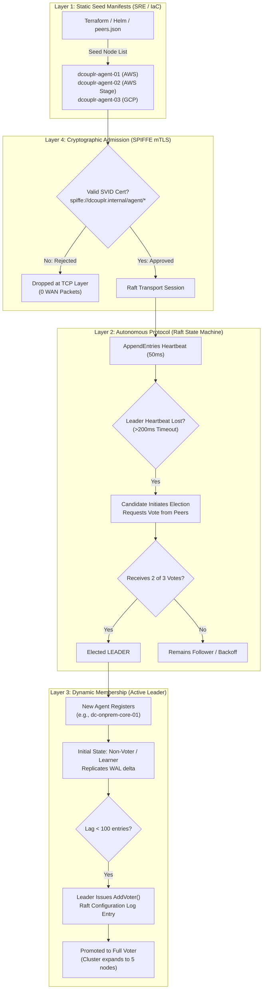
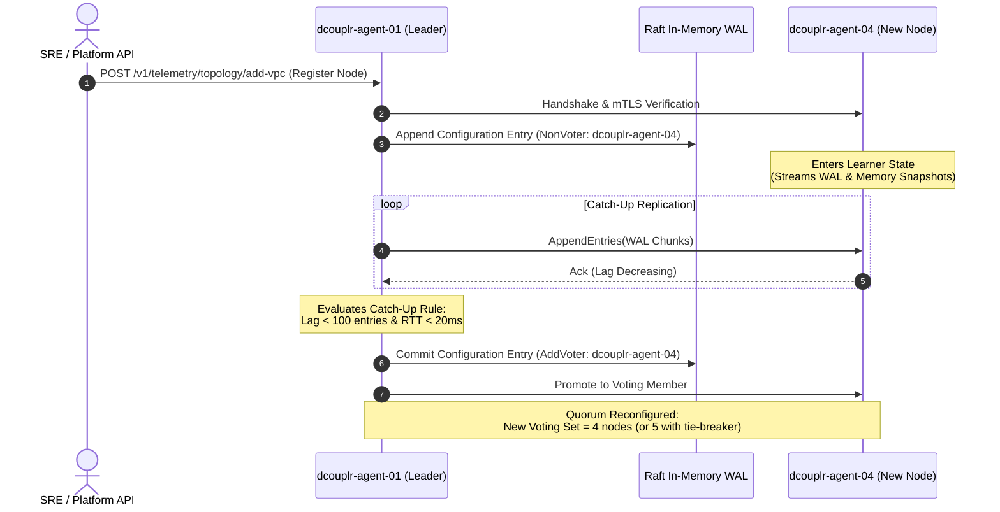

# <dcouplr/> Full-Stack Suite Specification: Embedded Raft Consensus, Quorum Decision Governance & Dynamic Membership Architecture

**Document ID:** `SPEC-FULLSTACK-RAFT-CONSENSUS-001`  
**Classification:** Core System Architecture & Distributed Systems Specification  
**Product Generation:** `<dcouplr/>` Full-Stack Suite  
**Target Audience:** Distributed Systems Architects, Cloud SREs, Security Engineering, Infrastructure Leads  
**Implementation References:** [`engine-go/engine/raft_config.go`](file:///c:/Users/JenniferCletaLee/.gemini/antigravity-ide/MigrationToolsAPI/engine-go/engine/raft_config.go), [`engine-go/engine/raft_transport_wrapper.go`](file:///c:/Users/JenniferCletaLee/.gemini/antigravity-ide/MigrationToolsAPI/engine-go/engine/raft_transport_wrapper.go), [`migration_tools/api/telemetry.py`](file:///c:/Users/JenniferCletaLee/.gemini/antigravity-ide/MigrationToolsAPI/migration_tools/api/telemetry.py)

---

## 1. Executive Summary

In the `<dcouplr/>` Full-Stack Suite, the control plane is completely decentralized into an in-memory, zero-egress distributed state machine powered by an embedded **HashiCorp Raft consensus cluster**. The cluster guarantees strict linearizability, atomic log compaction, and deterministic multi-cloud routing without relying on external cloud databases (e.g., AWS DynamoDB, GCP Cloud Spanner, or etcd).

A foundational operational question frequently asked by enterprise security and infrastructure teams is:

> *"Who decides who becomes part of the quorum in the 3-Node Quorum Active cluster?"*

This specification provides the formal, end-to-end answer. Quorum decision governance is implemented across **four defense-in-depth architectural layers**:

1. **Layer 1: Static Bootstrapping (Infrastructure SRE / IaC):** SREs declare initial failure domains in seed manifests.
2. **Layer 2: Autonomous Runtime Election (Raft Protocol State Machine):** Nodes elect leaders dynamically without human intervention.
3. **Layer 3: Dynamic Membership Promotion (Active Leader Log Commit):** The elected Leader atomically admits new voters via two-phase configuration entries.
4. **Layer 4: Cryptographic Gatekeeping (SPIFFE/SPIRE Zero-Trust mTLS):** Mutual TLS attestation guarantees only verified in-VPC daemons can participate in votes.

---

## 2. Quorum Mathematical Foundations

In Raft consensus, a **Quorum** is defined as the strict majority of voting members required to authorize state machine transitions, commit Write-Ahead Log (WAL) entries, and elect cluster leaders.

### 2.1 The Majority Formula

For an active cluster of $N$ voting nodes, the quorum size $Q$ is computed as:

$$Q = \left\lfloor \frac{N}{2} \right\rfloor + 1$$

The maximum number of simultaneous dead, partitioned, or Byzantine nodes $F$ that the cluster can tolerate while remaining 100% available is:

$$F = \left\lfloor \frac{N - 1}{2} \right\rfloor$$

### 2.2 Quorum Sizing Matrix

| Voting Nodes ($N$) | Quorum Required ($Q$) | Tolerable Faults ($F$) | Primary Operational Use Case |
| :---: | :---: | :---: | :--- |
| **1** | 1 (100%) | 0 | Local developer testing (non-HA, single laptop). |
| **3** *(Default)* | **2 (66.7%)** | **1 Node Dead** | **Standard <dcouplr/> Full-Stack Suite Production Mesh (AWS + GCP + On-Prem).** |
| **5** | 3 (60.0%) | 2 Nodes Dead | High-Resilience Global Banking / Multi-Region Hyperscaler Mesh. |
| **7** | 4 (57.1%) | 3 Nodes Dead | Extreme multi-cloud disaster recovery across 7 geo-regions. |

> [!IMPORTANT]
> **Why Odd Numbers?** Even-numbered clusters (e.g., 4 nodes) require 3 nodes for quorum ($4/2 + 1 = 3$), yet still only tolerate 1 failure. Adding a 4th voting node increases network replication overhead without increasing fault tolerance. `<dcouplr/>` Full-Stack Suite enforces odd-numbered voting clusters (3, 5, or 7).

---

## 3. Four-Layer Quorum Decision Governance



---

### Layer 1: Bootstrapping Seed Configuration (The Human / IaC Decision)

When the `<dcouplr/>` Full-Stack Suite starts for the very first time in an enterprise perimeter, **the cloud infrastructure engineer decides the seed quorum membership**:

1. **Seed Declaration:** The initial 3 nodes are declared in [`engine-go/engine/raft_bootstrap_test.go`](file:///c:/Users/JenniferCletaLee/.gemini/antigravity-ide/MigrationToolsAPI/engine-go/engine/raft_bootstrap_test.go) or Helm values:
   ```json
   [
     {"id": "dcouplr-agent-01", "address": "10.100.1.50:8300", "non_voter": false},
     {"id": "dcouplr-agent-02", "address": "10.101.1.20:8300", "non_voter": false},
     {"id": "dcouplr-agent-03", "address": "10.200.5.15:8300", "non_voter": false}
   ]
   ```
2. **Failure Domain Isolation:** `<dcouplr/>` Full-Stack Suite guidelines mandate placing the 3 voters in distinct availability zones or cloud networks:
   * **Node 1 (`dcouplr-agent-01`):** Primary VPC (`production_vpc`, AWS `us-east-1a`)
   * **Node 2 (`dcouplr-agent-02`):** Staging/Secondary VPC (`staging_vpc`, AWS `us-west-2a`)
   * **Node 3 (`dcouplr-agent-03`):** Analytics Cross-Cloud Mesh (`analytics_gcp_mesh`, GCP `us-central1`)
3. **Cluster Genesis:** At boot, `raft.BootstrapCluster(configuration)` writes an initial configuration log entry at index `1`. These 3 nodes form the baseline quorum.

---

### Layer 2: Autonomous Protocol Governance (The Nodes Decide)

Once the cluster is bootstrapped, **no human operator or central server chooses the leader or controls votes**. The nodes govern themselves via strict protocol timers defined in [`engine-go/engine/raft_config.go`](file:///c:/Users/JenniferCletaLee/.gemini/antigravity-ide/MigrationToolsAPI/engine-go/engine/raft_config.go):

* **Heartbeat Periodicity (`HeartbeatTimeout: 50ms`):** The Leader sends heartbeats to all followers 20 times per second.
* **Election Timeout Window (`ElectionTimeout: 200ms`):** If a follower hears no heartbeat for $>200$ms (due to network partition or host crash), it transitions to **Candidate**, increments the Raft **Term**, votes for itself, and transmits `RequestVote` RPCs.
* **Autonomous 2-of-3 Election:**
  * If Node 1 crashes, Node 2 and Node 3 detect the absence.
  * Node 2 requests votes from Node 3.
  * Node 3 grants its vote because Node 2’s log is at least as up-to-date as its own.
  * Node 2 attains 2 votes (itself + Node 3), achieving a majority of 3 ($2 \ge \lfloor 3/2 \rfloor + 1$).
  * Node 2 immediately becomes the new **LEADER**.

---

### Layer 3: Dynamic Membership Changes (The Active Leader Decides)

When enterprise customers add a 4th network (e.g. `legacy_datacenter_chicago` or Azure), how does that node join the voting quorum?

> [!NOTE]
> Under Raft safety invariants, simply adding a 4th voter instantly without log synchronization can trigger a split-brain condition where two disjoint quorums form simultaneously. The **<dcouplr/> Full-Stack Suite** enforces the **Learner $\rightarrow$ Voter Promotion Protocol**.



1. **Non-Voter (Learner) Phase:**
   * When `dc-onprem-core-01` is registered, it enters as a **Non-Voter**.
   * It receives log streams and replicates transactions, but **its vote is not counted** in elections or commit thresholds.
   * If the network link between on-premises and AWS is slow, it will never delay production commits.
2. **Catch-Up Verification:**
   * The Leader checks `last_applied - peer.match_index`.
   * Only when log lag drops below 100 entries does the Leader initiate promotion.
3. **Atomic `AddVoter` Commitment:**
   * The Leader commits an atomic Raft configuration log entry.
   * All nodes transition their internal quorum formula to the new cluster membership.

---

### Layer 4: Cryptographic Gatekeeping (SPIFFE/SPIRE mTLS)

Raft quorum participation is protected against spoofing, rogue containers, and unauthorized network injection via mutual TLS backed by SPIFFE:

* **Identity Verification:** Every agent presents an X.509 SVID with URI SAN:
  `spiffe://dcouplr.internal/ns/telemetry/sa/dcouplr-agent-node`
* **Transport Wrapping:** Built into [`engine-go/engine/spiffe_raft_transport.go`](file:///c:/Users/JenniferCletaLee/.gemini/antigravity-ide/MigrationToolsAPI/engine-go/engine/spiffe_raft_transport.go).
* **Fail-Fast Defense:** If an unauthenticated node attempts to send a `RequestVote` or `AppendEntries` frame, the connection is aborted at the TLS handshake in **< 1ms**. The rogue node is never recorded in the peer table and cannot influence quorum.

---

## 4. Operational Troubleshooting & Runbook

### 4.1 Inspecting Active Quorum Health

From any terminal or SRE bastion:

```bash
# Query live Raft cluster quorum snapshot
curl -s http://localhost:8000/v1/telemetry/metrics \
  -H "Authorization: Bearer dcouplr-admin-2026" | jq '.raft'
```

**Expected Healthy Response:**
```json
{
  "cluster_id": "dc-cell-prod-east",
  "node_id": "dcouplr-agent-01",
  "role": "LEADER",
  "term": 4,
  "commit_index": 28923,
  "last_applied": 28923,
  "snapshot_index": 24495,
  "uncompacted_delta": 4428,
  "compaction_threshold": 8192,
  "compaction_pct": 53.9,
  "peers": [
    {
      "id": "dcouplr-agent-02",
      "vpc": "vpc-staging-aws",
      "role": "FOLLOWER",
      "status": "HEALTHY",
      "rtt_ms": 14.2,
      "last_heartbeat_ms": 42
    },
    {
      "id": "dcouplr-agent-03",
      "vpc": "vpc-analytics-gcp",
      "role": "FOLLOWER",
      "status": "HEALTHY",
      "rtt_ms": 18.6,
      "last_heartbeat_ms": 48
    }
  ]
}
```

### 4.2 Tripping Circuit Breaker Chaos Drill

To verify how the quorum behaves when a node partition occurs:

1. On the dashboard, navigate to **Embedded Raft Consensus & WAL Compaction**.
2. Click **⚡ Trip Breaker**.
3. The circuit breaker trips to `OPEN`. Downstream RPCs immediately fail-fast in $<1$ms without blocking leader goroutines.
4. After the 10s cooldown timer, the state machine probes the canary in `HALF-OPEN` and auto-recovers to `CLOSED`.

---

## 5. Summary & Decision Authority Table

| Quorum Lifecycle Stage | Who Decides? | Mechanism Used | Security / Safety Guardrail |
| :--- | :--- | :--- | :--- |
| **Initial 3 Nodes** | Infrastructure SRE / DevOps Team | Deployment manifest / `peers.json` | Placed in 3 separate failure domains / AZs |
| **Who is Leader?** | The 3 Nodes (Autonomously) | Raft `RequestVote` Election | 2-of-3 Majority ($\lfloor 3/2 \rfloor + 1$) |
| **Adding a 4th/5th Node** | The Active Leader | `AddVoter` configuration log entry | Joins as Learner first; log lag must be $<100$ |
| **Who is Allowed to Connect?** | Control Plane Network Boundary | SPIFFE/SPIRE Workload Attestation | Mutual TLS X.509 SVID validation |
| **Emergency Recovery** | Incident Commander (SRE) | Force cluster re-seed (`peers.json` manual override) | Cryptographically signed administrative token |

---

*This document constitutes an official architectural standard of the `<dcouplr/>` Full-Stack Suite enterprise release.*

