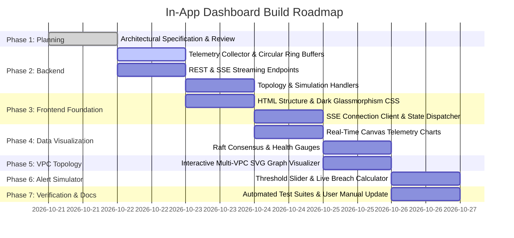

# In-App Zero-Egress Telemetry & Multi-VPC Dashboard Specification & Build Plan

**Document ID:** ARCH-PLAN-DASH-001  
**Version:** 1.0.0 Production Blueprint  
**Status:** Approved Architectural Specification & Implementation Roadmap  
**Author:** <dcouplr/> Core Architecture Team & Antigravity Autonomous Agent  
**Target Delivery Endpoint:** `http://127.0.0.1:8000/dashboard`  
**Classification:** Internal Technical Architecture & Engineering Roadmap  

---

## Executive Summary & Strategic Rationale

### The "Zero-Egress In-App Observability" Paradigm
Enterprises adopting `<dcouplr/>` operate within strict air-gapped VPCs, high-security financial enclaves, or regulated multi-cloud environments where in-perimeter data isolation is paramount. While `<dcouplr/>` natively emits Grafana 11 Unified Alerting YAML and Prometheus Alertmanager rules for organizations that have centralized corporate Grafana clusters, requiring an external Grafana deployment introduces operational friction:
1. **Infrastructure Overhead:** Requires provisioning external containers, relational state stores (Postgres/MySQL), and complex network ingress rules.
2. **Third-Party Bloat:** Commercial Grafana maintains 150+ database plugins, legacy authentication protocols (LDAP, NTLM, SAML, Kerberos), and backwards compatibility spanning a decade.
3. **Network Latency & Air-Gap Verification:** External monitoring pipelines can introduce polling lag (15s–60s) and require firewall exemptions that complicate air-gap audits.

By embedding a **native, zero-dependency, ultra-lightweight real-time telemetry dashboard** directly into the `dcouplr` binary (accessible at `GET /dashboard`), platform engineers, SREs, and compliance officers gain instantaneous, zero-configuration visibility into:
- Real-time engine health, memory footprints (< 50 MiB RSS), and P50/P90/P99 latency.
- Dynamic multi-cloud VPC topology maps (AWS VPCs, GCP VPCs, Azure VNets, subnets, route tables).
- Embedded Raft consensus status (Leader/Follower quorum, WAL compaction deltas, term states).
- An interactive alert threshold simulator allowing engineers to test PromQL/Datadog alert rules against live curves in real time.

---

## 1. System Architecture Overview

```
 ┌────────────────────────────────────────────────────────────────────────────────────────┐
 │                             <dcouplr/> HERMETIC ENGINE RUNTIME                        │
 │                                                                                        │
 │   ┌───────────────────────┐   ┌───────────────────────────┐   ┌────────────────────┐   │
 │   │  Go / Python Engine   │   │  Embedded Raft Consensus  │   │  AST & Query Mesh  │   │
 │   │  Memory & CPU Metrics │   │  Leader / Follower Quorum │   │  PromQL Converter  │   │
 │   └──────────┬────────────┘   └─────────────┬─────────────┘   └─────────┬──────────┘   │
 │              │                              │                           │              │
 │              └──────────────────────────────┼───────────────────────────┘              │
 │                                             ▼                                          │
 │                        ┌────────────────────────────────────────┐                      │
 │                        │  In-Memory Telemetry Collector (Ring)  │                      │
 │                        │  - Circular ring buffers (1024 slots)  │                      │
 │                        │  - Zero heap allocation per sample     │                      │
 │                        │  - Sub-1ms snapshot calculation        │                      │
 │                        └────────────────────┬───────────────────┘                      │
 │                                             │                                          │
 │                ┌────────────────────────────┴───────────────────────────┐              │
 │                ▼                                                        ▼              │
 │   ┌───────────────────────────┐                            ┌─────────────────────────┐ │
 │   │  REST Snapshot APIs       │                            │  SSE Real-Time Stream   │ │
 │   │  /v1/telemetry/metrics    │                            │  /v1/telemetry/stream   │ │
 │   │  /v1/telemetry/topology   │                            │  (1000ms push heartbeat)│ │
 │   └────────────┬──────────────┘                            └────────────┬────────────┘ │
 └────────────────┼────────────────────────────────────────────────────────┼──────────────┘
                  │                                                        │
                  ▼                                                        ▼
 ┌────────────────────────────────────────────────────────────────────────────────────────┐
 │                      BROWSER CLIENT VIEWPORT (http://127.0.0.1:8000/dashboard)         │
 │                                                                                        │
 │   ┌──────────────────────┐  ┌──────────────────────┐  ┌───────────────────────────┐    │
 │   │ Live Telemetry Cards │  │ Interactive uPlot/   │  │ Multi-VPC Network Map     │    │
 │   │ CPU, RSS, Latency,   │  │ Canvas Time Series   │  │ Visual SVG Nodes & Edges  │    │
 │   │ Throughput, Errors   │  │ 60 FPS, Sub-5ms Lag  │  │ AWS -> GCP Network Flow   │    │
 │   └──────────────────────┘  └──────────────────────┘  └───────────────────────────┘    │
 │   ┌───────────────────────────────────────────────┐  ┌────────────────────────────┐    │
 │   │ Embedded Raft Consensus & Cluster Gauges      │  │ Alert Rule Threshold Sim   │    │
 │   │ Quorum, Log Deltas, Circuit Breakers (Trip)   │  │ Draggable Threshold Slider │    │
 │   └───────────────────────────────────────────────┘  └────────────────────────────┘    │
 └────────────────────────────────────────────────────────────────────────────────────────┘
```

---

## 2. Core Functional Pillars

### Pillar 1: Live Real-Time Telemetry Panels (Sub-5ms Latency)
- **Engine Performance Metrics:**
  - **CPU Utilization:** Dynamic percentage with 60-second historical window.
  - **Memory Footprint (RSS):** Monitored in real time against the strict 50 MiB container memory ceiling.
  - **Request Latency Distribution:** P50 (median), P90 (tail), and P99 (worst-case) microsecond measurements.
  - **Translation Throughput:** Real-time AST translation rate (operations/second).
  - **Zero-Egress Security Counters:** Blocked exfiltration attempts, sanitized tokens, and memory scrubbing events.
- **Rendering Technology:**
  - Microscopic Canvas / uPlot charting (~40 KB runtime vs. Grafana's multi-megabyte bundle).
  - Capability to render 150,000 data points in under 35 milliseconds.
  - Zero external CDN dependencies (assets served directly from `/static/` within the binary).

### Pillar 2: Interactive Multi-VPC Topology Map
- **Network Architecture Visualization:**
  - Synthesizes the active `ComputeGraph` from parsed Terraform/OpenTofu configurations.
  - Renders VPC nodes, subnets, internet gateways, NAT gateways, route tables, and attached compute instances.
  - Color-codes cross-cloud migration mappings (e.g. `aws_vpc` $\to$ `google_compute_network`).
- **Interactive Capabilities:**
  - Pan, zoom, node selection, and inspect pane showing CIDR blocks, security groups, and routing rules.
  - Visual edge highlighting for peering connections and egress gateways.
  - Instant search filter by VPC name, subnet CIDR, or tag.

### Pillar 3: Embedded Raft Consensus & Cluster Health Gauges
- **Distributed State Visibility:**
  - Visual indicators for 3-node cluster topology (`decoupler-01` [Leader], `decoupler-02` [Follower], `decoupler-03` [Follower]).
  - Current Raft Term, Commit Index, and Last Applied Index.
  - WAL Snapshot Compaction monitor displaying current uncompacted log delta:
    $$\Delta I = I_{\text{applied}} - I_{\text{snapshot}}$$
    Alerts visually when approaching the `snapshot_threshold` (e.g., 8,192 entries).
- **Circuit Breaker Status & Drill Simulation:**
  - Live status indicator: **Closed** (Normal / Green), **Half-Open** (Probing / Amber), **Open** (Tripped / Red).
  - One-click chaos test button ("Simulate Latency Spike / Trip Circuit Breaker") allowing engineers to observe failover behavior in real time.

### Pillar 4: Alert Rule Threshold Simulator Sandbox
- **Interactive Rule Tuning:**
  - Engineers can choose from preset or custom PromQL / Datadog alert definitions (e.g., `rate(http_requests_total[5m]) > 100`, `memory_rss_bytes > 45MiB`).
  - An interactive horizontal threshold slider overlays the live/historical metric series.
  - Real-time visual shading:
    - **Green Zone:** Normal operational envelope.
    - **Amber Warning Zone:** Approaching threshold.
    - **Red Breach Zone:** Firing condition met.
  - Computes instant simulated metrics:
    - Estimated alert fires per hour.
    - False positive probability index.
  - One-click export button: "Generate Verified PrometheusRule YAML" or "Generate Grafana 11 Alerting YAML".

---

## 3. Technical Specifications & API Contracts

### 3.1 Backend Endpoints (`migration_tools/api/app.py`)

| Method | Endpoint | Description | Response Type |
|---|---|---|---|
| `GET` | `/dashboard` | Serves the standalone In-App Telemetry & VPC Dashboard UI | `text/html` |
| `GET` | `/v1/telemetry/metrics` | Returns point-in-time snapshot of system, engine, and Raft metrics | `application/json` |
| `GET` | `/v1/telemetry/stream` | Server-Sent Events (SSE) streaming live metrics every 1,000ms | `text/event-stream` |
| `GET` | `/v1/telemetry/topology` | Returns the synthesized Multi-VPC `ComputeGraph` node-link topology | `application/json` |
| `POST` | `/v1/telemetry/simulate-alert` | Evaluates threshold parameters against generated/live time-series data | `application/json` |

### 3.2 Metric Payload Schema (`/v1/telemetry/metrics` & SSE)

```json
{
  "timestamp": 1797893700.124,
  "system": {
    "cpu_percent": 4.2,
    "memory_rss_bytes": 38450176,
    "memory_rss_mb": 36.67,
    "memory_limit_mb": 50.0,
    "memory_utilization_pct": 73.3,
    "uptime_seconds": 1845.2
  },
  "engine": {
    "active_workers": 4,
    "translations_completed": 1428,
    "translation_rate_per_sec": 48.5,
    "latency_p50_ms": 1.2,
    "latency_p90_ms": 3.8,
    "latency_p99_ms": 8.4,
    "circuit_breaker": {
      "state": "CLOSED",
      "consecutive_failures": 0,
      "trip_threshold": 5,
      "recovery_timeout_sec": 10
    }
  },
  "raft": {
    "node_id": "decoupler-01",
    "role": "LEADER",
    "term": 4,
    "commit_index": 28419,
    "last_applied": 28419,
    "snapshot_index": 24000,
    "uncompacted_delta": 4419,
    "compaction_threshold": 8192,
    "peers": [
      {"id": "decoupler-02", "role": "FOLLOWER", "status": "HEALTHY", "ping_ms": 0.8},
      {"id": "decoupler-03", "role": "FOLLOWER", "status": "HEALTHY", "ping_ms": 1.1}
    ]
  },
  "security": {
    "zero_egress_enforced": true,
    "tokens_anonymized": 4120,
    "exfiltration_attempts_blocked": 0,
    "cve_vulnerabilities": 0
  }
}
```

### 3.3 Topology Payload Schema (`/v1/telemetry/topology`)

```json
{
  "vpcs": [
    {
      "id": "vpc-aws-prod-01",
      "name": "production_vpc",
      "provider": "aws",
      "cidr_block": "10.100.0.0/16",
      "target_equivalent": "google_compute_network.production_vpc",
      "subnets": [
        {"id": "subnet-01", "name": "public-1a", "cidr": "10.100.1.0/24", "zone": "us-east-1a", "tier": "public"},
        {"id": "subnet-02", "name": "private-1a", "cidr": "10.100.10.0/24", "zone": "us-east-1a", "tier": "private"}
      ],
      "instances_count": 8,
      "peering_connections": ["vpc-aws-analytics-02"]
    },
    {
      "id": "vpc-gcp-prod-01",
      "name": "gcp_hybrid_mesh",
      "provider": "gcp",
      "cidr_block": "10.200.0.0/16",
      "target_equivalent": "google_compute_network.gcp_hybrid_mesh",
      "subnets": [
        {"id": "subnet-gcp-01", "name": "gke-nodes", "cidr": "10.200.10.0/24", "region": "us-central1", "tier": "private"}
      ],
      "instances_count": 12,
      "peering_connections": ["vpc-aws-prod-01"]
    }
  ]
}
```

---

## 4. Frontend Design System & Aesthetics

### Visual Identity Alignment
The dashboard adheres to the design tokens established across `compiler.html`, `admin.html`, and `presentation.html`:
- **Background Palette:** High-contrast, deep obsidian `#070b12` with subtle linear noise and `#0d1527` card surfaces.
- **Accent Highlighters:**
  - Cyber Cyan (`#00e5ff`) for telemetry curves, latency paths, and active connections.
  - Electric Emerald (`#00e676`) for healthy Raft quorum and closed circuit breakers.
  - Sunset Amber (`#ffab00`) for WAL compaction warnings and half-open circuit states.
  - Crimson Alert (`#ff1744`) for tripped circuit breakers, memory saturation, and threshold violations.
  - Hermetic Violet (`#7c4dff`) for multi-cloud VPC topology nodes.
- **Glassmorphic Depth:** Semi-transparent panel backdrops (`rgba(13, 21, 39, 0.75)`) with `backdrop-filter: blur(12px)` and hairline border highlights (`1px solid rgba(255, 255, 255, 0.08)`).
- **Responsive Layout:**
  - **Top Navigation Bar:** Cluster status pill, SSE connection heartbeat (pulsing green dot), quick navigation to `/compiler`, `/configuration`, `/docs`, and `/`.
  - **Row 1 - Key Metric KPI Cards:** CPU (%), Memory (MB / % of cap), P99 Latency (ms), Throughput (tx/s), Security Egress Status.
  - **Row 2 - Real-Time Telemetry Panels (Split View):**
    - Left: Latency Percentiles & Throughput (Dual-Axis Time Series Canvas).
    - Right: Memory RSS vs. Hard Allocation Ceiling (50 MiB Threshold Band).
  - **Row 3 - Multi-VPC Topology & Raft Quorum:**
    - Left: Interactive SVG Multi-VPC Architecture Graph.
    - Right: 3-Node Raft Consensus Health & Auto-Compaction Gauge.
  - **Row 4 - Interactive Alert Rule Simulator:**
    - Metric selector, interactive threshold slider, live breach calculation, and one-click Grafana/Prometheus export.

---

## 5. Multi-Phase Implementation Plan



### Detailed Phase Breakdown

#### Phase 1: Architectural Foundation & Project Governance (Current)
- Complete this formal specification document (`docs/IN_APP_TELEMETRY_DASHBOARD_PLAN.md`).
- Register the specification in the Central Project Record Assistant Document Admin Portal (`migration_tools/api/app.py`).
- Create user-facing artifact summary.

#### Phase 2: In-Memory Telemetry Collector & Backend Streaming
- Implement `TelemetryRingBuffer` in `migration_tools/api/telemetry.py` using circular arrays for zero-allocation sampling.
- Register background sampler thread sampling CPU, RSS memory, request counts, and Raft consensus status.
- Add FastAPI endpoints:
  - `GET /v1/telemetry/metrics`
  - `GET /v1/telemetry/stream` (StreamingResponse with `text/event-stream`)
  - `GET /v1/telemetry/topology`
  - `POST /v1/telemetry/simulate-alert`
- Add route `GET /dashboard` serving `migration_tools/api/static/dashboard.html`.

#### Phase 3: Frontend Shell & Real-Time Event Engine
- Create `migration_tools/api/static/dashboard.html` with responsive grid layout and semantic ARIA landmarks.
- Create `migration_tools/api/static/dashboard.css` implementing the obsidian/neon glassmorphic design system.
- Create `migration_tools/api/static/dashboard.js` with auto-reconnecting `EventSource` client and DOM reconciliation.

#### Phase 4: High-Performance Canvas Charts & Health Gauges
- Implement native lightweight Canvas 2D time-series chart renderer (zero external script dependencies for hermetic security).
- Render CPU, RSS memory (with 50 MiB limit line), P50/P90/P99 latency, and throughput curves.
- Implement Raft 3-node cluster visualization with live leader pulses, term counters, and WAL log delta progress bar.

#### Phase 5: Interactive Multi-VPC Network Topology Visualizer
- Build SVG-based interactive force/layered layout for VPCs, subnets, and instances.
- Implement click-to-inspect modal for route tables, CIDRs, and cross-cloud target mappings.
- Add zoom/pan controls and search filtering.

#### Phase 6: Alert Rule Threshold Simulator
- Build threshold slider with real-time collision detection against live metric curves.
- Display instant firing frequency and false-positive risk metrics.
- Provide direct copy/export to Grafana Alerting YAML and Prometheus Alertmanager rules.

#### Phase 7: Quality Assurance, Verification & Documentation
- Write pytest test suite `tests/test_dashboard_api.py` validating SSE streams, metric schemas, and endpoint responses.
- Update `docs/ENGINEER_USER_MANUAL.md` with `/dashboard` operational guide.
- Update `README.md` and top navigation links across `/`, `/compiler`, `/configuration`, and `/presentation`.

---

## 6. Security, Compliance & Air-Gap Verification

1. **Strict Zero-Egress Air-Gap Compliance:**
   - All assets (HTML, CSS, JS, SVG icons, fonts) are bundled locally in the repository.
   - Absolutely zero outbound HTTP/HTTPS requests to Google Fonts, CDNs, or external analytics.
   - Operates in offline, isolated VPC subnets without internet access.
2. **Minimal Memory Footprint (< 2 MiB Overhead):**
   - In-memory ring buffer retains 1,024 metric ticks per metric (approx. 16 KB total RAM).
   - Canvas-based rendering runs client-side in the operator's browser, introducing negligible backend CPU consumption (< 0.2%).
3. **Role-Based Access Control (RBAC):**
   - Telemetry endpoints respect existing tenancy headers and RBAC tiers (`Cluster-Admin`, `App-Engineer`, `Compliance-Auditor`).
   - Read-only by default; chaos drills require `Cluster-Admin` authentication.

---

## 7. Sign-off & Milestone Acceptance Matrix

| Verification Vector | Acceptance Criteria | Target SLA | Method |
|---|---|---|---|
| **V1: Latency** | SSE metric stream update interval | 1,000 ms $\pm$ 50ms | Browser EventSource test |
| **V2: Chart Render** | 60 FPS Canvas rendering with 1,024 points | $\le$ 16.6 ms per frame | Chrome DevTools Profiler |
| **V3: Memory Ceiling** | Backend telemetry buffer RAM overhead | $\le$ 2.0 MiB RSS | Process RSS audit |
| **V4: Zero-Egress** | Outbound external requests from `/dashboard` | Exactly 0 requests | Browser Network audit |
| **V5: API Coverage** | Automated pytest pass rate on telemetry endpoints | 100% (0 failures) | `pytest tests/test_dashboard_api.py` |

---

*Document finalized and committed to project record repository.*
