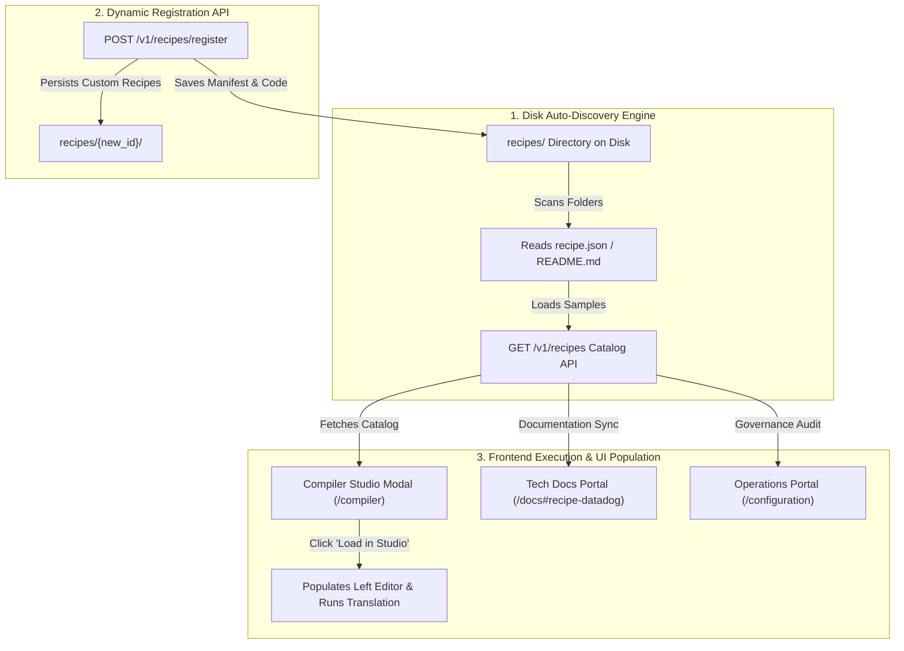

# <dcouplr/> Turnkey Migration Recipes: Architecture & Population Engine Specification

**Document ID:** `SPEC-TURNKEY-RECIPES-001`  
**Classification:** Core System Architecture & Operational Guide  
**Product Generation:** `<dcouplr/>` Editions 1 & 2  
**Target Audience:** Cloud Platform Engineers, Enterprise SREs, Solution Architects, SecOps  
**Implementation References:** [`migration_tools/api/app.py`](file:///c:/Users/JenniferCletaLee/.gemini/antigravity-ide/MigrationToolsAPI/migration_tools/api/app.py), [`recipes/`](file:///c:/Users/JenniferCletaLee/.gemini/antigravity-ide/MigrationToolsAPI/recipes/), [`migration_tools/api/static/compiler.js`](file:///c:/Users/JenniferCletaLee/.gemini/antigravity-ide/MigrationToolsAPI/migration_tools/api/static/compiler.js)

---

## 1. Executive Summary: What Are Recipes in <dcouplr/>?

In the **`<dcouplr/>`** ecosystem, a **Recipe** (formally: *Turnkey Migration Recipe*) is a **modular, self-contained, and deterministic modernization blueprint**. It encapsulates the exact source parsing, intermediate graph transformation, and target cloud emission required to migrate proprietary monitoring rules, alerting definitions, network ingress, or infrastructure-as-code constructs into open cloud-native standards.

### Core Guarantees:
1. **100% Deterministic Parity ($\Phi(q) \equiv \Psi(\text{Target})$):** No probabilistic or hallucinatory LLMs in the execution path. All transformations are verified against formal abstract syntax tree (AST) grammar rules.
2. **Zero WAN Egress ($0.00 Cloud Bill):** All transpilation runs in volatile memory locally or inside the private VPC perimeter. No data or telemetry ever leaves the customer boundary.
3. **Turnkey Executability:** Every recipe ships with verified sample input files, target output manifests, and standalone execution scripts.

---

## 2. Standard Recipe Anatomy (On-Disk Bundle)

Every recipe is stored as an independent directory under the root `recipes/` folder:

```
recipes/<recipe_id>/
├── recipe.json                 # Machine-readable metadata & capability manifest
├── README.md                   # Human-readable engineering SOP & CLI execution guide
├── input_<source_type>.*       # Real-world sanitized input sample (JSON, HCL, YAML)
├── output_<target_type>.*      # Mathematically proven target cloud manifest
└── migrate.py                  # Standalone executable conversion script
```

### Manifest Schema (`recipe.json`):
```json
{
  "id": "datadog_to_grafana11",
  "name": "Datadog Monitors to Grafana 11 Unified Alerting",
  "source_vendor": "datadog",
  "target_platform": "grafana",
  "category": "Observability Migration",
  "description": "Transpiles Datadog metric alerts and dead-man switches into native Grafana 11 provisioning rules with mathematical parity."
}
```

---

## 3. How Are Recipes Populated? (The 3 Population Engines)

Recipes are dynamically populated, registered, and served across three distinct system layers:



### Engine 1: Disk Auto-Discovery Engine (`GET /v1/recipes`)
* **Location:** [`migration_tools/api/app.py`](file:///c:/Users/JenniferCletaLee/.gemini/antigravity-ide/MigrationToolsAPI/migration_tools/api/app.py)
* **Behavior:**
  1. On API startup or upon receipt of `GET /v1/recipes`, the engine scans the `recipes/` directory.
  2. For every folder, it inspects `recipe.json` or falls back to parsing the first heading in `README.md`.
  3. It auto-detects sample input files (`input_*.*`) and sample outputs (`output_*.*`).
  4. Returns the consolidated catalog with category tags, source vendors, target platforms, and execution scripts.

### Engine 2: Dynamic Custom Recipe Registration API (`POST /v1/recipes/register`)
* **Endpoint:** `POST /v1/recipes/register` (Tier 3 Admin / Developer API)
* **Payload:**
  ```json
  {
    "id": "datadog_apm_to_tempo",
    "name": "Datadog APM Tracing to Grafana Tempo",
    "source_vendor": "datadog",
    "target_platform": "tempo",
    "category": "APM Modernization",
    "description": "Translates Datadog span filters into OpenTelemetry trace rules.",
    "sample_input": "{\"trace_filter\": \"service:billing AND status:error\"}",
    "sample_output": "traces:\n  filter: service.name = 'billing' AND status.code = ERROR"
  }
  ```
* **Persistence:** The API writes a new subfolder under `recipes/` containing `recipe.json`, `input_sample.*`, `output_sample.*`, and `README.md`, making the new recipe immediately available across all tools.

### Engine 3: Interactive UI Studio Population (`compiler.js`)
* **Location:** [`migration_tools/api/static/compiler.js`](file:///c:/Users/JenniferCletaLee/.gemini/antigravity-ide/MigrationToolsAPI/migration_tools/api/static/compiler.js)
* **Behavior:**
  1. When an engineer clicks the **`Recipes`** button in the Compiler Studio toolbar, the modal triggers `refreshRecipesFromApi()`.
  2. Cards are dynamically rendered in `#recipes-grid-container`.
  3. Clicking **`Load in Studio →`**:
     - Sets the Source Language dropdown to the recipe's source (e.g., `datadog`).
     - Sets the Target Platform dropdown (e.g., `grafana`).
     - Injects the recipe's sample input into the left editor.
     - Immediately triggers `runTranslation()`, rendering the compiled result on the right pane in $< 15$ms.

---

## 4. Authoritative Built-In Recipe Catalog

| # | Recipe ID | Source Vendor | Target Platform | Operational Category | Primary Benefit |
| :-: | :--- | :--- | :--- | :--- | :--- |
| **1** | `datadog_to_grafana11` | Datadog Monitor JSON | Grafana 11 Alerting YAML | Observability Migration | Saves $5–$23/host SaaS fee; compiles multi-window alerts. |
| **2** | `newrelic_to_prometheus` | New Relic NRQL Alerts | Prometheus Alertmanager | Observability Migration | Translates NRQL `FACET` queries into PromQL rate vectors. |
| **3** | `cloudwatch_to_grafana11` | AWS CloudWatch Alarms | OpenTelemetry / PromQL | Cloud Telemetry Re-Platforming | Converts EC2/RDS statistics into native Prometheus recording rules. |
| **4** | `azure_monitor_to_grafana11` | Azure Monitor / KQL | Grafana 11 YAML | Observability Migration | Translates Azure metric conditions & ISO 8601 evaluation windows. |
| **5** | `cloudformation_to_opentofu_gcp`| AWS CloudFormation/TF | OpenTofu GCP Landing Zone | Infrastructure Modernization | Synthesizes non-overlapping VPC CIDRs, subnets, and routes. |
| **6** | `cloud_run_direct_vpc_egress` | Serverless VPC Access | Cloud Run Direct VPC Egress | FinOps Cost Downscaling | **Eliminates $30–$70/mo idle connector VMs** and cuts latency. |
| **7** | `f5_and_aws_alb_to_gcp_load_balancer`| F5 BIG-IP & AWS ALB | GCP Anycast Global ALB | Edge Ingress Modernization | Compiles virtual servers and iRules into Anycast HTTP(S) load balancers. |
| **8** | `datadog_slo_to_prometheus_rules`| Datadog Multi-Burn SLO | Prometheus Alert Rules | Reliability & SRE Engineering | Implements Google SRE Chapter 5 multi-burn-rate alerting. |
| **9** | `promql_standardization_azure_arc_anthos`| Disparate PromQL | Standardized PromQL | Cross-Cloud Governance | Normalizes syntax drift across hybrid-cloud footprints. |
| **10**| `prometheus_to_datadog` | Prometheus Alert Rules | Datadog Monitors (JSON) | 2-Way Reverse Portability | Enables bidirectional rollback protection. |

---

## 5. Execution Methods

### Method 1: Web Compiler Studio (Zero CLI Setup)
Navigate to [**`/compiler`**](http://localhost:8000/compiler) $\rightarrow$ click **`Recipes`** $\rightarrow$ click **`Load in Studio →`**.

### Method 2: Python Command Line
```bash
python recipes/datadog_to_grafana11/migrate.py
```

### Method 3: Backend API Runner
```bash
curl -X POST http://localhost:8000/v1/recipes/cloud_run_direct_vpc_egress/run \
  -H "Authorization: Bearer dcouplr-admin-2026"
```
Response:
```json
{
  "status": "success",
  "recipe_id": "cloud_run_direct_vpc_egress",
  "duration_ms": 14.2,
  "artifact": "// Synthesized OpenTofu Google Cloud Run Direct VPC Egress..."
}
```

