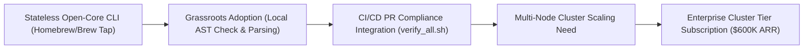

# 🗺️ `<dcouplr/>`: Q1 Developer Community Outreach Roadmap — Value Expansion Plan

**Initiative:** `<dcouplr/>` Open-Core Community & Enterprise Conversion Velocity  
**Product Descriptor:** The Open-Core Telemetry & Infrastructure Translation Engine  
**Operational & Security Architecture:** Zero-Egress Observability & IaC Transpiler  
**Time Horizon:** Days 1 through 90 Post-Launch  
**Strategic Alignment:** Bottom-Up Product-Led Growth (PLG) to Enterprise Node Subscriptions ($600K Y1 ARR Target)  

---

## 🎯 Executive Overview & Growth Loop

The `<dcouplr/>` community expansion strategy targets developer and platform engineering pain around astronomical vendor telemetry bills. By distributing our high-fidelity, stateless CLI tool context-free into developers' local terminal environments, we build grassroots trust, eliminate security review friction via our zero-exfiltration architecture, and establish an organic pipeline for enterprise cluster node licensing.

---

## Month 1: Seeding Developer Core Trust (Days 1–30)

*   **The Wedge Distribution Campaign:**  
    Push the standalone stateless CLI binary aggressively via major developer distribution channels:
    *   Official Homebrew Core & Tap (`brew install dcouplr-tech/tap/dcouplr`).
    *   Direct Debian/Ubuntu package archives (`apt-get install dcouplr`).
    *   Pre-compiled multi-arch statically linked binaries via GitHub Releases with SHA-256 provenance manifests.
*   **Deep-Dive Technical Content:**  
    Publish an itemized, highly transparent open-letter article on platforms like Hacker News, dev.to, and Lobsters titled:  
    > *"Why We Don't Want Your Data Logs: Building a 92% Gross-Margin Open-Core Infrastructure Startup."*  
    Detailing the mechanics of shifting data compute gravity back into the customer perimeter and explaining our architectural moat.
*   **Frictionless Verification Showcase:**  
    Release a recorded 5-minute technical screencast showing a developer executing `dcouplr check` locally to catch un-anonymized AWS credential string leaks inside an infrastructure template file in real time.

---

## Month 2: Developer Interception & Hackathons (Days 31–60)

*   **Open-Core Parity Integrations:**  
    Launch community-driven plugin translation modules. Challenge contributors to extend the **Unified IR schema** to parse other complex monitoring targets (e.g., converting CloudWatch and New Relic NRQL definitions directly to PromQL metrics format).
*   **The "Observability Bill Shock" Challenge:**  
    Create a lightweight, open-source online calculator tool that helps teams analyze their cloud telemetry logs to pinpoint volume spikes, showing how a local-first decoupling agent provides immediate budget stability.
*   **Targeted Developer Event Tracks:**  
    Host virtual workshop events with Cloud-Native and Kubernetes user groups, focusing on embedded HashiCorp Raft timing matrices, sub-20ms asymmetric circuit breakers, and zero-exfiltration SPIFFE security profiles.

---

## Month 3: Converting Scale to the Enterprise Tier (Days 61–90)

*   **Community Case Study Highlights:**  
    Document early deployment architectures where growth teams used the open-source CLI to migrate hundreds of alerts seamlessly into production Grafana instances with zero application lag.
*   **GitOps Orchestration Modules:**  
    Publish production-grade, pre-verified **ArgoCD Application configurations** and enterprise Helm chart setups to make multi-agent deployments effortless for teams scaling past basic clusters.
*   **The Single-Command Verification Target:**  
    Encourage corporate engineering teams to integrate `verify_all.sh` into their CI/CD pull request validation flows, driving structural bottom-up pipeline adoption that naturally converts users to the commercial cluster tier.

---

## Community Performance & Conversion KPI Dashboard

| Quarter Phase | Core KPI Target | Leading Performance Indicator | Enterprise Conversion Gate |
| :--- | :--- | :--- | :--- |
| **Month 1** | 5,000 CLI downloads | > 1,500 GitHub Stars, HN Top 3 post | 50 inbound pilot discovery inquiries |
| **Month 2** | 25 community contributors | 10 community IR translation plugins | 15 active POC sandbox deployments |
| **Month 3** | 100 enterprise cluster installs | 3 enterprise customer case studies | 5 signed enterprise node subscriptions ($250K+ committed ARR) |
