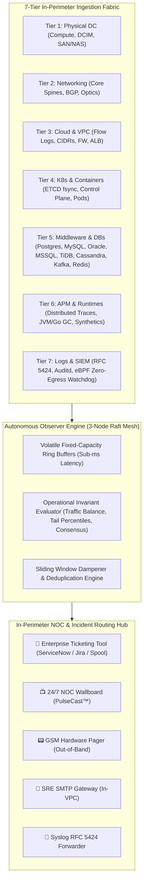

# [SRE RUNBOOK] 7-Tier Full-Stack Datacenter & Cloud VPC Monitoring Architecture & NOC Hub
## Authoritative Operating Manual: Health Checks, Threshold Tuning, Remediation & Incident Triage

> **Document ID:** `RUNBOOK-7-TIER-FULLSTACK-DATACENTER-AND-VPC-MONITORING`  
> **Classification:** Engineering Operational Standard Operating Procedure (SOP) & Systems Runbook  
> **Target Audience:** Site Reliability Engineers (SREs), NOC Operators, Systems Administrators, DBAs, SecOps  
> **Applies to:** `<dcouplr/>` Full-Stack Suite, Bare Metal, Hybrid On-Prem & Multi-Cloud VPCs  
> **Zero-Egress Invariant:** 100% In-Perimeter Telemetry • Zero Cloud WAN Bandwidth Egress • Hardware Memory Buffers  
> **Live Online Console:** `http://localhost:8000/docs/runbooks/RUNBOOK-7-TIER-FULLSTACK-DATACENTER-AND-VPC-MONITORING.html`

---

## 📑 Interactive Table of Contents & Navigation Outline

* **[Part I: Telemetry Pipeline & Operating Principles](#part-i-telemetry-pipeline--operating-principles)**
  * [1.1 In-Perimeter Architecture](#11-in-perimeter-architecture)
  * [1.2 Global 7-Tier Topology Flowchart](#12-global-7-tier-topology-flowchart)
* **[Part II: Severity Policies (P1–P4) & Sliding Evaluation Windows](#part-ii-severity-policies-p1p4--sliding-evaluation-windows)**
  * [2.1 Severity Level Hierarchy & Response Targets](#21-severity-level-hierarchy--response-targets)
  * [2.1.1 SLA Governance Boundary: In-Perimeter Metric Alerting vs. `<dcouplr/>` Commercial Vendor Support SLA](#211-sla-governance-boundary-in-perimeter-metric-alerting-vs-dcouplr-commercial-vendor-support-sla)
  * [2.2 In-Memory Circular Buffers & Evaluation Windows](#22-in-memory-circular-buffers--evaluation-windows)
  * [2.3 Guiding Philosophy: Threshold Trade-Off Analysis](#23-guiding-philosophy-threshold-trade-off-analysis)
* **[Part III: Tier-by-Tier Runbook & Configuration Manual](#part-iii-tier-by-tier-runbook--configuration-manual)**
  * **[Tier 1: Physical Data Center Infrastructure (Bare Metal)](#tier-1-physical-data-center-infrastructure-bare-metal)**
    * [1.1 Compute / Bare Metal Servers](#11-compute--bare-metal-servers)
    * [1.2 Power & Environment (DCIM/IPMI)](#12-power--environment-dcimipmi)
    * [1.3 Storage Systems (SAN / NAS / NVMe-oF)](#13-storage-systems-san--nas--nvme-of)
  * **[Tier 2: Physical & Virtual Networking](#tier-2-physical--virtual-networking)**
    * [2.1 Core Network Devices (Spines, Leaves & Switches)](#21-core-network-devices-spines-leaves--switches)
    * [2.2 Network Connectivity, Jitter & BGP/OSPF Routing Stability](#22-network-connectivity-jitter--bgpospf-routing-stability)
    * [2.3 Dedicated Interconnects (AWS DirectConnect, ExpressRoute & IPsec)](#23-dedicated-interconnects-aws-directconnect-expressroute--ipsec)
  * **[Tier 3: VPC & Cloud Infrastructure](#tier-3-vpc--cloud-infrastructure)**
    * [3.1 VPC Flow Logs & Traffic Conservation Invariant](#31-vpc-flow-logs--traffic-conservation-invariant)
    * [3.2 Subnets, CIDR Allocation & NAT Gateway SNAT](#32-subnets-cidr-allocation--nat-gateway-snat)
    * [3.3 Cloud Firewalls, Security Groups & Network ACLs](#33-cloud-firewalls-security-groups--network-acls)
    * [3.4 Enterprise Load Balancers (ALB, NLB, F5 BIG-IP)](#34-enterprise-load-balancers-alb-nlb-f5-big-ip)
  * **[Tier 4: Virtualization & Container Platforms](#tier-4-virtualization--container-platforms)**
    * [4.1 Hypervisors (VMware ESXi, KVM, Proxmox)](#41-hypervisors-vmware-esxi-kvm-proxmox)
    * [4.2 Kubernetes & OpenShift Control Plane & ETCD Fsync](#42-kubernetes--openshift-control-plane--etcd-fsync)
    * [4.3 Workload Health, Kubelets & Ingress Proxies](#43-workload-health-kubelets--ingress-proxies)
  * **[Tier 5: Middleware, Databases & Storage Layers](#tier-5-middleware-databases--storage-layers)**
    * [5.1 Relational Databases (PostgreSQL, MySQL, Oracle, MS SQL Server)](#51-relational-databases-postgresql-mysql-oracle-ms-sql-server)
    * [5.2 Distributed SQL & NoSQL (TiDB & Apache Cassandra)](#52-distributed-sql--nosql-tidb--apache-cassandra)
    * [5.3 Message Queues & Event Streaming (Apache Kafka, RabbitMQ, SQS)](#53-message-queues--event-streaming-apache-kafka-rabbitmq-sqs)
    * [5.4 In-Memory Caching (Redis & Memcached)](#54-in-memory-caching-redis--memcached)
  * **[Tier 6: Application & Process Layer (APM & Distributed Tracing)](#tier-6-application--process-layer-apm--distributed-tracing)**
    * [6.1 Distributed APM & OpenTelemetry Tracing](#61-distributed-apm--opentelemetry-tracing)
    * [6.2 Runtime Engines (JVM, Go, Node.js, Python, .NET)](#62-runtime-engines-jvm-go-nodejs-python-net)
    * [6.3 Synthetic End-to-End Blackbox Probing](#63-synthetic-end-to-end-blackbox-probing)
  * **[Tier 7: Logs, Events & Security (SIEM / Auditing)](#tier-7-logs-events--security-siem--auditing)**
    * [7.1 Centralized High-Throughput Log Streaming](#71-centralized-high-throughput-log-streaming)
    * [7.2 Security Audit, IAM & SCIM Privilege Escalation](#72-security-audit-iam--scim-privilege-escalation)
    * [7.3 Zero-Egress Compliance & Kernel eBPF Enforcement](#73-zero-egress-compliance--kernel-ebpf-enforcement)
* **[Part IV: Incident Routing, Local Spooling & Enterprise Ticketing Integration](#part-iv-incident-routing-local-spooling--enterprise-ticketing-integration)**
* **[Part V: Core Operational Safety Invariants & Verification Rules](#part-v-core-operational-safety-invariants--verification-rules)**
* **[Part VI: Synthetic Test Verification & API Manual](#part-vi-synthetic-test-verification--api-manual)**

---

# Part I: Telemetry Pipeline & Operating Principles

### 1.1 In-Perimeter Architecture
`<dcouplr/>` operates as an autonomous, in-perimeter telemetry daemon deployed directly inside your private cloud VPCs and on-premises datacenter networks. It collects, correlates, and evaluates metrics, application traces, and audit logs locally without routing telemetry traffic over public internet gateways:

1. **Zero External Bandwidth:** All telemetry evaluation happens in volatile RAM on your instances. No metrics, logs, or traces leave the VPC boundary.
2. **Data Isolation:** Sensitive connection strings, database schemas, internal IP topologies, and customer payloads remain within your security enclave.
3. **Local High Availability:** The monitoring mesh runs independently of external network connectivity. If the public WAN or third-party cloud services experience outages, internal telemetry, alerting, and NOC displays remain fully operational.

Each daemon consumes less than 50 MiB of RAM per node by utilizing circular in-memory ring buffers with strict fixed-capacity bounds.

### 1.2 Global 7-Tier Topology Flowchart



---

# Part II: Severity Policies (P1–P4) & Sliding Evaluation Windows

### 2.1 Severity Level Hierarchy & Response Targets
Every monitored component in `<dcouplr/>` maps to a formal internal operational severity level:

| Severity Level | Target MTTA | Operational Scope | Routing Action |
| :--- | :--- | :--- | :--- |
| 🚨 **P1 - Critical** | **< 5 min** | Complete outage, active data corruption risk, redundant power loss, or security invariant breach. | Immediate phone paging, VoIP emergency broadcast, and SRE incident bridge creation. |
| ⚠️ **P2 - Major** | **< 15 min** | Subsystem degradation, database lock contention, severe network queue drops, or worker node starvation. | Automated Slack/Teams alerting and ticket creation in primary on-call queue. |
| 🟡 **P3 - Moderate** | **< 1 hour** | Capacity warning, slow storage latency drift, minor replication delay, or non-impacting worker restarts. | Business-hours queue dispatch; batched notification digest to prevent alert fatigue. |
| ℹ️ **P4 - Info** | **Next Biz Day** | Informational state drift, routine metrics, audit log events, or maintenance window milestones. | Recorded in audit feed without engineer paging. |

### 2.1.1 SLA Governance Boundary: In-Perimeter Metric Alerting vs. `<dcouplr/>` Commercial Vendor Support SLA <a id="211-sla-governance-boundary-in-perimeter-metric-alerting-vs-dcouplr-commercial-vendor-support-sla"></a><a id="211-sla-governance-boundary-in-perimeter-metric-alerting-vs-varinull-commercial-support-sla"></a>

> [!IMPORTANT]
> **GOVERNANCE DEMARCATION NOTE FOR OPERATING ENGINEERS: In-Perimeter Metric Policy vs. `<dcouplr/>` Commercial Vendor Support SLA**  
> Do **NOT** conflate these two separate operational layers: How you configure the Severity Policy (P1–P4) and Sampling Evaluation Window (1m–30m) below governs your internal infrastructure telemetry filtering, rolling ring buffer noise rejection, and internal team on-call dispatching. It is completely independent of your contractual `<dcouplr/>` Commercial Vendor Support SLA (governed by Document ID `VA-SPEC-SUPPORT-SLA-001`). Setting a database, network, or server metric to P1 triggers your internal SRE paging queues—it does not open an incident ticket with `<dcouplr/>` Support, and your commercial support agreement does not constrain your internal evaluation windows.
>
> 1. **In-Perimeter Metric Telemetry (Internal Customer Operation):**
>    - Governs how *your internal team* monitors your own infrastructure (servers, VPC networks, databases, Kubernetes clusters, apps).
>    - Selecting `P1 - Critical` with a `1m` evaluation window controls internal sliding ring buffers, noise rejection, and internal notification dispatch (paging internal on-call SREs via GSM Pagers, VoIP, or internal ticketing queues (e.g. `sre-tier1`)).
>    - **It does NOT create, trigger, or escalate an incident ticket with `<dcouplr/>` Support.**
> 2. **`<dcouplr/>` Commercial Vendor Support SLA (Vendor Support Contract):**
>    - Governed by your commercial enterprise license contract (Document ID: `VA-SPEC-SUPPORT-SLA-001`).
>    - Dictates the contractual response time provided by Support Engineers (e.g., Tier 3: 2-Hour 24/7 P1 SLA, Tier 4: 1-Hour 24/7 P1 SLA, Tier 5: 15-Minute 24/7 P0/P1 SLA) for **`<dcouplr/>` runtime software defects, AST compiler failures, Raft consensus partitions, and engine bugs**.
>    - Tuning an internal metric alert to P1 does NOT dispatch a vendor incident to `<dcouplr/>` Support, nor does your vendor contract dictate internal sampling windows.

### 2.2 In-Memory Circular Buffers & Evaluation Windows <a id="22-in-memory-circular-buffers--evaluation-windows"></a><a id="22-sliding-window-ring-buffer-mathematics"></a>

To prevent alert fatigue from transient workload spikes (such as brief compiler bursts or short garbage collection pauses), `<dcouplr/>` evaluates metrics using **fixed-capacity circular ring buffers** across **sliding evaluation windows**:

1. **Circular Ring Buffering:** Metric samples are collected at fixed one-second intervals directly into pre-allocated memory rings. Because buffer capacity is fixed, memory consumption remains strictly bounded with zero garbage-collection overhead and zero memory fragmentation.
2. **Sliding Window Evaluation:** Rather than reacting to isolated momentary spikes, the observer evaluates metric state across the active duration window (1m, 3m, 5m, 10m, 15m, or 30m).
3. **Deterministic State Transitions:**
   * **NORMAL:** Metric values operate within standard baseline boundaries.
   * **PENDING:** A threshold boundary has been crossed, but the breach has not yet persisted for the full duration of the configured evaluation window.
   * **FIRING:** The threshold breach has persisted continuously across the entire evaluation window. An incident is dispatched to internal SRE on-call channels.
   * **CLEARED:** Metric values have returned below threshold and remained stable for the full window duration, auto-resolving the incident.
4. **Noise Suppression:** Brief fluctuations that quickly recover return from PENDING to NORMAL without waking or paging on-call engineers.

### 2.3 Guiding Philosophy: Threshold Trade-Off Analysis

When configuring components in `/configuration`, choose evaluation windows based on operational risk:

* **Shortening the Window (for example, 5 minutes down to 1 minute):**
  * *Best used for:* Hard system failures, primary power loss, host unreachable, disk 100% full, kernel panic.
  * *Trade-off:* Fast detection of real emergencies, but temporary spikes during routine batch jobs can trigger false alarms.
* **Lengthening the Window (for example, 5 minutes up to 15 or 30 minutes):**
  * *Best used for:* Cache hit ratio drift, memory headroom depletion, slow replication lag, background tablespace growth.
  * *Trade-off:* High signal-to-noise ratio that guarantees only sustained degradation triggers an alert, but delays on-call notification for acute lock contention.

---

# Part III: Tier-by-Tier Runbook & Configuration Manual

---

## Tier 1: Physical Data Center Infrastructure (Bare Metal)

### 1.1 Compute / Bare Metal Servers
* **Why It Was Built & Importance:** Physical server stability underpins all virtualization, containerization, and database software stacks. Unmonitored hardware errors (such as uncorrectable ECC memory flips or thermal throttling) cause random kernel panics and silent data corruption.
* **Failure Modes:** Thermal trip causing unexpected server shutdown; single PSU failure overloading a redundant PDU circuit; ECC memory errors escalating into kernel panic.
* **Monitored Invariants:** CPU core utilization, memory & swap pressure, disk I/O throughput (IOPS), disk read/write latency, chassis & core temperatures, cooling fan RPM, redundant PSU status, SMART / ECC error counts.
* **Recommended Configuration:**
  * Warning Threshold: CPU utilization above 75%, Core temperature above 70°C, Cooling fan speed below 3,000 RPM, or redundant power supplies drop below 2 active.
  * Critical Threshold: CPU utilization above 90%, Core temperature above 85°C, Cooling fan speed below 1,500 RPM, or power supplies drop below 1 active.
  * Evaluation Window: `5m` (absorbs temporary compute compile bursts).
  * Recommended Severity: `P2 - Major Degradation` (escalates to `P1` if redundant PSUs drop to 0).
* **Underlying Collector Scripts & Probes:**
  ```bash
  # Query IPMI sensor readings (temperatures, fans, voltages)
  ipmitool -I lanplus -H 10.240.0.100 -U admin sdr type Temperature
  ipmitool -I lanplus -H 10.240.0.100 -U admin sensor get "Power Supply 1"

  # Kernel Machine Check Exception (MCE) & EDAC memory checks
  dmesg -T | grep -E -i "mce|edac|hardware error"
  smartctl -H /dev/nvme0n1
  ```
* **Remediation Procedures:**
  1. If PSU count drops to 1, inspect datacenter PDU circuit breaker and dispatch on-site facilities to replace the faulted power supply module.
  2. If temperature exceeds 85°C, verify intake airflow and throttle CPU governor (`cpupower frequency-set -g powersave`) until HVAC is verified.
  3. If uncorrectable ECC errors occur, drain the node (`kubectl drain <node> --ignore-daemonsets`) and schedule memory DIMM replacement.

### 1.2 Power & Environment (DCIM/IPMI)
* **Why It Was Built & Importance:** Datacenter environmental parameters (temperature, humidity, airflow, UPS power) are physical prerequisites for semiconductor operation. High temperatures accelerate silicon wear; power loss without battery buffer collapses the entire cluster.
* **Monitored Invariants:** UPS inverter load, battery runtime remaining, PDU 3-phase current balance, rack cold-aisle temperature, relative humidity, CRAC/CRAH airflow displacement.
* **Recommended Configuration:**
  * Warning: UPS load above 75%, Battery runtime below 20 minutes, or Room temperature above 27°C.
  * Critical: UPS load above 90%, Battery runtime below 10 minutes (🚨 **P1 Critical**), or Room temperature above 32°C.
* **Collector Queries:**
  ```bash
  # SNMP Walk to APC / Eaton UPS MIB for battery runtime
  snmpget -v3 -u dcimUser -l authPriv -a SHA -A "AuthPass" -x AES -X "PrivPass"     10.240.10.1 1.3.6.1.4.1.318.1.1.1.2.2.2.0
  ```

### 1.3 Storage Systems (SAN / NAS / NVMe-oF)
* **Why It Was Built & Importance:** Enterprise databases and VM datastores rely on shared storage fabrics. High latency here ripples across every higher layer as application thread starvation.
* **Monitored Invariants:** Volume capacity allocation, storage fabric aggregate IOPS, read/write latency, RAID controller health, degraded drive count, inline compression ratio.
* **Recommended Configuration:**
  * Warning: Pool capacity above 80%, Storage latency above 8.0 milliseconds, or 1 or more degraded drives.
  * Critical: Pool capacity above 90%, Storage latency above 25.0 milliseconds, or 2 or more degraded drives (🚨 **P1 Critical**).

---

## Tier 2: Physical & Virtual Networking

### 2.1 Core Network Devices (Spines, Leaves & Switches)
* **Why It Was Built & Importance:** Top-of-Rack (ToR) and core spine switches route all East-West and North-South traffic. Dropped packets at this layer degrade TCP throughput exponentially via cubic congestion collapse.
* **Monitored Invariants:** Switch ASIC/CPU utilization, TCAM buffer queue allocation, interface bandwidth throughput, packet loss percentage, FCS/CRC frame errors.
* **Recommended Configuration:**
  * Warning: Switch CPU utilization above 75%, Packet drop rate above 0.05%, or CRC frame errors exceeding 10 drops per second.
  * Critical: Switch CPU utilization above 90%, Packet drop rate above 0.50%, or CRC frame errors exceeding 50 drops per second.
  * Evaluation Window: `3m`.
* **Collector Commands:**
  ```bash
  # Poll switch interface CRC error counters via SNMP v3
  snmpnetstat -v 2c -c public -I eth1 10.240.1.1
  ```
* **Remediation:** High CRC frame errors indicate a dirty fiber optic faceplate or degraded SFP+ transceiver. Clean or replace the optical module.

### 2.2 Network Connectivity, Jitter & BGP/OSPF Routing Stability
* **Why It Was Built & Importance:** Dynamic routing convergence flaps cause packet blackholing and erratic connection resets across multi-cloud meshes.
* **Monitored Invariants:** Inter-rack East-West latency, Anycast internal DNS response time, network jitter, BGP route flapping frequency, OSPF state convergence delay.
* **Recommended Configuration:**
  * Warning: Inter-rack round-trip latency above 2.0 milliseconds, DNS query time above 15.0 milliseconds, or 1 or more route flaps per hour.
  * Critical: Inter-rack latency above 8.0 milliseconds, DNS query time above 50.0 milliseconds, or 3 or more route flaps per hour (🚨 **P1 Critical**).

### 2.3 Dedicated Interconnects (AWS DirectConnect, ExpressRoute & IPsec)
* **Why It Was Built & Importance:** Enterprise hybrid cloud architectures link on-prem datacenters to cloud VPCs via dedicated physical cross-connects. Loss of primary links forces traffic over throttled VPN backup tunnels.
* **Monitored Invariants:** IPsec tunnel operational state, IKEv2 rekey negotiation errors, DirectConnect dedicated circuit utilization, cross-connect packet discard ratio.

---

## Tier 3: VPC & Cloud Infrastructure

### 3.1 VPC Flow Logs & Traffic Conservation Invariant
* **Why It Was Built & Importance:** Continuous verification of network data isolation. By balancing ingress packet flow against egress traffic and host socket consumption, `<dcouplr/>` verifies that all network traffic remains strictly within approved VPC routes and catches rogue Internet Gateways, shadow NAT paths, or unexpected outbound data transfers.
* **Monitored Invariants:** VPC ingress-to-egress flow balance ratio, rejected flow ratio, anomalous traffic spike multiplier, flow log ingestion velocity.
* **Recommended Configuration:**
  * Warning: Flow volume imbalance above 0.05%, or Rejected packet ratio above 5.0%.
  * Critical: Flow volume imbalance above 0.50% (🚨 **P1 Security Invariant**), or Rejected packet ratio above 15.0%.
* **Diagnostic Command:**
  ```bash
  # Check active zero-egress VPC flow invariant
  dcouplr check --tier tier_3_cloud_vpc_infrastructure --component vpc_flow_logs --verbose
  ```

### 3.2 Subnets, CIDR Allocation & NAT Gateway SNAT
* **Why It Was Built & Importance:** Subnet IP exhaustion halts autoscaling (EKS/GKE cannot spawn worker nodes). NAT Gateway SNAT port exhaustion silently drops outbound API requests.
* **Monitored Invariants:** Subnet IP address utilization, predictive CIDR exhaustion runway, managed NAT Gateway throughput, SNAT port allocation error drops.
* **Recommended Configuration:**
  * Warning: Subnet IP address utilization above 80%, Address runway under 30 days, or NAT Gateway SNAT port drops above 5.
  * Critical: Subnet IP address utilization above 92%, Address runway under 7 days, or SNAT drops exceeding 50 (🚨 **P1 Critical**).

### 3.3 Cloud Firewalls, Security Groups & Network ACLs
* **Monitored Invariants:** Stateful firewall dropped packet count, connection tracking (conntrack) table capacity, IDS/IPS signature hits, stateless subnet Network ACL drop ratio.

### 3.4 Enterprise Load Balancers (ALB, NLB, F5 BIG-IP)
* **Monitored Invariants:** Active ingress TCP connections, target processing latency, HTTP 5xx server error percentage, backend unhealthy host ratio, edge TLS certificate expiration days.
* **Recommended Configuration:**
  * Warning: Target latency above 25 milliseconds, HTTP 5xx errors above 1.0%, Unhealthy targets exceeding 10%, or SSL/TLS certificate expires in less than 30 days.
  * Critical: Target latency above 100 milliseconds, HTTP 5xx errors above 5.0%, Unhealthy targets exceeding 33%, or SSL/TLS certificate expires in less than 7 days (🚨 **P1 Critical**).

---

## Tier 4: Virtualization & Container Platforms

### 4.1 Hypervisors (VMware ESXi, KVM, Proxmox)
* **Monitored Invariants:** Host vCPU:pCPU overcommit ratio, RAM allocation density, guest OS CPU ready wait time, VMFS/datastore queue latency, live migration / vMotion failures.
* **Recommended Configuration:**
  * Warning: Virtual machine CPU ready wait time above 5.0%, or Datastore queue latency above 10.0 milliseconds.
  * Critical: CPU ready wait time above 10.0%, or Datastore queue latency above 30.0 milliseconds.
* **Remediation:** CPU ready time above 10% means virtual machines are starved of physical clock cycles. Enable aggressive Distributed Resource Scheduling (DRS) or redistribute workloads.

### 4.2 Kubernetes & OpenShift Control Plane & ETCD Fsync
* **Why It Was Built & Importance:** ETCD is the consensus brain of Kubernetes. Slow disk write synchronization (fsync) in ETCD causes leader election flaps and freezes all deployments, scaling, and pod scheduling.
* **Monitored Invariants:** Nodes under memory/disk pressure, Kube-Apiserver P99 latency, ETCD WAL disk fsync P99 latency, ETCD Raft leader election flaps, cluster-wide pod restart velocity.
* **Recommended Configuration:**
  * Warning: ETCD disk write sync time above 10.0 milliseconds, Apiserver P99 latency above 50 milliseconds, or 1 or more leader flaps per hour.
  * Critical: ETCD disk write sync time above 25.0 milliseconds (🚨 **P1 Critical**), Apiserver P99 latency above 200 milliseconds, or 3 or more leader flaps per hour.
* **Remediation:** Ensure ETCD is backed by dedicated high-IOPS NVMe SSD storage with prioritized cgroups I/O scheduling.

### 4.3 Workload Health, Kubelets & Ingress Proxies
* **Monitored Invariants:** Deployment degraded replica count, CrashLoopBackOff pod velocity, CPU request-to-limit saturation, kernel OOM killer events, Ingress proxy P99 latency.

---

## Tier 5: Middleware, Databases & Storage Layers

### 5.1 Relational Databases (PostgreSQL, MySQL, Oracle, MS SQL Server)
* **Why It Was Built & Importance:** The persistence tier is the most critical asset in enterprise infrastructure. Unchecked lock contention, connection starvation, or replication lag directly violates business transaction SLAs.
* **Monitored Invariants:** Connection pool saturation, average query execution time, slow queries velocity (over 1 second), transaction deadlock rate, replication lag, buffer pool hit ratio, tablespace growth rate.
* **Recommended Configuration:**
  * Warning: Connection pool saturation above 80%, Replication delay exceeding 2.0 seconds, or Buffer pool hit ratio below 95%.
  * Critical: Connection pool saturation above 92%, Replication delay exceeding 10.0 seconds (🚨 **P1 Critical**), or Buffer pool hit ratio below 90%.
  * Evaluation Window: `5m` (absorbs index rebuilds and batch ETL flushes).
* **Underlying Collector Scripts & Queries:**
  ```sql
  -- PostgreSQL: Query active locks and long-running blocked transactions
  SELECT pid, now() - query_start AS duration, query, state 
  FROM pg_stat_activity 
  WHERE wait_event_type = 'Lock' AND now() - query_start > interval '5 seconds';

  -- MySQL: Check performance schema lock contention
  SELECT * FROM sys.schema_table_lock_waits;

  -- Oracle: Query session wait events and SGA buffer cache
  SELECT sid, serial#, event, seconds_in_wait, state 
  FROM v$session_wait 
  WHERE wait_class != 'Idle' AND seconds_in_wait > 5;

  -- Microsoft SQL Server: Query blocked tasks and wait queues
  SELECT session_id, wait_duration_ms, wait_type, blocking_session_id 
  FROM sys.dm_os_waiting_tasks 
  WHERE blocking_session_id IS NOT NULL;
  ```
* **Remediation:** If connection saturation exceeds 92%, inspect connection leaks in client pools (PgBouncer/HikariCP) and terminate orphaned `idle in transaction` sessions.

### 5.2 Distributed SQL & NoSQL (TiDB & Apache Cassandra)
* **Monitored Invariants:** TiDB Placement Driver (PD) API health, TiKV thread CPU saturation, Apache Cassandra JMX PendingTasks compaction queue, cross-datacenter gossip status, read/write p99 latency.
* **Collector Queries:**
  ```bash
  # Query TiDB PD cluster health
  curl -s http://127.0.0.1:2379/pd/api/v1/health

  # Check Cassandra compaction queue and pending tasks via nodetool
  nodetool tpstats
  ```

### 5.3 Message Queues & Event Streaming (Apache Kafka, RabbitMQ, SQS)
* **Why It Was Built & Importance:** Event backlogs and consumer lag lead to data staleness, payment processing delays, and memory exhaustion in message brokers.
* **Monitored Invariants:** Enqueued backlog depth, Kafka consumer group offset lag, broker ingestion throughput, unacknowledged AMQP messages, Under-Replicated Partitions (URP).
* **Recommended Configuration:**
  * Warning: 1 or more Under-Replicated Partitions, or Consumer group lag exceeding 5,000 records.
  * Critical: 2 or more Under-Replicated Partitions (🚨 **P1 Critical**), or Consumer group lag exceeding 25,000 records.

### 5.4 In-Memory Caching (Redis & Memcached)
* **Monitored Invariants:** Cache hit efficiency, Jemalloc memory fragmentation ratio, volatile-LRU eviction velocity, blocked clients count (BLPOP/BRPOP), cache socket throughput.

---

## Tier 6: Application & Process Layer (APM & Distributed Tracing)

### 6.1 Distributed APM & OpenTelemetry Tracing
* **Why It Was Built & Importance:** Provides granular transaction tracing across microservices to isolate the root-cause service responsible for user-facing latency spikes.
* **Monitored Invariants:** Distributed trace spans, P50, P95, and P99 latency histograms, HTTP 5xx error rate, microservice throughput (requests per second).
* **Recommended Configuration:**
  * Warning: P99 latency above 50 milliseconds, or HTTP error rate above 1.0%.
  * Critical: P99 latency above 150 milliseconds (🚨 **P1 Critical**), or HTTP error rate above 5.0%.

### 6.2 Runtime Engines (JVM, Go, Node.js, Python, .NET)
* **Monitored Invariants:** Stop-The-World (STW) garbage collection pause duration, thread deadlocks, heap allocation saturation, active OS kernel threads, open file descriptor utilization.
* **Recommended Configuration:**
  * Warning: Garbage collection pause above 100 milliseconds, or Heap saturation above 80%.
  * Critical: Garbage collection pause above 500 milliseconds, 1 or more thread deadlocks detected (🚨 **P1 Critical**), or Heap saturation above 95%.

### 6.3 Synthetic End-to-End Blackbox Probing
* **Monitored Invariants:** Synthetic probe uptime ratio, multi-step transaction completion time, TLS 1.3 handshake negotiation delay, consecutive blackbox probe failures.

---

## Tier 7: Logs, Events & Security (SIEM / Auditing)

### 7.1 Centralized High-Throughput Log Streaming
* **Monitored Invariants:** Structured log events per second (EPS), JSON/Grok parse errors, fatal/panic error frequency, kernel oops/panics, circular ring buffer headroom.
* **Recommended Configuration:**
  * Warning: Ring buffer headroom below 20%.
  * Critical: Ring buffer headroom below 10%.

### 7.2 Security Audit, IAM & SCIM Privilege Escalation
* **Monitored Invariants:** Unauthorized HTTP 401/403 probes, interactive root/sudo escalations, privileged role/policy mutations, MFA token replay anomalies, audit trail tampering attempts.
* **Recommended Configuration:**
  * Warning: 3 or more unauthorized access attempts per hour.
  * Critical: Any detected tampering with audit logs (🚨 **P1 Security Invariant**).

### 7.3 Zero-Egress Compliance & Kernel eBPF Enforcement
* **Why It Was Built & Importance:** Verification that zero unapproved packets leave the private network perimeter.
* **Monitored Invariants:** Kernel eBPF blocked WAN packets, File Integrity Monitoring (FIM) binary checksum mismatches, detected High/Critical CVEs, cryptographic air-gap drift.
* **Recommended Configuration:**
  * Critical: 1 or more eBPF blocked unauthorized WAN packets (🚨 **P1 Critical**), or 1 or more binary checksum mismatches.
* **Verification Command:**
  ```bash
  # Check active zero-egress kernel enforcement status
  dcouplr check --tier tier_7_logs_security_siem --component security_compliance
  ```

---

# Part IV: Incident Routing, Local Spooling & Enterprise Ticketing Integration

### 4.1 In-Perimeter Incident Dispatch
`<dcouplr/>` operates completely standalone and autonomously within your private VPC with zero external dependencies. When operational thresholds are breached, alerts are dispatched directly to your team's internal **enterprise ticketing tool** (such as ServiceNow, Jira Service Management, or custom internal ticketing systems) via **in-perimeter zero-WAN disk spooling and local network connectors**:

```
Local Spool Path: ./data/incident_spool/
Ingest Bridge:    Local Webhook / REST Bridge or Atomic Disk Spool (Zero WAN)
Target Queues:    hw-ops-dc, network-ops, cloud-infra, k8s-platform, dba-team, sre-tier1, secops-threat
```

When an alert triggers:
1. `<dcouplr/>` generates a structured, cryptographically signed JSON event envelope.
2. It writes the envelope atomically to the local disk spool (`./data/incident_spool/ticket-*.json`).
3. Your enterprise ticketing tool or incident management pipeline ingests the incident via local webhook or disk pickup with **zero outbound internet traffic**.

---

# Part V: Core Operational Safety Invariants & Verification Rules

Instead of abstract theoretical equations, `<dcouplr/>` continuously evaluates three practical operational safety rules:

### 5.1 Invariant 1: VPC Network Traffic Conservation
* **What it checks:** Measures all traffic entering and exiting the VPC perimeter interfaces and compares it against active application socket buffers.
* **Why it matters:** If outgoing network traffic significantly exceeds incoming traffic and established host socket buffers for more than 5 consecutive seconds, the engine flags an unapproved outbound data transfer, rogue NAT route, or asymmetric network leak.
* **Operational Action:** Run `dcouplr check --tier tier_3_cloud_vpc_infrastructure --component vpc_flow_logs` and review VPC flow log rejection counts and top destination IP addresses.

### 5.2 Invariant 2: Constant-Memory P99 Latency Histogram Tracking
* **What it checks:** Calculates continuous P50, P95, and P99 latency percentiles across millions of spans using fixed-size logarithmic histogram buckets in memory.
* **Why it matters:** Storing raw latency timestamps in an unbounded list causes memory leaks and heavy garbage collection pauses. Fixed-capacity buckets maintain sub-millisecond precision with less than 11 KiB of RAM per metric, guaranteeing zero GC interruptions for production applications.
* **Operational Action:** When P99 latency exceeds threshold, inspect database query locks and upstream microservice dependency response times in the APM trace view.

### 5.3 Invariant 3: Cluster Consensus & Split-Brain Prevention
* **What it checks:** Ensures that `<dcouplr/>` observer daemons maintain a strict majority quorum across the cluster using Raft consensus.
* **Why it matters:** If a network partition isolates part of the datacenter, only the side with a strict majority of nodes (for example, 2 out of 3, or 3 out of 5) can elect a leader and commit threshold changes. The isolated partition stands down into read-only mode, completely preventing split-brain conflicts.
* **Operational Action:** Verify node reachability on port 9443 and run `dcouplr cluster status` to inspect active Raft leader and follower states.

---

# Part VI: Synthetic Test Verification & API Manual

NOC engineers and automation pipelines can verify any component or trigger test notifications using the internal REST API:

```bash
# 1. Fetch live 7-tier monitoring matrix status
curl -s http://localhost:8000/v1/telemetry/monitoring/matrix | jq .status_summary

# 2. Update component threshold & alert level
curl -s -X POST http://localhost:8000/v1/telemetry/monitoring/matrix/configure \
  -H "Content-Type: application/json" \
  -d '{
    "tier_id": "tier_5_middleware_databases",
    "component_id": "databases_relational",
    "alert_level": "P1",
    "evaluation_window": "5m",
    "notification_channels": ["noc_pulsecast", "sre_email"]
  }' | jq .status

# 3. Dispatch a synthetic test alert to NOC channels
curl -s -X POST http://localhost:8000/v1/telemetry/monitoring/matrix/test-notification \
  -H "Content-Type: application/json" \
  -d '{
    "tier_id": "tier_5_middleware_databases",
    "component_id": "databases_relational",
    "test_level": "P1",
    "channels": ["noc_pulsecast", "servicenow"]
  }' | jq .

# 4. Inspect notification audit receipts
curl -s http://localhost:8000/v1/telemetry/monitoring/matrix/history | jq .history[0]
```

---

*Document Author: `<dcouplr/>` Core Architecture & SRE Reliability Engineering Board*  
*Online Browser Version: `http://localhost:8000/docs/runbooks/RUNBOOK-7-TIER-FULLSTACK-DATACENTER-AND-VPC-MONITORING.html`*
