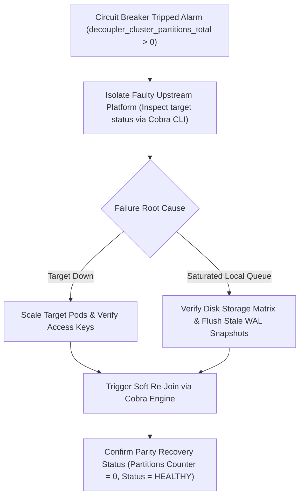

# Incident Response Runbook: Circuit Breaker Recovery

**Runbook Reference:** `RUNBOOK-DECOUPLER-004`  
**Target Alert Condition:** `decoupler_cluster_partitions_total > 0` (Circuit Breaker Tripped)  
**Severity:** Critical (P1)  
**Applicability:** Production In-VPC Cluster Nodes, Sync Agents, and Consensus Mesh  

---

## 1. Executive Overview

When a downstream target stack experiences performance degradation, high network latency (> 20ms), or total connection drops, the local <dcouplr/> synchronization agent immediately trips its 20ms asymmetric circuit breaker. This decouples the pipelines, preventing thread pools and buffer channels from starving while keeping the healthy stack functional.



```text
    [ Circuit Breaker Tripped Alarm ]
                   |
                   v
    Isolate Faulty Upstream Platform  (Inspect target status via Cobra CLI)
                   |
        +----------+----------+
        |                     |
        v (Target Down)       v (Saturated Local Queue)
  Scale Target Pods     Verify Disk Storage Matrix
  Verify Access Keys     Flush Stale WAL Snapshots
        |                     |
        +----------+----------+
                   |
                   v
  Trigger Soft Re-Join via Cobra Engine
```

---

## 2. Step-by-Step Incident Response & Remediation

### Step 1: Identify the Broken Target Interface
Execute the Cobra monitoring tools locally within the degraded namespace to identify which connection layer broke:

```bash
dcouplr status
# Legacy alias: decoupler status
```

Review the terminal telemetry output and tabular status matrix to pinpoint the failing target connection hash, active voters, and uncommitted log deltas.

### Step 2: Remediate Target Network Latency
* **If the Target Stack is Down:**
  1. Inspect the downstream cluster services (e.g. Grafana endpoint, Prometheus scraper, or OpenTofu controller).
  2. Check for bad API tokens, outdated mutual TLS certificates, expired SPIFFE SVIDs, or service outages on the destination platform.
  3. Validate upstream pod health via `kubectl get pods -n kube-system -l app.kubernetes.io/name=dcouplr-agent`.
* **If the Local Channel is Saturated:**
  1. Check disk performance and I/O metrics on the local storage partition handler.
  2. Ensure that log compaction BoltDB layers are truncating properly (`trailing_logs: 5000`, `snapshot_threshold: 10000`).
  3. Trigger an on-demand compaction if uncompacted log delta $\Delta I \ge T_{\text{compact}}$.

### Step 3: Reset and Re-Join the Synchronization Topology
Once network connectivity and downstream responsiveness are restored, trigger a cluster reset to clear the circuit breaker and re-establish quorum:

```bash
dcouplr join --peer=10.192.42.11:8300 --node-id=agent-node-01
# Legacy alias: decoupler join --peer=10.192.42.11:8300 --node-id=agent-node-01
```

### Step 4: Confirm Parity Recovery Status
1. Verify that the `decoupler_cluster_partitions_total` counter stops incrementing.
2. Confirm the Grafana Health Dashboard panel **Circuit Breaker Status** transitions back to `HEALTHY (0 Partitions)`.
3. Check that the Prometheus gauge `decoupler_cluster_active_nodes` equals the expected voter count ($N \ge 3$).

---

## 3. Escalation & Verification Protocol

| Checkpoint | Expected Normal State | Escalation Threshold |
| :--- | :--- | :--- |
| **Partition Counter** | 0 events/min | Incrementing for > 3 consecutive evaluation cycles |
| **Raft Quorum** | $\ge 2$ out of 3 voters | Loss of quorum ($\le 1$ voter active) |
| **RPC Roundtrip** | $< 5\text{ ms}$ LAN latency | $> 20\text{ ms}$ sustained timeout |
