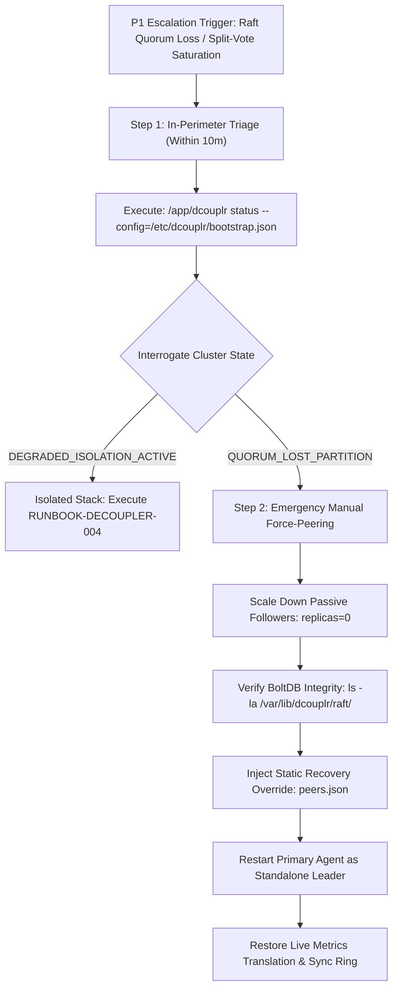

# Tier-3 Platform Engineering Escalation Runbook: Distributed Raft Quorum Failure Mitigation

**Runbook Identifier:** `RUNBOOK-DECOUPLER-P1-009`  
**Escalation Trigger:** Complete Cluster Quorum Loss / Raft Split-Vote State Saturation  
**Target Group:** Tier-3 Core Infrastructure Platform Engineers  
**Target SLA Bound:** Strict 2-hour initial enterprise service mitigation SLA  
**Applicability:** Production Multi-Zone Node Meshes, Raft Consensus Rings, and Localized Storage Engines  

---

## 1. Executive Summary & Triage Overview

When multi-agent nodes experience extreme packet drops, cross-availability-zone partitions, or cascading node terminations, the embedded HashiCorp Raft consensus ring can drop below quorum limits ($N/2 + 1$), causing live transactions, state mirroring, and configuration synchronizations to stall.



---

## 2. Phase 1: Initial Triage & State Discovery (Within 10 Minutes of Escalation)

When multi-agent nodes experience extreme network degradation across availability zones, the cluster may drop below quorum limits, causing operations to halt.

1. **Access In-Perimeter Boundary:**
   Log directly into a secure shell environment inside the affected customer perimeter or bastion host.

2. **Interrogate Active Agent Runtime:**
   Execute low-level diagnostics using the local binary:
   ```bash
   /app/dcouplr status --config=/etc/dcouplr/bootstrap.json
   ```

3. **Evaluate Output Values:**
   * **If Cluster Member Status reads `QUORUM_LOST_PARTITION`:**  
     Proceed immediately to **Phase 2 (Manual Quorum Recovery & Force-Peering)**.
   * **If Circuit Breaker Status reads `DEGRADED_ISOLATION_ACTIVE`:**  
     The system has successfully isolated a failing downstream stack. Pivot to standard downstream remediation protocols ([RUNBOOK-DECOUPLER-004](file:///c:/Users/JenniferCletaLee/.gemini/antigravity-ide/MigrationToolsAPI/docs/runbooks/RUNBOOK-DECOUPLER-004.md)).

---

## 3. Phase 2: Manual Quorum Recovery & Force-Peering (Emergency Actions)

If nodes become permanently separated and split-vote loops prevent a clear Leader election, engineers must manually force a cluster configuration change to restore quorum.

### Step 1: Drain and Halt Passive Follower Instances
Safely take down the passive follower instances across affected nodes to stop corrupted or stale state logs from replicating:

```bash
kubectl scale daemonset dcouplr-sync-agent -n kube-system --replicas=0
```

### Step 2: Inspect Persistent BoltDB Storage Integrity
Inspect the persistent on-premises storage directories to confirm that local state files are free from filesystem corruption:

```bash
# Confirm that the local state files are free from filesystem corruption issues
ls -la /var/lib/dcouplr/raft/
```

Verify that `raft.db` and the latest snapshot folder `snapshots/` are non-zero in size and have valid write permissions.

### Step 3: Inject Emergency Static Recovery Configuration (`peers.json`)
Inject an emergency static recovery configuration (`peers.json`) into the remaining primary node's storage layer. This manually overrides the cluster configuration metadata, forcing the node to act as a standalone single-node leader:

```json
[
  {
    "id": "agent-node-01",
    "address": "127.0.0.1:8300",
    "non_voter": false
  }
]
```

To write this file directly inside the container or persistent volume mount:
```bash
cat << 'EOF' > /var/lib/dcouplr/raft/peers.json
[
  {
    "id": "agent-node-01",
    "address": "127.0.0.1:8300",
    "non_voter": false
  }
]
EOF
```

### Step 4: Restart the Primary Agent Container
Restart the primary agent container. The node reads the tracking override file, clears old voting indexes, declares itself the cluster leader, and immediately recovers your live metrics translation and synchronization pipelines:

```bash
# Verify leader status has recovered
/app/dcouplr status --config=/etc/dcouplr/bootstrap.json
```

Confirm that:
- `Leader`: `agent-node-01`
- `Raft State`: `LEADER`
- `Voters Total`: `1`
- `Uncommitted Entries`: `0`

Once leader state is restored and pipeline latencies settle under 20ms, gradually rejoin follower nodes using the gRPC join flow:
```bash
/app/dcouplr cluster join --peer-addr=10.244.1.15:8301 --voter=true
```

---

## 4. Operational Mitigation Matrix

| Step | Operation | Execution Command | Target Verification State |
| :--- | :--- | :--- | :--- |
| **Triage** | Inspect runtime state | `/app/dcouplr status --config=...` | Detect `QUORUM_LOST_PARTITION` |
| **Isolate** | Halt follower replications | `kubectl scale daemonset ... --replicas=0` | Terminate split-vote contention |
| **Audit** | Check storage integrity | `ls -la /var/lib/dcouplr/raft/` | Validate uncorrupted `raft.db` |
| **Override** | Inject `peers.json` | Write static voter array to raft dir | Configure single-node leader seed |
| **Recover** | Reboot primary agent | Restart pod / service | Status transitions to `LEADER` |
| **Verify** | Confirm pipeline latency | Query Prometheus scrape latency | Processing loop $< 20\text{ms}$ |
