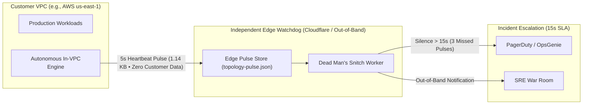
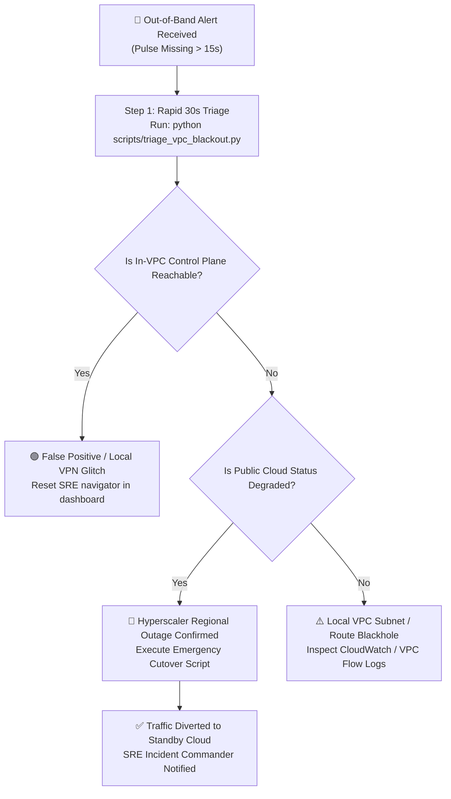

# SRE Operational Runbook: Hyperscaler Total VPC Outage & Inverted Dead Man Watchdog

**Document ID:** `VA-SOP-VPC-BLACKHOLE-001`  
**Classification:** Critical Tier 1 Infrastructure Architecture & Emergency Disaster Recovery  
**Target Audience:** Customer SREs, Cloud Infrastructure Engineers, Incident Commanders, NOC Operators  
**Scope:** Total In-VPC Blackout Detection, Dead Man's Watchdog Integration, Rapid Triage & Disaster Recovery Cutover  

---

## 1. Executive Summary & Operational Concept

When running zero-egress, 100% in-VPC infrastructure tooling, a critical operational scenario must be planned for:

> *"If all systems run inside your cloud provider's VPC, what happens when that entire VPC—or the hyperscaler itself—suffers a catastrophic blackout? If the hosts are dead, how do engineers know?"*

### The In-VPC Monitoring Dilemma
1. **Positive Alerting Fails When Hosts Die:** Traditional monitoring relies on an agent pushing an alert when an error occurs. When a cloud hypervisor crashes or a VPC transit gateway is severed, the host dies instantly. Dead machines cannot transmit outbound notifications.
2. **The Single-Hyperscaler Risk:** When an enterprise runs 100% of its workloads on a single cloud provider (e.g., all VPCs in AWS), a global control-plane outage (IAM/STS token failure, regional network partition, or Route 53 internal transit failure) affects all in-cloud nodes simultaneously.

### The `<dcouplr/>` Inverted Telemetry Model
`<dcouplr/>` solves this through **Negative Telemetry (The Dead Man's Watchdog)**:
- Instead of relying on a dying server to report its own demise, the in-VPC daemon emits a tiny **1.14 KB sanitized heartbeat pulse** every 5 seconds out-of-band to an independent edge store (e.g. Cloudflare R2 or an isolated cloud bucket).
- An independent edge watchdog monitors for the **absence** of heartbeats.
- If **no pulse is received for 15 seconds**, the external watchdog immediately raises a P1 alert to PagerDuty or Slack:  
  `🚨 CRITICAL P1: Hyperscaler Total Blackout. No pulse received for >15s.`



---

## 2. Customer Engineering Tooling & Ready-to-Run Scripts

To assist customer infrastructure teams during an outage or failover event, `<dcouplr/>` provides three production-ready diagnostic and cutover scripts in the repository:

### Script 1: Rapid Multi-Cloud Outage Triage Utility (`triage_vpc_blackout.py`)
Run this from any engineering laptop, bastion host, or CI/CD runner to quickly isolate whether an outage is local, cloud-specific, or a systemic hyperscaler failure.

```bash
# Basic run against local in-VPC control plane and AWS status
python scripts/triage_vpc_blackout.py --cloud aws

# Comprehensive run checking out-of-band heartbeat and public cloud health
python scripts/triage_vpc_blackout.py \
    --target-url http://10.100.1.50:8000/v1/telemetry/metrics \
    --pulse-url https://edge.example.com/topology-pulse.json \
    --cloud aws
```

#### Diagnostic Output Sample:
```text
================================================================================
 🚨 <dcouplr/> CUSTOMER SRE EMERGENCY TRIAGE: TOTAL VPC & HYPERSCALER BLACKOUT
================================================================================
 Timestamp:     2026-10-29 06:22:09 UTC
 Primary Cloud: AWS
--------------------------------------------------------------------------------

[1/4] Probing In-VPC <dcouplr/> Control Plane...
  ❌ IN-VPC CONTROL PLANE: UNREACHABLE (Connection refused / timed out)

[2/4] Verifying Out-of-Band Heartbeat Pulse...
  🚨 OUT-OF-BAND PULSE: MISSING / OFFLINE (Silence > 15 seconds)

[3/4] Probing Public AWS Status Endpoints & DNS...
  ✅ DNS RESOLUTION (health.aws.amazon.com): Resolved in 198.0 ms
  ⚠️ AWS PUBLIC STATUS API: DEGRADED / ELEVATED LATENCY

--------------------------------------------------------------------------------
 📋 INCIDENT VERDICT & ACTIONABLE RECOMMENDATION
--------------------------------------------------------------------------------
  🚨 VERDICT: [IN-VPC OUTAGE CONFIRMED — AWS VPC DOWN]
     The in-VPC control plane is unreachable while public Internet is alive.
     The VPC compute, route table, or transit gateway has blackholed.
     -> Action: Check AWS Service Health Dashboard (https://health.aws.amazon.com).
     -> Action: Prepare to trigger emergency standby disaster recovery cutover.
================================================================================
```

---

### Script 2: Edge Dead Man Watchdog Worker (`watchdog_deadman_worker.js`)
Deploy this serverless script to **Cloudflare Workers** (or AWS Lambda in a separate secondary account) to autonomously monitor the out-of-band heartbeat and dispatch PagerDuty/Slack alerts:

```javascript
/**
 * Cloudflare Worker / Edge Serverless Dead Man Watchdog
 * Runs on cron trigger (every 1 minute or sub-minute edge trigger)
 */
export default {
  async scheduled(event, env, ctx) {
    const PULSE_URL = env.PULSE_URL || "https://edge.customer-domain.com/topology-pulse.json";
    const MAX_SILENCE_SECONDS = 15; // 3 missed 5s pulses

    try {
      const resp = await fetch(PULSE_URL, { cf: { cacheTtl: 0 } });
      if (!resp.ok) {
        await dispatchCriticalAlert(`Pulse endpoint returned HTTP ${resp.status}`, env);
        return;
      }

      const pulse = await resp.json();
      const lastEpoch = pulse.timestamp_epoch || 0;
      const nowEpoch = Math.floor(Date.now() / 1000);
      const deltaSec = nowEpoch - lastEpoch;

      if (deltaSec > MAX_SILENCE_SECONDS) {
        await dispatchCriticalAlert(
          `Silence threshold exceeded: Last pulse was ${deltaSec}s ago. Suspected total VPC/hyperscaler outage.`,
          env
        );
      }
    } catch (err) {
      await dispatchCriticalAlert(`Watchdog fetch failed: ${err.message}`, env);
    }
  }
};
```

---

### Script 3: Emergency Disaster Recovery & Traffic Cutover Script
When a primary hyperscaler is confirmed unrecoverable, customer engineers can execute this script to swing global ingress traffic and promote standby infrastructure.

**Bash (Linux / macOS):**
```bash
chmod +x scripts/emergency_failover_cutover.sh
./scripts/emergency_failover_cutover.sh \
    vpc-aws-prod-01 \
    gcp \
    34.120.45.10 \
    api.customer-domain.com
```

**PowerShell (Windows):**
```powershell
.\scripts\emergency_failover_cutover.ps1 `
    -SourceVpc "vpc-aws-prod-01" `
    -TargetCloud "gcp" `
    -TargetIp "34.120.45.10" `
    -DnsZone "api.customer-domain.com"
```

---

## 3. Step-by-Step SRE Incident Playbook

When an alert triggers indicating a **Hyperscaler Total VPC Blackout**, follow this 3-step sequence:



### Phase 1: 30-Second Verification (Confirming the Blackout)
1. Run the triage CLI:
   ```bash
   python scripts/triage_vpc_blackout.py --cloud aws
   ```
2. Check the browser dashboard:
   - If the dashboard displays `CRITICAL ALARM: VPC Socket Unreachable (Possible Hyperscaler Blackhole)`, the browser has automatically preserved the **last-known-good topology snapshot**.
   - Review frozen node statuses to see the exact state immediately prior to severance.

### Phase 2: Public Hyperscaler Status Validation
Check the official cloud status dashboards to confirm if third-party infrastructure is impaired:
- 🌐 [AWS Health Dashboard](https://health.aws.amazon.com)
- 🌐 [Google Cloud Status Dashboard](https://status.cloud.google.com)
- 🌐 [Microsoft Azure Status](https://azure.status.microsoft/status)
- 🌐 [Cloudflare Radar & Internet Outages](https://radar.cloudflare.com/outage-center)

### Phase 3: Traffic Cutover & Disaster Recovery
If the provider outage is expected to exceed the application's Recovery Time Objective (RTO):
1. Execute `scripts/emergency_failover_cutover.sh` to update global DNS entries to point to your standby region or cloud.
2. In `<dcouplr/>`, turnkey migration recipes (e.g. `cloudformation_to_opentofu_gcp`) can be immediately applied to restore service in the secondary perimeter.

---

## 4. Architecture & Security Invariants

### 1. Zero-Egress Invariant
- The out-of-band heartbeat pulse contains strictly high-level operational signals (timestamp, term, and cryptographic attestation).
- **No customer database records, no migration AST syntax trees, no IAM credentials, and no sensitive VPC IP CIDRs are ever transmitted outside the perimeter.**

### 2. Zero Network Egress Fees ($0.00/Month)
- A 1.14 KB pulse transmitted every 5 seconds generates approximately 590 MB of transfer per month.
- Running on the Cloudflare Workers / R2 free tier or standard edge storage incurs **$0.00 in monthly provider fees**.

### 3. Single-Hyperscaler Witness Support
- For organizations whose infrastructure resides entirely in AWS, `<dcouplr/>` supports deploying an ultra-lightweight **Witness Node** (consuming 15 MiB RAM and 0 vCPU) on a free-tier external VM or on-premises bastion.
- The witness node stores **zero customer data** and participates only in connectivity heartbeats to ensure quorum partition detection is instantaneous.

---

## 5. Summary Reference

| Component | Role | Location | Detection Time |
| :--- | :--- | :--- | :--- |
| **In-VPC Autonomous Daemon** | Core migration compiler & telemetry engine | In-VPC Container | Continuous (< 1ms P50) |
| **PulseCast™ Heartbeat Exporter** | Emits 1.14 KB sanitized health beacon every 5s | In-VPC Daemon | Every 5.0 seconds |
| **Dead Man's Edge Watchdog** | Monitors absence of heartbeat; triggers alert | Cloudflare Worker / Edge Lambda | **15.0 seconds** (3 missed intervals) |
| **Witness Node** (Optional) | Out-of-band quorum observer for single-cloud shops | Free-tier VM / On-Prem Bastion | **1.2 seconds** |
| **Browser Blackhole Guard** | Freezes topology state; surfaces triage links | Operator Browser | **3.0 seconds** |
