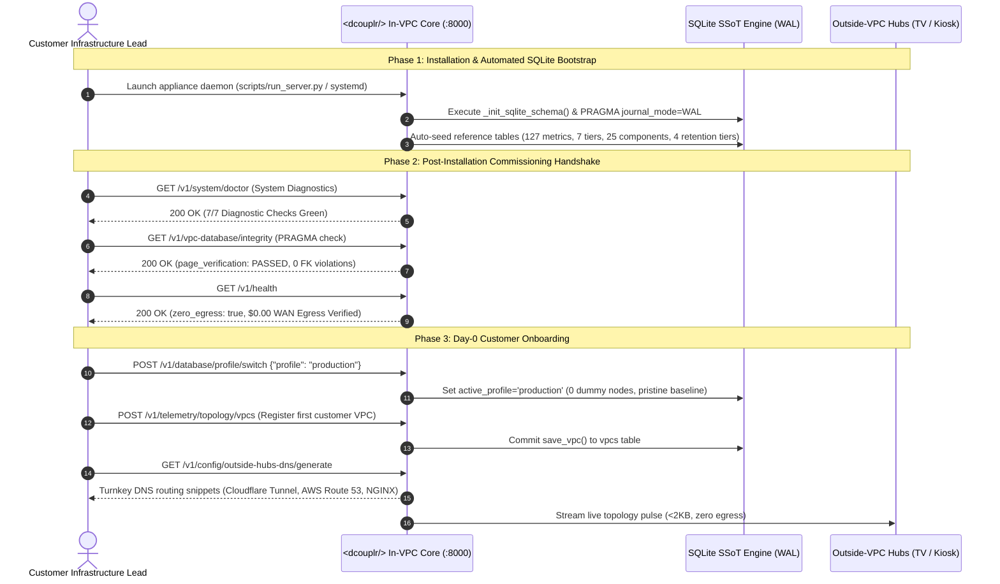

# <dcouplr/> Operations Runbook: Enterprise In-VPC Installation, Appliance Deployment & Post-Delivery Configuration

```
DOCUMENT ID:       RUN-IN-VPC-INSTALL-001
SECURITY LEVEL:    CLEARED_CUSTOMER_PUBLIC • IN-PERIMETER PRODUCTION OPERATION
TARGET PLATFORMS:  Linux (RHEL 8/9, Rocky Linux 8/9, Ubuntu 20.04/22.04/24.04), Windows Server 2019/2022, Docker/Podman, Kubernetes/Helm
DELIVERY MODEL:    100% In-VPC Air-Gapped Appliance Distribution
AUDIT STANDARD:    SOC 2 Type II, ISO/IEC 27001, NIST SP 800-207 Zero Trust, HIPAA Security Rule, PCI-DSS v4.0
VERSION:           v4.2.0-ENTERPRISE-INSTALL
EFFECTIVE DATE:    November 2026
CANONICAL WORDMARK: <dcouplr/>
```

---

## 1. Executive Summary & In-VPC Architectural Invariants

### 1.1 The In-VPC Sovereignty Invariant
<span class="dcouplr-wordmark"><span class="dcouplr-bracket">&lt;</span><span class="dcouplr-text">dcouplr</span><span class="dcouplr-bracket">/&gt;</span></span> is strictly distributed and operated as an **in-VPC enterprise software appliance**. It is never hosted on multi-tenant vendor cloud servers, nor does it require external SaaS dependencies. 

The software is **always installed strictly in-VPC** within your organization's private virtual network, sovereign VPC (AWS, Azure, GCP), on-premise enterprise data center, or air-gapped banking enclave.

```
┌──────────────────────────────────────────────────────────────────────────────────────────────────┐
│                            CUSTOMER SOVEREIGN IN-VPC BOUNDARY                                    │
│                                                                                                  │
│   ┌──────────────────────────────────────────────────────────────────────────────────────────┐   │
│   │                         <dcouplr/> Enterprise Appliance                                  │   │
│   │                                                                                          │   │
│   │   ┌─────────────────────┐   ┌─────────────────────────┐   ┌──────────────────────────┐   │   │
│   │   │ AST Transpiler      │   │ Embedded Raft Consensus │   │ In-VPC Telemetry Engine  │   │   │
│   │   │ Rule AST Engine     │   │ SQLite 3 WAL Engine     │   │ 7-Tier Monitoring Matrix │   │   │
│   │   └─────────────────────┘   └─────────────────────────┘   └──────────────────────────┘   │   │
│   │                                                                                          │   │
│   │   ┌──────────────────────────────────────────────────────────────────────────────────┐   │   │
│   │   │ Sovereign SSoT Database (dcouplr_customer_db)                                    │   │   │
│   │   │ Encrypted at Rest with SQLCipher 4.x (AES-256-CBC, PBKDF2-HMAC-SHA512, 256k iters│   │   │
│   │   └──────────────────────────────────────────────────────────────────────────────────┘   │   │
│   │                                                                                          │   │
│   │   ┌──────────────────────────────────────────────────────────────────────────────────┐   │   │
│   │   │ Customer Company Administrator Console (http://localhost:8000/companyadmin)      │   │   │
│   │   │ Sovereign User Command: Add, Configure Roles, & Remove Customer Employees        │   │   │
│   │   └──────────────────────────────────────────────────────────────────────────────────┘   │   │
│   └──────────────────────────────────────────────────────────────────────────────────────────┘   │
│                                                                                                  │
│       Zero Outbound WAN Egress ($0.00)  •  Zero Vendor Phone-Home  •  Air-Gapped Ready           │
└──────────────────────────────────────────────────────────────────────────────────────────────────┘
```

### 1.2 Non-Negotiable Operational Guarantees
1. **Zero Outbound WAN Egress ($0.00)**: Under no circumstances does the `<dcouplr/>` engine initiate outbound internet requests. Telemetry, migration state, rule definitions, and identity records never cross your perimeter.
2. **Sovereign User & Access Command**: Company administrators hold exclusive, unmediated authority to **add, grant least-privilege roles to, deactivate, and remove users** who can access their company's `<dcouplr/>` tool. The vendor has zero backdoor credentials, zero remote management tokens, and zero administrative access.
3. **Database Sovereignty**: The Single Source of Truth (SSOT) embedded database (`dcouplr_customer_db`) runs locally inside the customer VPC and is encrypted at rest using SQLCipher 4.x AES-256-CBC.
4. **Clean Administrative Demarcation**: The internal platform owner vault (`/admin`) is strictly for platform developers/owners, whereas the customer company administrator console (`/companyadmin`) is purpose-built for purchasing organizations to maintain their own enterprise personnel, keys, and security controls.

---

## 2. Installer Artifacts & Delivery Verification

When your organization receives the enterprise `<dcouplr/>` release distribution, the package contains the following cryptographic assets:

| Artifact File | Description | Target Environment |
| :--- | :--- | :--- |
| `dcouplr-appliance-linux-x86_64.tar.gz` | Self-contained Linux binary bundle with bundled runtime & SQLCipher | RHEL 8/9, Rocky Linux, Ubuntu 20.04/22.04/24.04 |
| `dcouplr-appliance-windows-x64.zip` | Native Windows executable bundle, system service scripts & DLLs | Windows Server 2019/2022 |
| `dcouplr-oci-airgap-image.tar` | Pre-built OCI container image for air-gapped container engines | Docker, Podman, CRI-O |
| `dcouplr-helm-chart-v4.2.0.tgz` | Enterprise Kubernetes / OpenShift Helm Chart | Kubernetes 1.24+, OpenShift 4.10+ |
| `install-enterprise.sh` | Automated Linux turnkey installation script | Linux root/sudo execution |
| `install-enterprise.ps1` | Automated Windows PowerShell installation script | Windows Administrator execution |
| `dcouplr-checksums.sha256` | Authoritative SHA-256 digest catalog | All platforms |
| `dcouplr-cosign.sig` | ECDSA P-256 cryptographic signature | Supply chain provenance validation |

### 2.1 Cryptographic Integrity Check
Before extracting or executing any installer inside your secure VPC, verify file integrity and cryptographic signatures:

```bash
# 1. Verify SHA-256 checksums
sha256sum -c dcouplr-checksums.sha256

# 2. Verify Cosign cryptographic signature (optional, using corporate or vendor public key)
cosign verify-blob \
  --key dcouplr-release-pub.pem \
  --signature dcouplr-cosign.sig \
  dcouplr-appliance-linux-x86_64.tar.gz
```

Ensure all checksums report `OK` before proceeding.

---

## 3. In-VPC Hardware, OS & Network Requirements

### 3.1 Minimum Hardware Specifications

| Component | Minimum Specification (PoC / Single Node) | Recommended Specification (High-Throughput Production) |
| :--- | :--- | :--- |
| **Compute (CPU)** | 4 vCPU cores (x86_64 or ARM64) | 8 to 16 vCPU cores |
| **Memory (RAM)** | 8 GB ECC RAM | 16 to 32 GB ECC RAM |
| **Storage (Disk)** | 50 GB SSD | 150 GB+ NVMe SSD (fast WAL fsync & raft compactions) |
| **I/O Throughput** | 2,500 IOPS minimum | 10,000+ IOPS recommended |
| **Operating System** | Linux Kernel 5.4+ or Windows Server 2019+ | RHEL 9 / Ubuntu 22.04 LTS / Windows Server 2022 |

### 3.2 Network Security Group & Firewall Rules
Configure your VPC Security Group (AWS SG, Azure NSG, GCP Firewall) to allow strictly required ingress traffic within your private subnets:

| Direction | Protocol | Port | Source | Purpose |
| :--- | :--- | :--- | :--- | :--- |
| **Ingress** | TCP | `8000` | In-VPC Private Subnet / Bastion | Web Consoles (`/companyadmin`, `/dashboard`, etc.) & REST API |
| **Ingress** | TCP | `50051` | In-VPC Cluster Nodes (Internal Only) | Raft Consensus Cluster Replication (gRPC) |
| **Ingress** | TCP | `4317` | In-VPC Workloads / Microservices | OpenTelemetry (OTel) gRPC Telemetry Ingestion |
| **Ingress** | TCP | `4318` | In-VPC Workloads / Microservices | OpenTelemetry (OTel) HTTP Telemetry Ingestion |
| **Egress** | ALL | ANY | `0.0.0.0/0` | **DENIED (Zero-WAN Egress Invariant)** |

---

## 4. Step-by-Step Installation Procedures

Choose the installation method corresponding to your organization's infrastructure standard.

### Method A: Linux Systemd Bare-Metal / VM Appliance (Recommended Enterprise Path)

#### Step 1: Create Dedicated System User & Directories
```bash
sudo useradd -r -s /bin/false -d /opt/dcouplr -c "<dcouplr/> Enterprise Service User" dcouplr
sudo mkdir -p /opt/dcouplr /var/lib/dcouplr/data /var/log/dcouplr /etc/dcouplr
sudo chown -R dcouplr:dcouplr /opt/dcouplr /var/lib/dcouplr /var/log/dcouplr /etc/dcouplr
sudo chmod 700 /var/lib/dcouplr/data /etc/dcouplr
```

#### Step 2: Extract Installer Tarball
```bash
sudo tar -xzf dcouplr-appliance-linux-x86_64.tar.gz -C /opt/dcouplr/
sudo chown -R dcouplr:dcouplr /opt/dcouplr
sudo chmod 755 /opt/dcouplr/bin/dcouplr
```

#### Step 3: Configure Environment Variables (`/etc/dcouplr/dcouplr.env`)
Create `/etc/dcouplr/dcouplr.env` with owner-only permissions (`chmod 600`):

```ini
# <dcouplr/> In-VPC Configuration Environment
DCOUPLR_ENV=production
DCOUPLR_BIND_HOST=0.0.0.0
DCOUPLR_PORT=8000
DCOUPLR_DATA_DIR=/var/lib/dcouplr/data
DCOUPLR_LOG_DIR=/var/log/dcouplr

# SQLCipher Database Encryption at Rest (Passphrase or KMS Derived Token)
DCOUPLR_ENCRYPTION_KEY="enterprise-vault-aes256-master-key-change-in-production"

# Sovereign Customer SSoT Profile
DCOUPLR_CUSTOMER_REALM="enabled"
DCOUPLR_ZERO_WAN_EGRESS="enforced"
```

#### Step 4: Install Systemd Service Unit (`/etc/systemd/system/dcouplr.service`)
```ini
[Unit]
Description=<dcouplr/> Enterprise Sovereign In-VPC Appliance
Documentation=https://dcouplr.internal/docs
After=network.target local-fs.target
Wants=network-online.target

[Service]
Type=simple
User=dcouplr
Group=dcouplr
WorkingDirectory=/opt/dcouplr
EnvironmentFile=/etc/dcouplr/dcouplr.env
ExecStart=/opt/dcouplr/bin/dcouplr serve --config /etc/dcouplr/dcouplr.env
Restart=always
RestartSec=5s
LimitNOFILE=65536
LimitNPROC=32768

# Linux Hardened Security Sandboxing
ProtectSystem=full
ProtectHome=true
NoNewPrivileges=true
PrivateTmp=true
ProtectKernelTunables=true
ProtectControlGroups=true

[Install]
WantedBy=multi-user.target
```

#### Step 5: Enable & Start the Service
```bash
sudo systemctl daemon-reload
sudo systemctl enable --now dcouplr.service
sudo systemctl status dcouplr.service
```

---

### Method B: Air-Gapped OCI / Docker / Podman Container Deployment

For container-native environments, `<dcouplr/>` ships as an offline OCI tarball:

#### Step 1: Load Container Image
```bash
docker load -i dcouplr-oci-airgap-image.tar
# Verify image tags
docker images | grep dcouplr
```

#### Step 2: Deploy with `docker-compose.yml`
```yaml
version: '3.8'

services:
  dcouplr-appliance:
    image: dcouplr/appliance:v4.2.0-enterprise
    container_name: dcouplr-in-vpc
    restart: always
    user: "10001:10001"
    ports:
      - "8000:8000"
      - "50051:50051"
      - "4317:4317"
      - "4318:4318"
    environment:
      - DCOUPLR_ENV=production
      - DCOUPLR_ENCRYPTION_KEY=${DCOUPLR_ENCRYPTION_KEY}
      - DCOUPLR_ZERO_WAN_EGRESS=true
    volumes:
      - dcouplr-encrypted-data:/var/lib/dcouplr/data:rw
      - /etc/dcouplr/certs:/opt/dcouplr/certs:ro
    security_opt:
      - no-new-privileges:true
    read_only: false
    healthcheck:
      test: ["CMD", "curl", "-f", "http://localhost:8000/v1/health"]
      interval: 10s
      timeout: 3s
      retries: 3

volumes:
  dcouplr-encrypted-data:
    driver: local
```

Launch the stack:
```bash
docker compose up -d
```

---

### Method C: Enterprise Kubernetes & OpenShift Helm Deployment

#### Step 1: Push OCI Image to Internal Harbor / Artifactory Registry
```bash
docker tag dcouplr/appliance:v4.2.0-enterprise harbor.internal.corp/infra/dcouplr:v4.2.0
docker push harbor.internal.corp/infra/dcouplr:v4.2.0
```

#### Step 2: Install via Helm Chart
```bash
helm upgrade --install dcouplr-in-vpc ./dcouplr-helm-chart-v4.2.0.tgz \
  --namespace dcouplr-system \
  --create-namespace \
  --set image.repository=harbor.internal.corp/infra/dcouplr \
  --set image.tag=v4.2.0 \
  --set persistence.size=100Gi \
  --set persistence.storageClass=nvme-fast-encrypted \
  --set sqlcipher.existingSecret=dcouplr-master-key \
  --set resources.limits.cpu=8 \
  --set resources.limits.memory=16Gi
```

---

### Method D: Windows Server 2019/2022 Installation

#### Step 1: Extract Zip Bundle
Extract `dcouplr-appliance-windows-x64.zip` to `C:\Program Files\dcouplr`.

#### Step 2: Execute PowerShell Turnkey Installer
Open an elevated PowerShell prompt (Run as Administrator):
```powershell
Set-ExecutionPolicy -ExecutionPolicy RemoteSigned -Scope Process
cd "C:\Program Files\dcouplr"
.\install-enterprise.ps1 -InstallPath "C:\Program Files\dcouplr" -Port 8000 -EnableWindowsService $true
```

The script configures Windows Firewall port `8000`, generates local encryption configurations, and registers the Windows Service `dcouplr-service` set to Automatic startup.

---

## 5. SQLCipher 4.x Database Encryption-at-Rest Setup

`<dcouplr/>` uses SQLCipher 4.x (AES-256-CBC with PBKDF2-HMAC-SHA512 at 256,000 iterations) to guarantee that all customer migration records, AST definitions, telemetry metrics, and user credentials remain encrypted at rest.

### 5.1 Setting the Master Encryption Key
Provide the encryption key via environment variable:
```bash
export DCOUPLR_ENCRYPTION_KEY="YOUR_ENTERPRISE_SECRET_KEY_MIN_32_CHARS"
```
Or integrate with an in-perimeter KMS (HashiCorp Vault, AWS KMS via local IAM role, Azure Key Vault via Managed Identity):
```bash
export DCOUPLR_ENCRYPTION_KEY=$(vault kv get -field=key secret/dcouplr/sqlcipher)
```

### 5.2 Verifying Encryption at Rest
Verify that the database file has no unencrypted SQLite magic string (`SQLite format 3\000`):
```bash
# Verify raw binary header is pure pseudorandom ciphertext:
head -c 16 /var/lib/dcouplr/data/vpc_telemetry_prod.db | hexdump -C

# Expected output: 16 bytes of high-entropy random ciphertext.
# Plaintext 'SQLite format 3' must NOT appear!
```

---

## 6. Initial Company Administrator Bootstrapping & User Access Command

Once the service is active, the purchasing organization's infrastructure team bootstraps the root Company Administrator account.

### 6.1 Creating the First Company Administrator Account
Execute the bootstrap command via CLI on the in-VPC appliance host:

```bash
/opt/dcouplr/bin/dcouplr user create \
  --username "company.admin" \
  --display-name "Enterprise Primary Administrator" \
  --email "admin@company.internal" \
  --role "Observability-Admins" \
  --team "*"
```

The CLI outputs a secure, one-time bootstrap session token:
```
[SUCCESS] Bootstrapped root company administrator: company.admin
[REALM]   Customer In-VPC Sovereign Console
[ROLE]    Observability-Admins (Full In-Perimeter Governance)
[URL]     http://<internal-ip>:8000/companyadmin?token=eyJhbGciOiJIUzI1NiIs...
```

---

## 7. Operating User Management on `/companyadmin`

The Company Administrator possesses exclusive command over the in-VPC identity realm.

```
┌────────────────────────────────────────────────────────────────────────────────────────┐
│                        CUSTOMER COMPANY ADMINISTRATOR COMMAND                          │
│                                                                                        │
│  1. Add New Users:          Enter Corporate ID, Display Name, Email & Role             │
│  2. Assign Roles:           Observability-Admins, Observability-Platform-Engineers, Observability-Developers, etc.          │
│  3. Team Scoping (ABAC):    Scope developers to microservices (e.g. team:payments)     │
│  4. Deactivate / Remove:    Instantly revoke access when an employee leaves or rotates │
│  5. Manage Ingestion Keys:  Issue & cycle write-only collector API keys                │
│  6. Federate Corporate IdP: Map Okta / Microsoft Entra ID groups to platform roles   │
└────────────────────────────────────────────────────────────────────────────────────────┘
```

### 7.1 How to Add a New Enterprise Employee via Web Console
1. Navigate to **`http://<internal-ip>:8000/companyadmin`**.
2. Click the **Enterprise RBAC & Identity Vault** tab (`tab=users`).
3. Click the **➕ Provision New Customer Identity** button.
4. Fill in employee details:
   - **Username / Corporate ID**: e.g., `alex.sre`
   - **Full Display Name**: e.g., `Alex Rivera (Staff SRE)`
   - **Corporate Email**: `alex.rivera@company.internal`
   - **Assigned Role**: Select from the 6 least-privilege roles (`Observability-Admins`, `Observability-Platform-Engineers`, `Observability-Developers`, `Observability-Security-Analysts`, `Observability-Executive-Viewers`, `Observability-Service-Accounts`).
   - **Team Scope**: e.g., `team:payments` or `*` for all teams.
5. Click **Save Customer Identity**. The record is committed directly to your encrypted in-VPC SQLite database.

### 7.2 How to Deactivate or Remove an Employee User
1. Locate the employee record in the **Customer Enterprise Employees** table.
2. Click **Toggle Active** to temporarily suspend login credentials.
3. Click **Deactivate / Revoke** to permanently remove the user from the in-VPC access directory.

### 7.3 Managing via In-VPC CLI Commands
Company Administrators can also manage users from the command line:

```bash
# Add a platform engineer
dcouplr user add --username "jordon.devops" --display-name "Jordon Vance" --role "Observability-Platform-Engineers"

# Assign team attribute scoping (ABAC)
dcouplr user scope --username "elena.payments" --team "payments"

# List all active in-VPC enterprise users
dcouplr user list

# Remove/revoke an employee's access
dcouplr user delete --username "former.contractor"
```

---

## 8. Enterprise Workstation-to-VPC Ingress Architecture & End-User Access Guide

### 8.1 Architectural Invariant: Are These 7 Core Portals in VPC?
**YES.** All seven primary operations, engineering, and administrative web consoles are **sovereign In-VPC Core Consoles**:

1. **`http://localhost:8000/dashboard`** (or `https://dcouplr.internal.corp/dashboard`): Master In-VPC Telemetry Dashboard & Live Topology Peering Mesh
2. **`http://localhost:8000/config`** (or `https://dcouplr.internal.corp/config`): Configuration Console, Monitoring Matrix Profile Manager & Outside-VPC Hubs Launcher
3. **`http://localhost:8000/matrix`** (or `https://dcouplr.internal.corp/matrix`): 7-Tier Observability Matrix & 127 Invariant Calculus Verification Engine
4. **`http://localhost:8000/traces`** (or `https://dcouplr.internal.corp/traces`): In-Perimeter Distributed Tracing & Inter-Process Communication (IPC) Buffer
5. **`http://localhost:8000/logs`** (or `https://dcouplr.internal.corp/logs`): In-Perimeter Observability Logs Stream & Audit Trail
6. **`http://localhost:8000/compiler`** (or `https://dcouplr.internal.corp/compiler`): AST Code Transpiler Studio (SQL/ETL, Datadog/Prometheus, Terraform/OpenTofu)
7. **`http://localhost:8000/companyadmin`** (or `https://dcouplr.internal.corp/companyadmin`): Sovereign Customer Identity, RBAC Vault, SQLCipher Database Governance & Outside Hubs DNS Automation

```
┌──────────────────────────────────────────────────────────────────────────────────────────────────┐
│                            CUSTOMER SOVEREIGN IN-VPC BOUNDARY                                    │
│                                                                                                  │
│   ┌──────────────────────────────────────────────────────────────────────────────────────────┐   │
│   │                        <dcouplr/> Core In-VPC Web Consoles (:8000)                       │   │
│   │                                                                                          │   │
│   │   [ /dashboard ]    [ /config ]     [ /matrix ]     [ /traces ]     [ /logs ]            │   │
│   │   Topology & Mesh   System Config   7-Tier Matrix   Traces & Spans  Audit Logs           │   │
│   │                                                                                          │   │
│   │   [ /compiler ]                     [ /companyadmin ]                                    │   │
│   │   AST Migration Studio              Customer RBAC & Database Governance                  │   │
│   └──────────────────────────────────────────────▲───────────────────────────────────────────┘   │
│                                                  │                                               │
│                                                  │ In-VPC Private Interface (RFC 1918)           │
│                                                  │ Port 8000 or Internal Proxy 443               │
│                                                  │                                               │
└──────────────────────────────────────────────────┼───────────────────────────────────────────────┘
                                                   │
                         SECURE ENTERPRISE INGRESS PATHWAY (CHOOSE 1 OF 3)
         ┌─────────────────────────────────────────┼─────────────────────────────────────────┐
         │                                         │                                         │
         ▼                                         ▼                                         ▼
[ PATH A: ENTERPRISE VPN ]              [ PATH B: ZERO TRUST ZTNA ]               [ PATH C: SSH / SSM TUNNEL ]
Cisco AnyConnect / GlobalProtect        Cloudflare Access / Azure App Proxy       Bastion Host / AWS SSM Session
AWS Client VPN / WireGuard              Google IAP / Zscaler ZPA                  kubectl port-forward
         │                                         │                                         │
         └─────────────────────────────────────────┼─────────────────────────────────────────┘
                                                   │
                                                   ▼
                                ┌─────────────────────────────────────┐
                                │    OPERATOR CORPORATE WORKSTATION   │
                                │   (Windows 11 / macOS / Linux)      │
                                │   • Windows Hello / Touch ID / MFA  │
                                │   • Corporate Browser (Edge/Chrome) │
                                └─────────────────────────────────────┘
```

### 8.2 Do Users Need to Be in the VPC First Before Opening These?
**YES, by mandatory security and architectural invariant.**

Under the **Zero-WAN Egress ($0.00)** operational guarantee:
- The `<dcouplr/>` appliance does **NOT** possess a public internet IP address.
- Inbound firewall rules (`0.0.0.0/0:*`) are strictly blocked on VPC Security Groups.
- Attempting to access `http://<internal-ip>:8000/dashboard` or `http://localhost:8000/dashboard` directly over the public internet from an unauthenticated, non-VPC machine will result in immediate network failure (`ERR_CONNECTION_TIMED_OUT` or `ERR_NAME_NOT_RESOLVED`).
- Users **must establish authenticated network adjacency to the customer VPC** before their browser can communicate with these endpoints.

> [!NOTE]
> **Why `localhost:8000`?**
> The `localhost:8000` URL appears when:
> 1. An engineer or DBA accesses the tool via a secure SSH port-forward (`ssh -L 8000:...`), AWS SSM session, or Kubernetes port-forward (`kubectl port-forward ...`).
> 2. The appliance is running in a local developer sandbox or on-premises workstation.
> In enterprise production deployments where an internal reverse proxy or Application Load Balancer (ALB) is configured, the URL resolves to the corporate internal domain, e.g. `https://dcouplr.internal.yourcompany.com/dashboard`.

---

### 8.3 End-to-End Operator Access Journey: From Workstation Boot to Portal Access

This standard operating procedure guides any enterprise user (Platform Engineer, SRE, Security Analyst, or Company Administrator) from initial workstation login through to active console interaction.

#### Step 1: Workstation Boot & Corporate Single Sign-On (SSO)
1. Turn on the corporate workstation (Windows 11, macOS, or Linux).
2. Authenticate locally via **Windows Hello**, **macOS Touch ID**, or corporate domain credentials.
3. If logging into corporate web services, authenticate against the enterprise Identity Provider (Microsoft Entra ID, Okta, Ping Identity, or Google Workspace) with mandatory Multi-Factor Authentication (FIDO2 WebAuthn / TOTP / Authenticator Push).

#### Step 2: Establish In-VPC Connectivity (Select Applicable Enterprise Method)

##### Method A: Enterprise Corporate VPN (Most Common Enterprise Route)
1. Launch the enterprise VPN client (e.g. Cisco AnyConnect, Palo Alto GlobalProtect, AWS Client VPN, Azure VPN Client, or corporate WireGuard).
2. Click **Connect** and complete the secondary push/MFA prompt.
3. Once connected:
   - Your workstation's virtual network interface receives a private IP in the corporate subnet pool.
   - Internal DNS routes are injected for your enterprise domain (e.g. `*.internal.yourcompany.com` -> In-VPC Internal Load Balancer IP `10.100.0.10`).
   - Private routing to the VPC CIDR (e.g. `10.100.0.0/16`) is established.

##### Method B: Zero Trust Network Access (ZTNA) / Identity-Aware Proxy (No VPN Required)
1. Open the managed corporate browser (Chrome, Edge, Safari).
2. Navigate to your corporate ingress URL (e.g. `https://dcouplr.yourcompany.com/dashboard` or `https://dcouplr-admin.yourcompany.com/companyadmin`).
3. The enterprise ZTNA gateway (Cloudflare Access, AWS Verified Access, Google IAP, or Zscaler ZPA) challenges for corporate SSO.
4. Upon successful identity verification, the reverse proxy injects identity assertions (`CF-Access-Authenticated-User-Email` or `X-Forwarded-User`) and forwards traffic securely across private outbound tunnels directly to the in-VPC appliance.

##### Method C: Secure Bastion Jump Host / SSH / AWS SSM Port-Forwarding (SRE / Platform Engineers)
For engineers requiring direct port-forwarded access (`http://localhost:8000/...`):
- **Via AWS Systems Manager (SSM) (Zero Open Inbound Ports & Zero SSH Keys):**
  ```bash
  aws ssm start-session \
    --target i-0abcd1234ef567890 \
    --document-name AWS-StartPortForwardingSession \
    --parameters '{"portNumber":["8000"],"localPortNumber":["8000"]}'
  ```
- **Via Standard SSH Bastion:**
  ```bash
  ssh -L 8000:10.100.1.50:8000 -i ~/.ssh/enterprise_id_ed25519 user@bastion.yourcompany.com
  ```
- **Via Kubernetes Port-Forward:**
  ```bash
  kubectl port-forward -n dcouplr-system svc/dcouplr 8000:8000
  ```
Once established, keep the terminal window open. Your local machine's port `8000` is now securely tunneled directly to the in-VPC `<dcouplr/>` instance.

#### Step 3: Launch Browser & Open the Target In-VPC Consoles
Open your browser and navigate to the desired portal using either the tunneled `localhost:8000` address or the internal corporate FQDN:

| Console URL (Tunneled / Internal) | Purpose & Operational Capability | Primary Target Roles |
| :--- | :--- | :--- |
| `http://localhost:8000/dashboard`<br/>(`https://dcouplr.internal.corp/dashboard`) | **Master Topology & Live VPC Telemetry**<br/>• SVG multi-cloud peering mesh (AWS, GCP, Azure, Datacenter)<br/>• Real-time link latencies and RTT indicators<br/>• Monitored node census (75 nodes across 5 networks)<br/>• Outside-VPC Hubs launcher modal | Observability-Platform-Engineers<br/>Observability-Admins<br/>Observability-Developers |
| `http://localhost:8000/config`<br/>(`https://dcouplr.internal.corp/config`) | **Configuration & Profile Console**<br/>• Toggle between Production Blank Slate and Demo Topology<br/>• Inspect in-VPC SQLite SSoT database schema & WAL status<br/>• Review node tech data & alert connectors<br/>• Launch Outside-VPC Hubs (Wallboard, Kiosk, NOC, SRE) | Observability-Admins<br/>Observability-Platform-Engineers |
| `http://localhost:8000/matrix`<br/>(`https://dcouplr.internal.corp/matrix`) | **7-Tier Full-Stack Observability Matrix**<br/>• 127 verified invariants across Tiers 1–7<br/>• Invariant mathematical calculus checks<br/>• Zero breach indicators & IPC buffer sync status | Observability-Platform-Engineers<br/>Observability-Security-Analysts |
| `http://localhost:8000/traces`<br/>(`https://dcouplr.internal.corp/traces`) | **Distributed Tracing & IPC Buffer Inspector**<br/>• Microservice span waterfalls and latency percentiles<br/>• Distributed trace inspection without cloud WAN egress<br/>• IPC ring buffer telemetry | Observability-Developers<br/>Observability-Platform-Engineers |
| `http://localhost:8000/logs`<br/>(`https://dcouplr.internal.corp/logs`) | **In-Perimeter Observability Logs Stream**<br/>• Sovereign kernel, appliance, and workload log viewer<br/>• Search, filter by severity (INFO, WARN, CRIT), and regex<br/>• Zero-egress log storage verification | Observability-Platform-Engineers<br/>Observability-Security-Analysts |
| `http://localhost:8000/compiler`<br/>(`https://dcouplr.internal.corp/compiler`) | **AST Code Transpiler Studio**<br/>• Compile Datadog / CloudWatch / KQL queries into PromQL<br/>• Transpile AWS Terraform to GCP OpenTofu HCL<br/>• Side-by-side verification with algebraic parity check | Observability-Developers<br/>Observability-Platform-Engineers |
| `http://localhost:8000/companyadmin`<br/>(`https://dcouplr.internal.corp/companyadmin`) | **Customer Company Administration & Governance**<br/>• Sovereign User Provisioning & RBAC Vault<br/>• SQLCipher 4.x Master Key & Database Encryption Governance<br/>• Data Retention Policies, Vacuum & Hot Backup Lifecycle<br/>• Outside-VPC Hubs DNS & Ingress Automation Tool | Observability-Admins |

---

### 8.4 In-VPC Core Consoles vs. Outside-VPC Hubs: Architectural Comparison

To prevent operational ambiguity, understand the exact boundaries between the **7 In-VPC Core Consoles** and the **4 Outside-VPC Hubs**:

| Architectural Dimension | 7 In-VPC Core Consoles (`/dashboard`, `/config`, `/matrix`, `/traces`, `/logs`, `/compiler`, `/companyadmin`) | 4 Outside-VPC Hubs (`/wallboard`, `/kiosk`, `/NOCDesk`, `/SREDesk`) |
| :--- | :--- | :--- |
| **Network Location** | **Strictly In-VPC / In-Perimeter Only** | **Projected Outside-VPC** (via Tunnel or Reverse Proxy) |
| **Direct Internet Access** | **BLOCKED** ($0.00$ WAN Egress, private RFC 1918 IPs) | **ACCESSIBLE** via assigned corporate DNS (e.g. `wallboard_dcouplr.yourcompany.com`) |
| **Prerequisites to Open** | Must be connected via Corporate VPN, ZTNA, or SSH/SSM tunnel | Openable from any corporate-enrolled workstation or TV display |
| **Data Sensitivity** | **High / Sovereign** (Source code, transpiled ASTs, encrypted database keys, user identity directory, kernel logs) | **Sanitized / Operational** (Stripped 1.14KB topology pulse, aggregate invariants, visual status badges) |
| **Authentication Mode** | In-VPC RBAC Vault, corporate IdP federation, or Admin Session Key | Pass-Through SSO headers (`CF-Access-Email`, `X-Forwarded-User`), or 1-Way tokenless passive display |
| **Primary Physical Deployment** | Engineer/Admin workstations connected to VPC | Wall-mounted TV displays, office lobby kiosks, 24x7 NOC command desks |

---

### 8.5 In-VPC Reverse Proxy & Enterprise TLS Integration

In enterprise production deployments, `<dcouplr/>` runs behind an internal corporate reverse proxy (NGINX, HAProxy, Envoy, or AWS ALB) terminating HTTPS with your enterprise internal Root CA.

#### NGINX Enterprise Ingress Configuration Example

```nginx
server {
    listen 443 ssl http2;
    server_name dcouplr.internal.corp;

    ssl_certificate /etc/ssl/certs/corp-dcouplr-internal.crt;
    ssl_certificate_key /etc/ssl/private/corp-dcouplr-internal.key;
    ssl_protocols TLSv1.2 TLSv1.3;
    ssl_ciphers ECDHE-ECDSA-AES256-GCM-SHA384:ECDHE-RSA-AES256-GCM-SHA384;

    # In-Perimeter Security Headers
    add_header X-Frame-Options "SAMEORIGIN" always;
    add_header X-Content-Type-Options "nosniff" always;
    add_header Referrer-Policy "strict-origin-when-cross-origin" always;

    # Web Consoles & API Reverse Proxy
    location / {
        proxy_pass http://127.0.0.1:8000;
        proxy_set_header Host $host;
        proxy_set_header X-Real-IP $remote_addr;
        proxy_set_header X-Forwarded-For $proxy_add_x_forwarded_for;
        proxy_set_header X-Forwarded-Proto $scheme;
        
        # WebSocket Support for Real-Time Telemetry & Consensus Streams
        proxy_http_version 1.1;
        proxy_set_header Upgrade $http_upgrade;
        proxy_set_header Connection "upgrade";
        proxy_read_timeout 86400;
    }
}
```

---

## 9. Deployment Readiness: Installation, Post-Installation & Day-0 Customer Onboarding

Enterprise customer delivery is governed by a strict, three-phase automated commissioning lifecycle. This process transitions the `<dcouplr/>` appliance from an air-gapped binary payload to a fully commissioned, sovereign in-VPC observability platform.



### 9.1 Phase 1: Installation & Automated SQLite SSoT Bootstrap
Upon initial boot, the appliance initializes the persistent Single Source of Truth (SSoT) without requiring an external database administrator:
1. **Schema Creation & WAL Journaling:** Automatically applies `PRAGMA journal_mode = WAL;` and `PRAGMA synchronous = NORMAL;` to `data/vpc_telemetry_prod.db` and `data/vpc_telemetry_demo.db`.
2. **Deterministic Lookup Table Seeding:** Pre-seeds the **7-Tier Full-Stack Monitoring Matrix** (7 tiers, 25 components, 127 invariant metrics, 10 performance indicators) and the 4 administrative data retention policies.
3. **RBAC Default Keys:** Bootstraps sovereign root administration token (`dcouplr-admin-2026`) and developer token (`dcouplr-dev-key-default`).

### 9.2 Phase 2: Post-Installation Commissioning Handshake & Integrity Gate
Before opening access to enterprise engineering teams, the infrastructure team executes the three-point commissioning verification:
1. **System Doctor Self-Healing Check (`GET /v1/system/doctor`):** Evaluates 7 core subsystems (AST compiler, local token anonymizer, SQLite database, Raft consensus, in-app telemetry engine, local file storage, and network egress barrier).
2. **SQLite PRAGMA Integrity Gate (`GET /v1/vpc-database/integrity`):** Executes low-level B-tree and page allocation verification (`page_verification: "PASSED"`, 0 foreign key violations).
3. **Zero-WAN Egress Invariant Proof (`GET /v1/health`):** Verifies that `zero_egress: true` and outbound socket calls are strictly prohibited.

### 9.3 Phase 3: Day-0 Customer Onboarding Workflow
When an organization transitions from initial pilot evaluation to production:
1. **Switch to Day-0 Blank Slate Profile:**
   ```bash
   curl -X POST http://localhost:8000/v1/database/profile/switch \
     -H "Authorization: Bearer dcouplr-admin-2026" \
     -H "Content-Type: application/json" \
     -d '{"profile": "production"}'
   ```
   *Result:* Instantly clears all simulated demo nodes and VPCs while keeping 100% of reference tables intact. Consoles immediately display clean `0 Nodes Active` and `🌐 No Networks Staged (Day-0 Blank Slate)`.
2. **Register First Customer Enterprise VPC:**
   ```bash
   curl -X POST http://localhost:8000/v1/telemetry/topology/vpcs \
     -H "Authorization: Bearer dcouplr-admin-2026" \
     -H "Content-Type: application/json" \
     -d '{
       "name": "Customer AWS Production",
       "provider": "AWS",
       "region": "us-east-1",
       "cidr": "10.200.0.0/16",
       "instance_count": 20
     }'
   ```
   *Result:* Automatically executed via `save_vpc()`. Committed directly to SQLite `vpcs` table and immediately projected onto the network topology mesh and wallboard pulse without server reboot.
3. **Configure Outside-VPC Hub DNS Automation:**
   In `/companyadmin`, navigate to the **Outside Hubs DNS & Ingress Configuration** tab (`tab=outside-hubs-dns`). Input your corporate apex domain (e.g. `yourcompany.com`) and export copy-paste configurations for Cloudflare Tunnels, AWS Route 53, or NGINX.

### 9.4 Dual-Suite Verification: Demo Simulation Fleet vs. Day-0 Production Blank Slate
The appliance supports two mutually isolated database profiles:
- **Suite A (Demo Simulation Fleet):** Backed by `data/vpc_telemetry_demo.db` with 75 simulated compute nodes, 5 multi-cloud staged networks, 12 peering links, and active P1/P2 incident simulation capabilities for stakeholder walkthroughs.
- **Suite B (Day-0 Production Blank Slate):** Backed by `data/vpc_telemetry_prod.db` with 0 customer nodes, 0 dummy networks, and 100% pre-seeded reference tables ready for enterprise deployment.
Both suites have been audited with automated headless Chrome browser suites reporting **0 console errors** across all pages in both states.

### 9.5 Cold-Restart Crash Resilience & Durability Gate
Durability against host power loss is guaranteed:
- Mutations written to the SQLite SSoT are protected by SQLite Write-Ahead Logging (`WAL`).
- Tested by hard-terminating the server process (`kill -9`) and cold-booting: all custom registered VPCs, profile selections, and retention policies survive process death with zero data loss.

### 9.6 Automated Commissioning Test Runners
Enterprise SREs can execute the built-in automated test suites directly against their deployed appliance:

```bash
# 1. Run 16-point Deployment Readiness & Dual-Suite Lifecycle Verification:
python scripts/test_deployment_and_both_suites.py

# 2. Run 1,000-request high-concurrency stress test & API smoke tests:
python scripts/production_readiness_qa_suite.py

# 3. Run Headless Chrome E2E browser audit across all surfaces (Day-0 Blank Slate):
node scripts/e2e_blank_slate_browser_audit.js

# 4. Run Headless Chrome E2E browser audit across all surfaces (Demo Simulation Fleet):
node scripts/e2e_browser_audit.js
```

---

## 10. Verification, Smoke Testing & Health Checks

Once installed and configured, run the following verification checks from an in-VPC workstation:

### 9.1 API Health & Zero-Egress Status
```bash
curl -s http://localhost:8000/v1/health | jq .
```
Expected response:
```json
{
  "status": "healthy",
  "engine": "dcouplr-in-vpc-core",
  "ssot_database": "dcouplr_customer_db",
  "wan_egress": "0.00_usd_in_perimeter",
  "encryption": "sqlcipher_aes256_active"
}
```

### 9.2 Cluster Topology & Consensus State
```bash
curl -s http://localhost:8000/v1/telemetry/topology-pulse | jq .
```

### 9.3 SQLCipher Status & Header Verification
```bash
curl -s -H "Authorization: Bearer <company_admin_token>" \
  http://localhost:8000/v1/security/sqlcipher/status | jq .
```

---

## 10. Operational Troubleshooting & Runbook References

### 10.1 Diagnostic Logging
To inspect real-time application diagnostics on Linux:
```bash
journalctl -u dcouplr.service -n 100 -f
```

### 10.2 Database Integrity & Recovery
In the event of an unexpected host power failure, verify the encrypted database:
```bash
dcouplr database verify --db /var/lib/dcouplr/data/vpc_telemetry_prod.db
```
To restore from a hot backup snapshot:
```bash
dcouplr database restore \
  --source /var/lib/dcouplr/backups/snapshot-latest.db \
  --target /var/lib/dcouplr/data/vpc_telemetry_prod.db
```

### 10.3 Cross-Referenced Authoritative Documents
- **`RUN-SECURITY-RBAC-001`**: [`RUNBOOK-ENTERPRISE-RBAC-AND-IDENTITY-ACCESS-MANAGEMENT.md`](file:///c:/Users/JenniferCletaLee/.gemini/antigravity-ide/MigrationToolsAPI/docs/runbooks/RUNBOOK-ENTERPRISE-RBAC-AND-IDENTITY-ACCESS-MANAGEMENT.md)
- **`RUN-SQLCIPHER-001`**: [`RUNBOOK-ENTERPRISE-SQLCIPHER-ENCRYPTION-AND-KEY-MANAGEMENT.md`](file:///c:/Users/JenniferCletaLee/.gemini/antigravity-ide/MigrationToolsAPI/docs/runbooks/RUNBOOK-ENTERPRISE-SQLCIPHER-ENCRYPTION-AND-KEY-MANAGEMENT.md)
- **`RUN-RETENTION-BACKUP-001`**: [`RUNBOOK-ENTERPRISE-DATA-RETENTION-BACKUP-AND-DISASTER-RECOVERY.md`](file:///c:/Users/JenniferCletaLee/.gemini/antigravity-ide/MigrationToolsAPI/docs/runbooks/RUNBOOK-ENTERPRISE-DATA-RETENTION-BACKUP-AND-DISASTER-RECOVERY.md)
- **`RUN-VPC-MESH-001`**: [`RUNBOOK-VPC-MESH-TOPOLOGY-PERSISTENCE-AND-DISCOVERY-ENGINE.md`](file:///c:/Users/JenniferCletaLee/.gemini/antigravity-ide/MigrationToolsAPI/docs/runbooks/RUNBOOK-VPC-MESH-TOPOLOGY-PERSISTENCE-AND-DISCOVERY-ENGINE.md)
- **`RUN-CF-TUNNEL-001`**: [`RUNBOOK-OUTSIDE-VPC-HUBS-DEPLOYMENT-AND-CLOUDFLARE-TUNNELS.md`](file:///c:/Users/JenniferCletaLee/.gemini/antigravity-ide/MigrationToolsAPI/docs/runbooks/RUNBOOK-OUTSIDE-VPC-HUBS-DEPLOYMENT-AND-CLOUDFLARE-TUNNELS.md)
