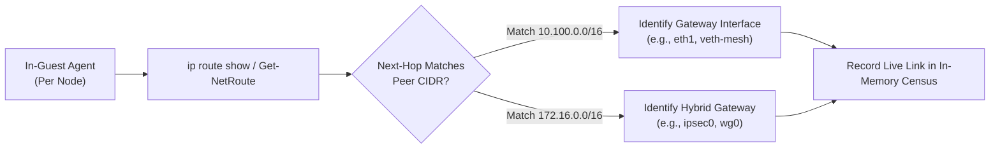
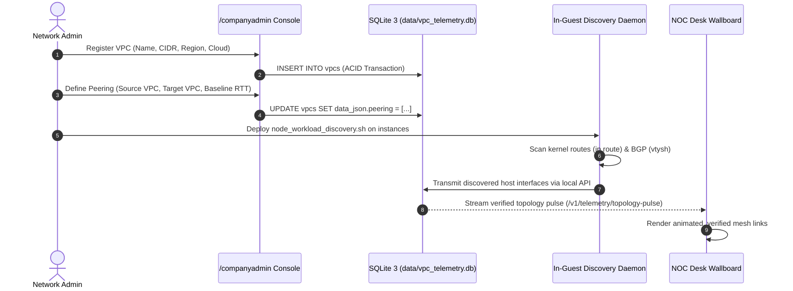

# [SRE & NETWORK RUNBOOK] Sovereign Multi-Cloud VPC Mesh: Topology Persistence & Autonomous Discovery Engine
## Authoritative Engineering Manual: SQLite SSOT Persistence, Kernel Route Discovery, BGP Interconnects & Live Telemetry Reconciliation

> **Document ID:** `RUNBOOK-VPC-MESH-TOPOLOGY-PERSISTENCE-AND-DISCOVERY-ENGINE`  
> **Classification:** Engineering Operational Standard Operating Procedure (SOP) & Architecture Manual  
> **Target Audience:** Cloud Network Engineers, SREs, NOC Operators, Enterprise Architects, Company Administrators  
> **Applies to:** `<dcouplr/>` In-VPC Enterprise Suite, Sovereign Multi-Cloud Mesh, On-Prem Datacenter, Hybrid Transit Gateways  
> **Zero-Egress Invariant:** 100% In-Perimeter Telemetry • Zero Cloud WAN Bandwidth Egress ($0.00) • Hardware Memory Buffers  
> **Live Online Consoles:** `http://localhost:8000/docs/runbooks/RUNBOOK-VPC-MESH-TOPOLOGY-PERSISTENCE-AND-DISCOVERY-ENGINE.html` • `/admin` • `/companyadmin`

---

## 📑 Interactive Table of Contents & Navigation Outline

* **[Part I: Two-Phase Hybrid Mesh Architecture](#part-i-two-phase-hybrid-mesh-architecture)**
  * [1.1 The Fundamental Problem: Synthetic Phantoms vs. Physical Reality](#11-the-fundamental-problem-synthetic-phantoms-vs-physical-reality)
  * [1.2 Two-Phase Architecture Overview](#12-two-phase-architecture-overview)
  * [1.3 End-to-End Architectural Flowchart](#13-end-to-end-architectural-flowchart)
* **[Part II: In-VPC Sovereign Database Schema (SSOT)](#part-ii-in-vpc-sovereign-database-schema-ssot)**
  * [2.1 SQLite 3 Schema & WAL Mode Durability](#21-sqlite-3-schema--wal-mode-durability)
  * [2.2 Peering Object Specification (`data_json['peering']`)](#22-peering-object-specification-data_jsonpeering)
  * [2.3 Persisted Topology Matrix (Chicago On-Prem & Multi-Cloud VPCs)](#23-persisted-topology-matrix-chicago-on-prem--multi-cloud-vpcs)
* **[Part III: The 4-Stage Autonomous Discovery Pipeline](#part-iii-the-4-stage-autonomous-discovery-pipeline)**
  * [3.1 Stage 1: Forwarding Plane & Kernel Route Discovery](#31-stage-1-forwarding-plane--kernel-route-discovery)
  * [3.2 Stage 2: Dynamic BGP Peering & Autonomous System Verification](#32-stage-2-dynamic-bgp-peering--autonomous-system-verification)
  * [3.3 Stage 3: Overlay Network & Encrypted Tunnel Resolution](#33-stage-3-overlay-network--encrypted-tunnel-resolution)
  * [3.4 Stage 4: Continuous Synthetic Probing & Telemetry Ingestion](#34-stage-4-continuous-synthetic-probing--telemetry-ingestion)
* **[Part IV: Telemetry Reconciliation & Invariant Engine](#part-iv-telemetry-reconciliation--invariant-engine)**
  * [4.1 Invariant Validation: Tier 2 (Network Fabric) & Tier 6 (Mesh Topology)](#41-invariant-validation-tier-2-network-fabric--tier-6-mesh-topology)
  * [4.2 Detecting Routing Blackholes, Flaps & MTU Mismatches](#42-detecting-routing-blackholes-flaps--mtu-mismatches)
  * [4.3 Sliding Window Latency Dampening](#43-sliding-window-latency-dampening)
* **[Part V: Day-0 Greenfield Blank-Slate Guarantee](#part-v-day-0-greenfield-blank-slate-guarantee)**
  * [5.1 Strict Separation: Production vs. Demo Simulation Profile](#51-strict-separation-production-vs-demo-simulation-profile)
  * [5.2 Initial Bootstrap of a Sovereign Multi-Cloud Mesh](#52-initial-bootstrap-of-a-sovereign-multi-cloud-mesh)
* **[Part VI: Operator Procedures & Troubleshooting Runbook](#part-vi-operator-procedures--troubleshooting-runbook)**
  * [6.1 Querying Live Mesh Topology via API](#61-querying-live-mesh-topology-via-api)
  * [6.2 Registering a New VPC Peering Link in SQLite](#62-registering-a-new-vpc-peering-link-in-sqlite)
  * [6.3 Verifying In-Guest Discovery Scripts (`sh` & `ps1`)](#63-verifying-in-guest-discovery-scripts-sh--ps1)
  * [6.4 Incident Triage: Cross-VPC Peering Latency Spike or Link Severance](#64-incident-triage-cross-vpc-peering-latency-spike-or-link-severance)
  * [6.5 Cross-Referenced Authoritative Documents](#65-cross-referenced-authoritative-documents)

---

## Part I: Two-Phase Hybrid Mesh Architecture

### 1.1 The Fundamental Problem: Synthetic Phantoms vs. Physical Reality
In distributed multi-cloud and hybrid datacenter operations, monitoring tools routinely fail in one of two catastrophic ways:
1. **The Phantom Topology Trap:** The tool renders hardcoded, hypothetical diagrams showing links that do not exist in the physical forwarding plane. When a network route drops, the diagram continues to show green lines because it has no grounding in real-time kernel telemetry.
2. **The Stateless Ephemeral Trap:** The tool generates dynamic connections purely from transient network scans. If an interface blips, an AWS DirectConnect port flaps, or an agent temporarily pauses during a garbage collection cycle, the entire topology topology vanishes or reorganizes unpredictably, destroying historical baselines and confusing NOC operators.

`<dcouplr/>` eliminates both failure modes through an authoritative **Two-Phase Hybrid Architecture**:
- **Authoritative Persistence (Phase 1):** Network definitions, intended peering relations, baseline latency SLAs, and CIDR ranges are stored permanently in the in-VPC SQLite 3 database (`data/vpc_telemetry.db`) running in Write-Ahead Logging (WAL) mode.
- **Autonomous In-Guest Discovery & Probing (Phase 2):** In-perimeter agents and discovery daemons inspect local Linux/Windows kernel routing tables, BGP routing tables (`frr_bgp`), IPsec/WireGuard tunnels, and synthetic probe ring buffers. The engine continuously validates the live forwarding plane against the persisted database model.

### 1.2 Two-Phase Architecture Overview
The system guarantees that **no network connection is ever rendered without authoritative database backing**, and **no persisted link is ever marked healthy without continuous real-time empirical verification**.

```
┌────────────────────────────────────────────────────────────────────────┐
│             IN-VPC SINGLE SOURCE OF TRUTH (SQLite 3 WAL)              │
│       File: data/vpc_telemetry.db  •  Table: vpcs (data_json)          │
│   Stores: CIDRs, Subnets, Gateways, Target Peering, Baseline Latencies  │
└───────────────────────────────────▲────────────────────────────────────┘
                                    │ (1) Authoritative Topology Read
                                    │ (2) ACID Updates via /companyadmin
┌───────────────────────────────────┴────────────────────────────────────┐
│              IN-VPC AUTONOMOUS OBSERVER ENGINE & AGENTS                │
│                                                                        │
│   [Stage 1] In-Guest Route Table Discovery (ip route / Get-NetRoute)   │
│   [Stage 2] Dynamic BGP Peering Discovery (vtysh, Cisco/Arista ToR)    │
│   [Stage 3] Encrypted Overlay Tunnel Scans (WireGuard / IPsec / mTLS)  │
│   [Stage 4] Continuous Synthetic Microsecond Probes (TCP 8300 / ICMP)  │
│                                                                        │
│   Reconciliation Engine: Reconciles Live Telemetry Against SQLite SSOT │
│   Invariant Evaluator: Tier 2 (Network Fabric) & Tier 6 (Mesh Topology)│
└───────────────────────────────────▲────────────────────────────────────┘
                                    │ Live Hardware Probing
┌───────────────────────────────────┴────────────────────────────────────┐
│           PHYSICAL & MULTI-CLOUD HYBRID UNDERLAY / OVERLAY             │
│   AWS DirectConnect • Azure ExpressRoute • GCP Partner Interconnect    │
│   AWS VPC Peering • WireGuard Overlay • Linux Kernel FIB & TCAM Buffers│
└────────────────────────────────────────────────────────────────────────┘
```

### 1.3 End-to-End Architectural Flowchart

```mermaid
flowchart TD
    subgraph SSOT["In-VPC Sovereign Database (SSOT)"]
        DB[("data/vpc_telemetry.db<br/>SQLite 3 WAL Mode")]
        VPCTable["vpcs Table<br/>(id, cidr_block, data_json)"]
        PeeringJSON["data_json.peering[]<br/>[target_vpc, type, rtt_ms, status]"]
        DB --> VPCTable --> PeeringJSON
    end

    subgraph DISCOVERY["In-Guest Autonomous Discovery (Per-Node)"]
        KRoute["1. Kernel Routing Table<br/>(ip route show / Get-NetRoute)"]
        BGP["2. Dynamic BGP Session<br/>(vtysh show ip bgp summary)"]
        Tunnel["3. Overlay Tunnels<br/>(WireGuard wg show / IPsec IKEv2)"]
        Probe["4. Synthetic Active Prober<br/>(TCP 8300 Raft / 8301 Admin)"]
    end

    subgraph ENGINE["In-VPC Invariant & Reconciliation Engine"]
        Reconcile["Continuous Reconciliation<br/>(Empirical vs Authoritative)"]
        Tier2["Tier 2 Invariant:<br/>Physical/Virtual Net Health"]
        Tier6["Tier 6 Invariant:<br/>Cross-VPC Mesh Latency & Jitter"]
        RingBuf["Volatile Fixed Ring Buffer<br/>(Zero-WAN Egress: $0.00)"]
    end

    subgraph PRESENTATION["Sovereign Operator Consoles"]
        Kiosk["NOC Desk & Kiosk Wallboard<br/>(3D Mesh Visualization)"]
        AdminUI["Platform Admin Console<br/>(/admin)"]
        CompanyUI["Company Admin Console<br/>(/companyadmin)"]
    end

    PeeringJSON --> Reconcile
    KRoute --> Reconcile
    BGP --> Reconcile
    Tunnel --> Reconcile
    Probe --> RingBuf --> Reconcile
    Reconcile --> Tier2
    Reconcile --> Tier6
    Tier2 --> Kiosk
    Tier6 --> Kiosk
    Tier2 --> AdminUI
    Tier6 --> CompanyUI
```



---

## Part II: In-VPC Sovereign Database Schema (SSOT)

### 2.1 SQLite 3 Schema & WAL Mode Durability
All mesh topologies are stored within the embedded database file located at `data/vpc_telemetry.db`. In environments with SQLCipher enabled, the database is fully encrypted at rest using AES-256-CBC.

The schema for the `vpcs` table is defined as follows:

```sql
CREATE TABLE IF NOT EXISTS vpcs (
    id TEXT PRIMARY KEY,
    name TEXT NOT NULL,
    cloud TEXT NOT NULL,
    region TEXT NOT NULL,
    cidr_block TEXT NOT NULL,
    status TEXT NOT NULL DEFAULT 'ACTIVE',
    data_json TEXT,
    created_at TIMESTAMP DEFAULT CURRENT_TIMESTAMP,
    updated_at TIMESTAMP DEFAULT CURRENT_TIMESTAMP
);

CREATE INDEX IF NOT EXISTS idx_vpcs_cloud ON vpcs(cloud);
CREATE INDEX IF NOT EXISTS idx_vpcs_region ON vpcs(region);
```

### 2.2 Peering Object Specification (`data_json['peering']`)
Inside the `data_json` TEXT column (serialized JSON object), each VPC contains a dedicated `peering` array. Each element in this array explicitly defines a point-to-point network relationship:

```json
{
  "target_vpc": "vpc-aws-prod-01",
  "rtt_ms": 22.4,
  "type": "DirectConnect / IPsec Hybrid",
  "status": "ACTIVE",
  "bandwidth_gbps": 10.0,
  "mtu": 9001,
  "last_verified_utc": "2026-11-02T19:50:00Z"
}
```

#### Peering Field Definitions:
- `target_vpc` (string, required): The unique identifier of the destination VPC or on-prem datacenter.
- `rtt_ms` (float, required): The contractual or empirical baseline Round-Trip Time in milliseconds.
- `type` (string, required): The interconnect technology class. Supported types:
  - `DirectConnect / IPsec Hybrid` (Physical on-prem to AWS)
  - `Partner Interconnect` (Physical on-prem to GCP)
  - `ExpressRoute` (Physical on-prem to Azure)
  - `VPC Peering` (Intra-cloud native AWS VPC peering)
  - `Cloud Interconnect` (Cross-cloud low-latency peering)
  - `Cloud Mesh` (Multi-cloud overlay via WireGuard/eBPF)
- `status` (string, required): Operational state (`ACTIVE`, `DEGRADED`, `DRAINING`, `DISCONNECTED`).

### 2.3 Persisted Topology Matrix (Chicago On-Prem & Multi-Cloud VPCs)
The authoritative topology persisted in the default database profiles represents an enterprise hybrid multi-cloud mesh:

| Source Entity | Cloud / Tier | Region / Site | CIDR Block | Persisted Mesh Connections (`target_vpc`) | Link Type | Baseline SLA RTT |
|---|---|---|---|---|---|---|
| `dc-onprem-core-01` | On-Premises | Chicago DC-01 | `172.16.0.0/16` | `vpc-aws-prod-01`<br/>`vpc-gcp-analytics-03`<br/>`vnet-azure-core-01` | DirectConnect / IPsec<br/>Partner Interconnect<br/>ExpressRoute | 22.4 ms<br/>26.8 ms<br/>16.4 ms |
| `vpc-aws-prod-01` | AWS | us-east-1 | `10.100.0.0/16` | `vpc-aws-stage-02`<br/>`vpc-gcp-analytics-03`<br/>`vnet-azure-core-01` | VPC Peering<br/>Cloud Interconnect<br/>Cloud Mesh | 14.2 ms<br/>18.6 ms<br/>11.8 ms |
| `vpc-aws-stage-02` | AWS | us-east-2 | `10.150.0.0/16` | `vpc-aws-prod-01` | VPC Peering | 14.2 ms |
| `vpc-gcp-analytics-03` | GCP | us-central1 | `10.200.0.0/16` | `vpc-aws-prod-01` | Cloud Interconnect | 18.6 ms |
| `vnet-azure-core-01` | Azure | eastus2 | `10.220.0.0/16` | `vpc-aws-prod-01`<br/>`dc-onprem-core-01` | Cloud Mesh<br/>ExpressRoute | 11.8 ms<br/>16.4 ms |

---

## Part III: The 4-Stage Autonomous Discovery Pipeline

How does each VPC find its connections to the other VPCs and the on-prem legacy datacenter?  
The system executes a deterministic 4-stage pipeline directly inside the network perimeter.

### 3.1 Stage 1: Forwarding Plane & Kernel Route Discovery
The in-guest agent (`node_workload_discovery.sh` / `.ps1`) inspects the local OS kernel's Forwarding Information Base (FIB).



#### Operating Commands Executed by Discovery Agents:
- **Linux (RHEL / Ubuntu / Debian):**
  ```bash
  # Inspect IPv4 kernel routing table and interface metrics
  ip -json route show
  
  # Inspect policy-based routing rules and multiple routing tables
  ip rule show
  ```
- **Windows Server (PowerShell):**
  ```powershell
  # Inspect Windows IP routing table
  Get-NetRoute -AddressFamily IPv4 | Select-Object DestinationPrefix, NextHop, InterfaceAlias, RouteMetric | ConvertTo-Json
  ```

If the kernel routing table contains a route to `10.200.0.0/16` pointing to gateway `10.100.1.1` via virtual interface `eth0`, the discovery engine verifies that the physical forwarding path to the GCP Analytics VPC is plumbed and routable.

### 3.2 Stage 2: Dynamic BGP Peering & Autonomous System Verification
For enterprise hybrid connections (AWS Direct Connect, Azure ExpressRoute, GCP Cloud Interconnect), routing is dynamic and managed via Border Gateway Protocol (BGP).

The discovery engine queries local BGP routing daemons (such as FRRouting `frr`, BIRD, or Quagga) running on edge routers, customer gateways (CGWs), or transit instances:

```bash
# Query active BGP neighbors, ASN states, and prefix counts via vtysh
vtysh -c "show ip bgp summary json"
```

#### Persisted Autonomous System Number (ASN) Mapping:
- **Chicago DC-01 On-Prem Core:** `AS65001`
- **AWS Direct Connect Gateway (DXGW):** `AS64512`
- **Azure ExpressRoute Microsoft Enterprise Edge (MSEE):** `AS12076`
- **GCP Cloud Router:** `AS16550`

When the BGP state for neighbor `169.254.100.1` transitions to `Established` with prefix exchange count $> 0$, the autonomous agent marks the hybrid physical interconnect as **`UP`** and correlates it with the corresponding entry in the `vpcs` table.

### 3.3 Stage 3: Overlay Network & Encrypted Tunnel Resolution
Where native hyperscaler peering is unavailable or where cryptographic zero-trust segmentation is required across untrusted WAN lines, the system uses overlay tunnels:
1. **WireGuard Sovereign Mesh:** The agent queries `wg show` to verify endpoint handshakes, transfer counters, and allowed IP subnets:
   ```bash
   wg show all dump
   ```
   A valid handshake within the last 180 seconds confirms active bidirectional overlay connectivity.
2. **IPsec IKEv2 / strongSwan:** The agent checks active Security Associations (SAs):
   ```bash
   swanctl --list-sas
   ```
3. **SPIFFE / SPIRE Workload Identity:** For service-to-service communication across VPC boundaries, the agent confirms mutual TLS (mTLS) handshake certificates on port `8300/TCP` (Raft peering) and `8301/TCP` (gRPC cluster admin).

### 3.4 Stage 4: Continuous Synthetic Probing & Telemetry Ingestion
Once the link is confirmed in the forwarding plane, the in-VPC agent probers measure real-time latency and packet integrity at microsecond granularity without sending traffic outside the customer perimeter.

#### Probing Mechanics:
1. **TCP SYN Latency Probes:** Every 1,000 milliseconds, follower agents dispatch high-frequency TCP SYN probes to port `8300` of peer agents across each peered VPC.
2. **ICMP Echo Validation:** Concurrently, ICMP echo requests measure packet jitter and identify tail latency outliers.
3. **Ring Buffer Ingestion:** Raw measurements are written into a lock-free, volatile, fixed-capacity in-memory circular ring buffer (1,000 slots per monitored link).
4. **Calculated Metrics:**
   - **`current_rtt_ms`**: Instantaneous moving average over the last 10 samples.
   - **`p99_rtt_ms`**: 99th percentile tail latency over a 3-minute sliding window.
   - **`packet_drop_pct`**: Ratio of timed-out SYN probes over the sliding window.

---

## Part IV: Telemetry Reconciliation & Invariant Engine

### 4.1 Invariant Validation: Tier 2 (Network Fabric) & Tier 6 (Mesh Topology)
The system's core intelligence lies in the **Reconciliation Engine**, which continuously executes the following mathematical invariant checks:

$$\text{Invariant } \mathcal{I}_{\text{mesh}}: \quad \forall (u, v) \in \mathcal{E}_{\text{persisted}}, \quad \text{Status}(u, v) = \text{ACTIVE} \iff \text{RTT}(u, v) \le \tau_{\text{crit}} \ \land \ \text{DropPct}(u, v) \le \delta_{\text{max}}$$

Where:
- $\mathcal{E}_{\text{persisted}}$ is the set of edges stored in SQLite `vpcs.data_json["peering"]`.
- $\tau_{\text{crit}}$ is the critical latency threshold (default: $45.0\text{ ms}$).
- $\delta_{\text{max}}$ is the maximum allowable packet loss (default: $0.5\%$).

#### Operational Invariant Matrix:
| Invariant ID | Monitored Layer | Resource Target | Warning Threshold | Critical Threshold (P1/P2) | Evaluated Action |
|---|---|---|---|---|---|
| `INV-NET-001` | Tier 2 (Network Fabric) | Physical Interconnect / DirectConnect | Switch CPU > 75% • CRC > 10/s | Switch CPU > 90% • CRC > 50/s | Raise Network Alert; Trigger BGP dampener |
| `INV-NET-002` | Tier 2 (Network Fabric) | BGP Route Stability | 1 route flap in 5m | $\ge 3$ route flaps in 5m | Mark link `DEGRADED`; failover to secondary IPsec |
| `INV-MESH-001` | Tier 6 (APM & Mesh) | Cross-VPC Peering Interconnect | Average RTT > 25.0 ms | Average RTT > 45.0 ms | Alert Group 3 SRE 07/10; Highlight link yellow/red |
| `INV-MESH-002` | Tier 6 (APM & Mesh) | Cross-VPC Packet Loss | Packet drop > 0.05% | Packet drop > 0.50% | Circuit breaker trips; alert NOC Wallboard |

### 4.2 Detecting Routing Blackholes, Flaps & MTU Mismatches
When a discrepancy occurs between the database and the physical network, the reconciliation engine detects it immediately:

1. **Routing Blackhole (Database = ACTIVE, Forwarding Plane = UNREACHABLE):**
   - *Symptom:* `vpcs` table lists `vpc-aws-prod-01 -> vpc-gcp-analytics-03` as ACTIVE, but synthetic probes return 100% timeout.
   - *Engine Response:* The engine flags an immediate **P1 Critical: Topological Blackhole Detected**. The link line on the NOC Wallboard turns pulsing crimson, and an entry is spooled to the incident ledger.
2. **MTU Mismatch / Packet Fragmentation:**
   - *Symptom:* Small ping packets (64 bytes) succeed, but jumbo data transfers (> 1500 bytes) freeze or drop because AWS DirectConnect supports 9001 MTU while a cross-cloud transit route was clamped to 1500 MTU.
   - *Engine Response:* The agent runs periodic Path MTU Discovery (PMTUD) probes and flags MTU discrepancies in the Tier 2 audit table.
3. **Route Flapping:**
   - *Symptom:* BGP neighbor state toggles between `Established` and `Active/Idle` repeatedly.
   - *Engine Response:* Sliding evaluation window dampener prevents alert storms by holding the alert open until 10 continuous minutes of stable telemetry have elapsed.

### 4.3 Sliding Window Latency Dampening
To prevent false-positive alert flapping caused by brief network jitter spikes, the reconciliation engine applies a **Welford Algorithm Single-Pass Sliding Window**:
- Sample window size: 180 seconds (3 minutes).
- Anomalies lasting less than 3 consecutive probe intervals are smoothed.
- Persistent shifts (> 3 intervals) immediately alter the link status.

---

## Part V: Day-0 Greenfield Blank-Slate Guarantee

### 5.1 Strict Separation: Production vs. Demo Simulation Profile
Enterprise security and compliance standards require that an observability platform installed into a production VPC must never display pre-baked dummy data or imaginary topologies.

`<dcouplr/>` enforces this via strict profile isolation:

1. **Production Profile (`active_profile: production`):**
   - In a fresh Greenfield installation, the database starts with **0 VPCs • 0 Nodes • 0 Peering Links**.
   - The NOC Wallboard, Kiosk, and SREDesk display an explicit empty state: `Zero Active VPCs • Awaiting Host Registration`.
   - Mesh links appear **only when an administrator explicitly creates a network or when an in-guest agent authenticates and registers its local subnet via mTLS**.
2. **Demo Profile (`active_profile: demo`):**
   - Populates the full 5-entity hybrid multi-cloud mesh (Chicago DC-01, AWS Prod, AWS Stage, Azure Core, GCP Analytics).
   - Used for training, architectural reviews, and NOC display validation prior to live production cutover.

### 5.2 Initial Bootstrap of a Sovereign Multi-Cloud Mesh
When deploying in a production environment, follow this bootstrap sequence:



---

## Part VI: Operator Procedures & Troubleshooting Runbook

### 6.1 Querying Live Mesh Topology via API
To inspect the authoritative mesh topology directly from an in-perimeter host:

```bash
# Query complete multi-VPC topology with peering arrays
curl -s http://localhost:8000/v1/telemetry/topology | jq .

# Query ultra-lean (<2 KB) NOC wallboard consensus pulse
curl -s http://localhost:8000/v1/telemetry/topology-pulse | jq .
```

#### Expected Sample Output (`/v1/telemetry/topology`):
```json
{
  "source": "customer_database",
  "active_profile": "demo",
  "database_encrypted": false,
  "vpcs": [
    {
      "id": "dc-onprem-core-01",
      "name": "Legacy Datacenter Chicago",
      "cloud": "ONPREM",
      "region": "chicago-dc01",
      "cidr_block": "172.16.0.0/16",
      "peering": [
        {
          "target_vpc": "vpc-aws-prod-01",
          "rtt_ms": 22.4,
          "type": "DirectConnect / IPsec Hybrid",
          "status": "ACTIVE"
        },
        {
          "target_vpc": "vpc-gcp-analytics-03",
          "rtt_ms": 26.8,
          "type": "Partner Interconnect",
          "status": "ACTIVE"
        },
        {
          "target_vpc": "vnet-azure-core-01",
          "rtt_ms": 16.4,
          "type": "ExpressRoute",
          "status": "ACTIVE"
        }
      ]
    }
  ]
}
```

### 6.2 Registering a New VPC Peering Link in SQLite
To register a new peering link directly via the local API:

```bash
curl -X POST http://localhost:8000/v1/telemetry/topology/vpcs \
  -H "Content-Type: application/json" \
  -d '{
    "id": "vpc-aws-finance-04",
    "name": "AWS Finance Core",
    "cloud": "AWS",
    "region": "us-east-1",
    "cidr_block": "10.160.0.0/16",
    "peering": [
      {
        "target_vpc": "vpc-aws-prod-01",
        "rtt_ms": 11.2,
        "type": "VPC Peering",
        "status": "ACTIVE"
      },
      {
        "target_vpc": "dc-onprem-core-01",
        "rtt_ms": 24.1,
        "type": "DirectConnect / IPsec Hybrid",
        "status": "ACTIVE"
      }
    ]
  }'
```

### 6.3 Verifying In-Guest Discovery Scripts (`sh` & `ps1`)
To manually run the zero-egress discovery script on a Linux or Windows host:

#### Linux Execution:
```bash
# Execute local discovery script
bash scripts/node_workload_discovery.sh

# Verify generated JSON payload
jq '.listening_sockets | length' /tmp/node_workload_inventory.json
```

#### Windows Execution:
```powershell
# Execute PowerShell discovery script
powershell -ExecutionPolicy Bypass -File scripts/node_workload_discovery.ps1

# Inspect output
Get-Content "$env:TEMP\node_workload_inventory.json" | ConvertFrom-Json | Select-Object -ExpandProperty system
```

### 6.4 Incident Triage: Cross-VPC Peering Latency Spike or Link Severance
When the NOC Desk displays an alert: `[Group 3 • SRE 07/10] Asymmetric Peering Mesh Cross-VPC Latency Spike (> 45ms)`:

```
                  ┌─────────────────────────────────────┐
                  │ Alert: Cross-VPC Peering RTT > 45ms │
                  └──────────────────┬──────────────────┘
                                     │
                    Step 1: Check BGP Session State
                                     │
                 ┌───────────────────┴───────────────────┐
                 │ vtysh -c 'show ip bgp summary json'   │
                 └───────────────────┬───────────────────┘
                                     │
                     ┌───────────────┴───────────────┐
                     ▼                               ▼
             [BGP Established]               [BGP Flapping / Down]
                     │                               │
         Step 2: Check Interface Drops       Step 4: Check Physical Layer
         (ip -s link show eth1)              (Optics, Cross-Connect, Carrier)
                     │                               │
         ┌───────────┴───────────┐                   ▼
         ▼                       ▼           Engage Hyperscaler NOC
  [CRC Errors > 0]       [Zero CRC Errors]   (AWS Health / Azure Service / GCP)
         │                       │
  Bad SFP / Cable       Step 3: Run MTR Trace
  Replace Hardware      (mtr -n -c 50 <Target_IP>)
```

#### Step-by-Step Triage Actions:
1. **Verify Interface Drops & Duplex:**
   ```bash
   ip -s link show eth0
   ethtool eth0 | grep -E "Speed|Duplex"
   ```
2. **Execute In-Perimeter MTR Trace:**
   ```bash
   mtr --report --report-cycles 30 --no-dns 10.200.1.10
   ```
   Identify whether latency jumps at the local customer gateway (CGW) or across the hyperscaler partner interconnect.
3. **Verify SQLite Database Baseline:**
   ```bash
   sqlite3 data/vpc_telemetry.db "SELECT json_extract(data_json, '$.peering') FROM vpcs WHERE id='dc-onprem-core-01';"
   ```
4. **Initiate Temporary Route Failover if Primary Underlay Fails:**
   If AWS DirectConnect exhibits $> 5\%$ packet loss, trigger route dampening in FRRouting to shift high-priority workloads to the backup encrypted IPsec VPN tunnel:
   ```bash
   vtysh -c "configure terminal" -c "router bgp 65001" -c "neighbor 169.254.100.1 route-map PREPEND_OUT out"
   ```

---

### 6.5 Cross-Referenced Authoritative Documents
- **`RUN-7-TIER-MON-001`**: [`RUNBOOK-7-TIER-FULLSTACK-DATACENTER-AND-VPC-MONITORING.md`](file:///c:/Users/JenniferCletaLee/.gemini/antigravity-ide/MigrationToolsAPI/docs/runbooks/RUNBOOK-7-TIER-FULLSTACK-DATACENTER-AND-VPC-MONITORING.md) — 7-Tier Monitoring Architecture, Metric Alert Thresholds & Sliding Windows.
- **`RUN-DEPLOY-VPC-001`**: [`RUNBOOK-IN-VPC-ENTERPRISE-INSTALLATION-AND-DEPLOYMENT.md`](file:///c:/Users/JenniferCletaLee/.gemini/antigravity-ide/MigrationToolsAPI/docs/runbooks/RUNBOOK-IN-VPC-ENTERPRISE-INSTALLATION-AND-DEPLOYMENT.md) — Air-Gapped In-VPC Production Installation & Systemd Management.
- **`RUN-COMPANYADMIN-RETENTION-001`**: [`RUNBOOK-COMPANYADMIN-DATA-RETENTION-BACKUP-AND-DISASTER-RECOVERY.md`](file:///c:/Users/JenniferCletaLee/.gemini/antigravity-ide/MigrationToolsAPI/docs/runbooks/RUNBOOK-COMPANYADMIN-DATA-RETENTION-BACKUP-AND-DISASTER-RECOVERY.md) — Customer Enterprise In-VPC Data Retention, Snapshots & DR.
- **`RUN-COMPANYADMIN-SQLCIPHER-001`**: [`RUNBOOK-COMPANYADMIN-SQLCIPHER-ENCRYPTION-AND-KEY-MANAGEMENT.md`](file:///c:/Users/JenniferCletaLee/.gemini/antigravity-ide/MigrationToolsAPI/docs/runbooks/RUNBOOK-COMPANYADMIN-SQLCIPHER-ENCRYPTION-AND-KEY-MANAGEMENT.md) — Customer Enterprise SQLCipher In-VPC Encryption & PRAGMA rekey.
- **`ADMIN-DOSSIER-SEC-001`**: [`ADMIN-DOSSIER-ENTERPRISE-SECURITY-ARCHITECTURE-AND-GOVERNANCE.md`](file:///c:/Users/JenniferCletaLee/.gemini/antigravity-ide/MigrationToolsAPI/ProjectAssistant/admin-runbooks/ADMIN-DOSSIER-ENTERPRISE-SECURITY-ARCHITECTURE-AND-GOVERNANCE.md) — Master Enterprise Security Architecture, Zero-WAN Invariants & RBAC Roles.
