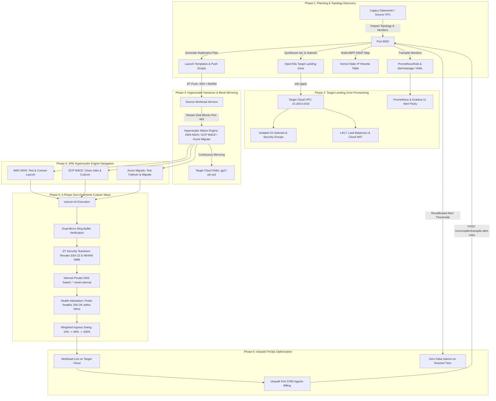

# Operations Runbook: End-to-End Lift & Shift Migration & Hyperscaler Handover

**Document Identifier:** `RUNBOOK-DCOUPLR-LIFT-AND-SHIFT-001`  
**Classification:** Enterprise Standard Operating Procedure (SOP)  
**Target Audience:** Cloud Engineers, Migration Architects, SREs, Platform Engineers, and DevSecOps Operators  
**Governing Architecture Standard:** `VA-SPEC-FINOPS-BRIDGE-001` / `D-41`  
**Supported Destination Hyperscalers:** Amazon Web Services (AWS MGN), Google Cloud (GCP M4CE), Microsoft Azure (Azure Migrate)  
**Security Boundary:** 100% In-VPC Isolated Execution ($0.00 Public WAN Egress)  

---

## 1. Executive Summary & Tool Architecture Division

Enterprise migrations fail when teams blur the boundary between the **Control Plane Brain**, the **Data Plane Replication Muscle**, and the **FinOps Spend Auditor**. To achieve a deterministic, zero-downtime migration with zero public internet data egress, the workload is partitioned across three specialized engines:

```
┌────────────────────────────────────────────────────────────────────────────────────────┐
│                        INFRASTRUCTURE MIGRATION DIVISION OF LABOR                      │
├───────────────────────────────┬────────────────────────────────────────────────────────┤
│ 1. <dcouplr/>                 │ • In-VPC Control Plane & Architectural Compiler Brain   │
│    (Port 8000)                │ • Non-overlapping RFC 1918 /24 Subnet Partitioning     │
│    Built by: <dcouplr/> Team  │ • Kernel-level eBPF & iptables DNAT (Static IP rewrites)│
│                               │ • OpenTofu HCL Target Landing Zone IaC Generation      │
│                               │ • AST Alert Transpilation (Datadog/NRQL -> PromQL YAML)│
│                               │ • Turnkey Hyperscaler Replication Staging & Cutover    │
├───────────────────────────────┼────────────────────────────────────────────────────────┤
│ 2. Hyperscaler Native Engines │ • Data Plane Replication Muscle (Continuous Mirroring) │
│    (AWS MGN, GCP M4CE,        │ • TLS-encrypted Block-level disk delta streaming       │
│     Azure Migrate)            │ • In-guest kernel driver & VSS snapshot synchronization│
│                               │ • Target EBS / Persistent Disk / Managed Disk creation │
├───────────────────────────────┼────────────────────────────────────────────────────────┤
│ 3. cloaudit (Cloud Audit)     │ • In-VPC FinOps Spend Auditor & Downscaling Verifier   │
│    (Port 3780)                │ • Ingests Cloud Invoicing (AWS CUR, GCP BigQuery, EA)   │
│    Built by: Same Team!       │ • Audits cost leaks without exporting financial data   │
│                               │ • Identifies zombie compute & over-provisioned nodes   │
│                               │ • Calls <dcouplr/> to recalibrate alert thresholds     │
│                               │ • Disputes erroneous cloud egress fees via SHA-256 proof│
└───────────────────────────────┴────────────────────────────────────────────────────────┘
```

> [!NOTE]
> **Architectural Note on `cloaudit` (Cloud Audit):**
> `cloaudit` is an independent, specialized FinOps and cloud spend audit tool **built by the same core engineering team that created `<dcouplr/>`**. 
> - While `<dcouplr/>` (Port 8000) focuses on AST transpilation, observability parity, multi-VPC topology synthesis, and lift-and-shift IaC packaging, `cloaudit` (Port 3780) runs alongside it inside the VPC to audit cloud provider billing, eliminate cost leaks, and recommend post-migration downscaling.
> - They communicate locally via internal REST APIs (e.g., `POST /v1/compiler/transpile-alert-rules`), preserving the strict zero-egress invariant while maintaining a clean separation of concerns between **Migration/Observability** and **FinOps/Spend Auditing**.

---

### Visual Architecture & Integration Handover Flow



---

## 2. Pre-Requisites & IAM Permissions Matrix

Before initiating migration, ensure operator credentials have appropriate role bindings:

### 2.1 Cloud Provider IAM Permissions

| Provider | Service Role / Policy | Required Capabilities |
| :--- | :--- | :--- |
| **AWS** | `AWSApplicationMigrationFullAccess`<br>`AWSApplicationMigrationAgentInstallationPolicy` | Initialize AWS MGN, create launch templates, register source replication servers, and launch cutover EC2 instances. |
| **GCP** | `roles/vmmigration.admin`<br>`roles/compute.networkAdmin` | Create M4CE migration groups, configure target projects/subnets, and execute migration cutover jobs. |
| **Azure** | `Azure Migrate Contributor`<br>`Virtual Machine Contributor` | Register Azure Migrate project, configure target Virtual Network, and manage Azure Site Recovery (ASR) replication. |

### 2.2 In-Guest Network Ports for Agent Push & JIT Provisioning

All management ports are ephemeral and **strictly restricted to the internal VPC migration runner** (`10.200.0.0/16`); public `0.0.0.0/0` ingress is blocked by architectural policy:

- **Linux Hosts:** TCP `22` (SSH) — authorized via temporary migration keypair.
- **Windows Hosts:** TCP `5986` (WinRM HTTPS) or TCP `5985` (WinRM HTTP).
- **Outbound Block Stream:** TCP `443` (TLS) from source hosts to the cloud provider's regional replication endpoint.

---

## 3. End-to-End Migration Flow: Planning to Hyperscaler Handover

```
Planning (Discovery & Synthesis)  ──>  Implementation (Landing Zone IaC)  ──>  Handover (Native Engine Push)
             <dcouplr/>                               <dcouplr/> + OpenTofu               Hyperscaler Native Engine
```

### 3.1 Phase 1: Planning, Topology Discovery & Pre-Migration Modeling

1. **Topology & Dependency Graph Discovery:**
   The `<dcouplr/>` engine inspects the source infrastructure (physical hosts, VMware clusters, legacy AWS/GCP VPCs), resolving server CPU/RAM profiles, active disk partitions, network interfaces, and inter-service dependencies.

2. **Collision-Free Subnet Planning:**
   `<dcouplr/>` partitions the target CIDR supernet (e.g. `10.200.0.0/16`) into isolated, non-overlapping `/24` subnets (e.g., `10.200.10.0/24` for App tier, `10.200.20.0/24` for Database tier). This eliminates the #1 cause of cloud migration outages: RFC 1918 CIDR collision.

3. **AST Alert & Monitoring Transpilation:**
   Source observability monitors (Datadog monitors, New Relic NRQL, AWS CloudWatch alarms) are transpiled by `<dcouplr/>` into vendor-neutral `PrometheusRule` YAML with mathematically verified threshold parity ($\Phi(q) \equiv \Psi(\text{PromQL})$).

4. **Kernel-Level eBPF Static IP Rewriting:**
   For legacy enterprise applications with hardcoded IP addresses (e.g. `172.16.1.15:5432`), `<dcouplr/>` generates an in-kernel eBPF DNAT rewrite map that translates legacy IPs to internal DNS aliases (`database-sub.mesh.internal`) at the Linux socket layer with zero application code changes.

5. **Generate Turnkey Migration Bundle:**
   ```bash
   # Execute in-VPC compilation on port 8000
   curl -X POST http://127.0.0.1:8000/v1/telemetry/topology/lift-and-shift \
     -H "Content-Type: application/json" \
     -d '{
       "source_vpc_id": "dc-onprem-core-01",
       "target_cloud": "AWS",
       "target_region": "us-east-1",
       "target_cidr": "10.200.0.0/16"
     }' -o lift_and_shift_bundle.json
   ```

---

### 3.2 Phase 2: Implementation & Target Landing Zone Deployment via OpenTofu

Before a single byte of data is replicated, `<dcouplr/>` provisions the target cloud foundation using OpenTofu IaC:

1. **Extract OpenTofu HCL:**
   ```bash
   jq -r '.opentofu_hcl' lift_and_shift_bundle.json > target_landing_zone.tf
   ```

2. **Deploy Target Infrastructure:**
   ```bash
   tofu init
   tofu plan -out=migration.tfplan
   tofu apply -auto-approve migration.tfplan
   ```

   **What OpenTofu Provisions in < 90 Seconds:**
   - Target VPC Network (`10.200.0.0/16`) with private API access enabled.
   - Non-overlapping `/24` subnets matching each source tier.
   - Internal VPC firewall rules and security groups.
   - Cloud NAT Gateway for zero-egress outbound package patching.
   - Declarative L4/L7 Load Balancers (ALB on AWS, Global External/Internal LBs on GCP).
   - JIT migration management security group (`enable_migration_mgmt_ports = true`).

---

### 3.3 Phase 3: Replication Staging & JIT Agent Handover

At this juncture, `<dcouplr/>` hands over data replication to the cloud provider's native block replication engine.

1. **Extract and Run Replication Staging Script:**
   ```bash
   jq -r '.replication_plan.provider_cli_script' lift_and_shift_bundle.json > stage_replication.sh
   chmod +x stage_replication.sh
   ./stage_replication.sh
   ```
   *This initializes the hyperscaler migration service and configures replication settings to use the `<dcouplr/>` target VPC and subnets.*

2. **Dispatch JIT In-Guest Replication Agents:**
   - **For Linux Workloads (SSH 22):**
     ```bash
     jq -r '.replication_plan.agent_push_script_bash' lift_and_shift_bundle.json > push_linux.sh
     export DCOUPLR_JIT_SESSION_TOKEN="<ephemeral-token>"
     bash push_linux.sh
     ```
   - **For Windows Workloads (WinRM 5986):**
     ```powershell
     $plan = Get-Content lift_and_shift_bundle.json | ConvertFrom-Json
     $plan.replication_plan.agent_push_script_powershell | Out-File -Encoding utf8 push_windows.ps1
     $env:DCOUPLR_JIT_SESSION_TOKEN="<ephemeral-token>"
     .\push_windows.ps1
     ```

---

## 4. Navigating & Operating Hyperscaler Native Engines

Once the replication agents are pushed, SREs must operate the cloud provider's native engine to achieve continuous replication and validate test instances before live cutover.

### 4.1 Operating AWS Application Migration Service (AWS MGN)

AWS MGN provides continuous block-level disk replication into a lightweight staging area EC2 subnet provisioned by `<dcouplr/>`.

```
Source Server (Linux/Win)                    AWS MGN Staging Subnet                    AWS Target Production Subnet
┌───────────────────────┐                    ┌─────────────────────────┐               ┌───────────────────────────┐
│ AWS Replication Agent │ ──TLS Port 443──>  │ Replication Server (t3) │ ──EBS Sync──> │ Cutover EC2 Instance      │
│ In-kernel disk driver │                    │ Staging EBS Disks (gp3) │               │ Attached to <dcouplr/> /24│
└───────────────────────┘                    └─────────────────────────┘               └───────────────────────────┘
```

#### Step-by-Step Operator Guide:

1. **Configure Replication Settings Template:**
   Ensure the replication settings use the `<dcouplr/>`-provisioned staging subnet and KMS encryption:
   ```bash
   aws mgn update-replication-configuration-template \
     --replication-configuration-template-id "$TEMPLATE_ID" \
     --staging-area-subnet-id "subnet-prod-priv-1a" \
     --replication-server-instance-type "t3.small" \
     --ebs-encryption "CUSTOM" \
     --kms-key-id "$KMS_KEY_ARN" \
     --use-dedicated-replication-server false
   ```

2. **Monitor Continuous Data Replication (CDR):**
   Track replication lifecycle progression:
   ```bash
   aws mgn describe-source-servers \
     --query "items[*].{ID:sourceServerID,Hostname:identificationHints.hostname,Status:dataReplicationInfo.dataReplicationState,Lag:dataReplicationInfo.lagDuration}" \
     --output table
   ```
   **Expected Lifecycle Progression:**
   `NOT_READY` &rarr; `INITIAL_SYNC` &rarr; `REPLICATING` &rarr; `CONTINUOUS`.
   *Requirement:* Ensure `dataReplicationState` is `CONTINUOUS` and `lagDuration` is **< 5 seconds**.

3. **Launch Non-Disruptive Test Instances:**
   AWS MGN allows launching test instances in the `<dcouplr/>` test subnet without halting source replication:
   ```bash
   # Launch test instance
   aws mgn launch-test-instances --source-server-ids "$SERVER_ID"
   ```
   - Connect to the test EC2 instance via AWS Systems Manager (SSM) Session Manager.
   - Verify filesystem integrity, application services, and eBPF DNAT socket rewrites.
   - Test internal `/healthz` endpoints.
   - Terminate test instances once validated:
     ```bash
     aws mgn finalize-test --source-server-ids "$SERVER_ID"
     ```

4. **Launch Live Cutover Instances:**
   During the cutover window (coordinated with `cutover.sh`):
   ```bash
   # Launch cutover EC2 instance in production subnet
   aws mgn launch-cutover-instances --source-server-ids "$SERVER_ID"
   ```

5. **Finalize Cutover & Cleanup:**
   After the DNS switch and health attestation pass:
   ```bash
   # Finalize cutover (stops replication and deletes staging replication servers)
   aws mgn finalize-cutover --source-server-ids "$SERVER_ID"
   
   # Mark source server as archived
   aws mgn mark-as-archived --source-server-ids "$SERVER_ID"
   ```

---

### 4.2 Operating Google Cloud Migrate to Virtual Machines (GCP M4CE)

Google Cloud Migrate to Virtual Machines (formerly M4CE v5.0) replicates VMware vCenter, AWS, or physical servers directly into Google Compute Engine (GCE) Persistent Disks.

```
Source Infrastructure                      GCP Cloud Migration Connector               GCP Target Production VPC
┌───────────────────────┐                  ┌───────────────────────────┐               ┌───────────────────────────┐
│ VMware vCenter / AWS  │ ──TLS Port 443─> │ Migration Connector (OVA) │ ──PD Cache──> │ Target GCE Instance (n2)  │
│ Snapshot Replicator   │                  │ Cloud Storage Buffer      │               │ In <dcouplr/> VPC Network │
└───────────────────────┘                  └───────────────────────────┘               └───────────────────────────┘
```

#### Step-by-Step Operator Guide:

1. **Verify Source Registration & Migration Group:**
   Verify that all target sources are mapped in the `<dcouplr/>` migration group:
   ```bash
   gcloud vms migration-groups describe "wave-01-chicago" --location=us-central1
   ```

2. **Configure Target GCE Properties:**
   Ensure each migrating source points to the `<dcouplr/>` provisioned network and subnetwork:
   ```bash
   gcloud vms target-projects add-resource-target "projects/my-gcp-project" \
     --network="projects/my-gcp-project/global/networks/production-vpc" \
     --subnetwork="projects/my-gcp-project/regions/us-central1/subnetworks/gke-dataproc-nodes" \
     --target-disk-type="pd-balanced" \
     --service-account="migration-runner@my-gcp-project.iam.gserviceaccount.com"
   ```

3. **Monitor Replication Cycles:**
   GCP M4CE continuously synchronizes disk deltas every 1 to 24 hours (default: continuous).
   ```bash
   gcloud vms sources describe-replication "node-01" --location=us-central1
   ```
   *Requirement:* Ensure replication status is `ACTIVE` and current cycle drift is **under 60 seconds**.

4. **Execute Pre-Cutover Test Clone:**
   Create a clone VM to test boot and network binding without interrupting live replication:
   ```bash
   gcloud vms clone-jobs create "clone-test-node-01" \
     --source="node-01" \
     --location=us-central1
   ```
   - GCE provisions a test instance with a private IP in the `<dcouplr/>` test subnet.
   - Perform smoke tests and curl `/healthz`.
   - Clean up test clone:
     ```bash
     gcloud vms clone-jobs delete "clone-test-node-01" --location=us-central1 --quiet
     ```

5. **Execute Live Cutover Job:**
   Trigger the final cutover job during the scheduled maintenance window:
   ```bash
   gcloud vms cutover-jobs create "cutover-node-01" \
     --source="node-01" \
     --location=us-central1
   ```
   - M4CE executes a final delta disk sync.
   - (Optional) Automatically shuts down the source VM on-prem to eliminate split-brain.
   - Provisions the production GCE instance and binds it to the `<dcouplr/>` static IP / internal DNS.

---

### 4.3 Operating Microsoft Azure Migrate (Server Migration / ASR)

Azure Migrate utilizes Azure Site Recovery (ASR) to replicate physical, VMware, or AWS VMs into Azure Managed Disks.

```
Source Workload                            Azure Migrate Appliance                     Azure Target Production VNet
┌───────────────────────┐                  ┌───────────────────────────┐               ┌───────────────────────────┐
│ Mobility Service      │ ──TLS Port 443─> │ Azure Migrate Appliance   │ ──Storage───> │ Azure Virtual Machine (D4)│
│ Block Filter Driver   │                  │ Cache Storage Account     │               │ In <dcouplr/> /24 Subnet  │
└───────────────────────┘                  └───────────────────────────┘               └───────────────────────────┘
```

#### Step-by-Step Operator Guide:

1. **Verify Azure Replication Settings:**
   Ensure target properties match the `<dcouplr/>` OpenTofu-provisioned Resource Group and Virtual Network:
   ```bash
   az migrate server-migration target-properties show \
     --project-name "Migration-Project" \
     --resource-group "rg-dcouplr-production"
   ```

2. **Monitor Continuous Replication Health:**
   ```bash
   az migrate server-migration list-replicating-servers \
     --project-name "Migration-Project" \
     --resource-group "rg-dcouplr-production" \
     --output table
   ```
   *Requirement:* Ensure `ReplicationHealth` is `Normal` and `LastSyncTime` is **current**.

3. **Execute Non-Disruptive Test Migration (Test Failover):**
   Azure Migrate creates a test replica in an isolated test subnet:
   ```bash
   az migrate server-migration start-test-migration \
     --project-name "Migration-Project" \
     --resource-group "rg-dcouplr-production" \
     --server-name "srv-app-01" \
     --test-network-id "$TEST_VNET_SUBNET_ID"
   ```
   - Verify application startup and database connectivity.
   - Clean up test failover:
     ```bash
     az migrate server-migration clean-up-test-migration \
       --project-name "Migration-Project" \
       --resource-group "rg-dcouplr-production" \
       --server-name "srv-app-01"
     ```

4. **Execute Cutover Migration:**
   ```bash
   # Perform live migration and power off source server to prevent data drift
   az migrate server-migration start-migration \
     --project-name "Migration-Project" \
     --resource-group "rg-dcouplr-production" \
     --server-name "srv-app-01" \
     --turn-off-source-server true
   ```

---

## 5. Live Cutover Execution: 5-Phase Zero-Downtime Wave (`cutover.sh`)

Once continuous replication is verified across all nodes, execute the automated `<dcouplr/>` cutover runbook:

```bash
jq -r '.cutover_script' lift_and_shift_bundle.json > cutover.sh
chmod +x cutover.sh
./cutover.sh
```

### What Happens During the 5 Cutover Phases:

```text
[Phase 1/5] Dual-Mirror Ring Buffer Synchronization:
            Flushes pending in-flight transactions and verifies zero data drift.

[Phase 2/5] JIT Security Teardown (Automated EXIT Trap):
            Instantly revokes ephemeral WinRM (5985/5986) and SSH (22) management ports
            via `tofu apply -var="enable_migration_mgmt_ports=false"`. Zero-trust restored.

[Phase 3/5] Route Reflector & Private DNS Switch:
            Swaps internal VPC DNS (*.mesh.internal) to resolve to new target private IPs.

[Phase 4/5] Health Attestation:
            Queries PromQL probes to confirm 99.9% success rate across all service endpoints.

[Phase 5/5] Weighted Canary Ingress Traffic Swing:
            Anycast edge dynamically shifts ingress traffic:
            10% Canary (60s) -> 50% Canary (60s) -> 100% Full Cutover.
```

---

## 6. Post-Cutover FinOps Handover to `cloaudit` (Cloud Audit)

Once production traffic runs on the target cloud, **`cloaudit` (Port 3780)** takes over to audit billing and rightsizing.

```
┌─────────────────────────────────┐                 ┌─────────────────────────────────┐
│     <dcouplr/> (Port 8000)      │                 │     cloaudit (Port 3780)        │
│  Architecture & Alert Compiler  │                 │  In-VPC FinOps & Cost Auditor   │
├─────────────────────────────────┤                 ├─────────────────────────────────┤
│ • AST Transpiler                │ <──Local REST── │ • Ingests AWS CUR / GCP Billing │
│ • Recalibrates Alert Thresholds │  Port 8000 API  │ • Detects Idle Compute / Disks  │
│ • Emits SHA-256 Egress Proofs   │                 │ • Recommends Instance Downscale │
└─────────────────────────────────┘                 └─────────────────────────────────┘
```

### 6.1 Downscaling Alert Recalibration Bridge

When `cloaudit` identifies an over-provisioned instance (e.g. `m5.4xlarge` 64GB &rarr; `m5.xlarge` 16GB), downscaling it would cause legacy alert rules to fire false alarms. To prevent this, `cloaudit` calls `<dcouplr/>`:

```bash
curl -X POST http://127.0.0.1:8000/v1/compiler/transpile-alert-rules \
  -H "X-API-Key: dcouplr-dev-2026" \
  -H "Content-Type: application/json" \
  -d '{
    "resource_id": "i-0987654321fedcba0",
    "original_tier": "m5.4xlarge",
    "target_tier": "m5.xlarge",
    "existing_rules": [
      {
        "id": 101,
        "name": "Host Memory Utilization Alert",
        "type": "metric alert",
        "severity": "critical",
        "query": "avg(last_5m):system.mem.used{host:db-node} > 48000",
        "options": {"thresholds": {"critical": 48000.0, "warning": 40000.0}}
      }
    ]
  }'
```

`<dcouplr/>` applies the capacity scale factor:
$$\text{Scale Factor} = \left(\frac{16\text{ GB}}{64\text{ GB}} \times 0.60\right) + \left(\frac{4\text{ vCPU}}{16\text{ vCPU}} \times 0.40\right) = 0.25$$
- Memory threshold is scaled from `48,000 MB` to `12,000 MB`.
- Result: **Zero false-alarm storms** following rightsizing.

### 6.2 Zero-Egress Cryptographic Proof for Billing Disputes

If cloud providers erroneously bill internet data egress or NAT Gateway fees, `cloaudit` queries `<dcouplr/>` for SHA-256 legal attestation:

```bash
curl -s http://127.0.0.1:8000/v1/telemetry/vpcs/dc-onprem-core-01/egress-attestation \
  -H "X-API-Key: dcouplr-admin-2026"
```

Response returns verified cryptographic proof:
```json
{
  "vpc_id": "dc-onprem-core-01",
  "external_wan_egress_bytes": 0,
  "zero_egress_enforced": true,
  "sha256_proof": "b01020593d32fe4de30e0600d8db9c882c9744c80387b322a4664e40e69be29a",
  "verification_status": "VERIFIED_ZERO_EGRESS",
  "finops_dispute_ready": true
}
```

---

## 7. Emergency Rollback Playbook

If a critical anomaly is detected during Phase 5 (e.g., P99 latency > 25ms or error rate > 0.5%):

1. **Immediate Ingress Swing Reversal:**
   ```bash
   dcouplr-cli ingress swing-traffic \
     --source-vpc "dc-onprem-core-01" \
     --target-vpc "vpc-migrated-prod" \
     --canary-steps "0" \
     --emergency-revert true
   ```
2. **Revert Internal Private DNS:**
   ```bash
   dcouplr-cli dns revert-records --source-vpc "dc-onprem-core-01"
   ```
3. **Verify Source Environment Resumption:**
   Confirm source nodes resume handling 100% of read/write traffic with zero data loss. Disk replication in the hyperscaler continues running in the background for investigation and re-cutover.

---

## 8. Summary Checklist for SREs

- [ ] **Phase 1: Planning:** Run `POST /v1/telemetry/topology/lift-and-shift` to compile `lift_and_shift_bundle.json`.
- [ ] **Phase 2: Implementation:** Deploy target VPC and subnets via `tofu apply target_landing_zone.tf`.
- [ ] **Phase 3: Staging & Handover:** Run `stage_replication.sh` and push replication agents via `push_linux.sh` / `push_windows.ps1`.
- [ ] **Phase 4: Hyperscaler Navigation:**
  - [ ] **AWS MGN:** Verify CDR state `CONTINUOUS` & lag < 5s; launch and validate Test Instance; launch Cutover Instance; finalize cutover.
  - [ ] **GCP M4CE:** Verify replication cycle drift < 60s; launch Test Clone; execute Cutover Job.
  - [ ] **Azure Migrate:** Verify replication health `Normal`; run Test Migration (Test Failover); execute Live Migration with source power-off.
- [ ] **Phase 5: Cutover Execution:** Execute `cutover.sh` (Dual mirror sync &rarr; JIT port revoke &rarr; DNS swap &rarr; Canary swing).
- [ ] **Phase 6: FinOps Handover:** Transfer to `cloaudit` (port 3780) for cloud invoice auditing and alert threshold recalibration.
