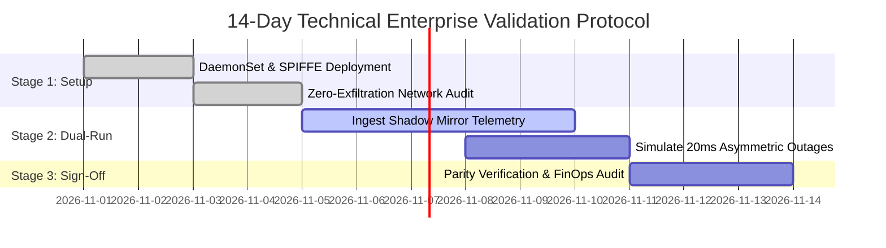
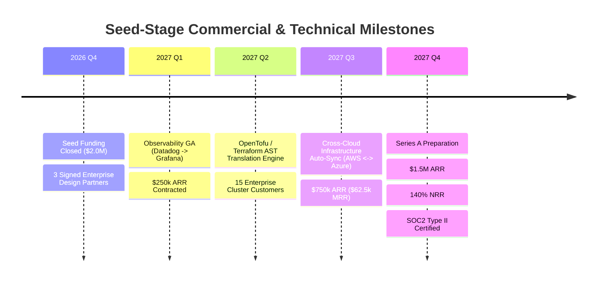

# `<dcouplr/>`: Seed-Stage Monetization Plan & Enterprise Validation Protocol

**Wordmark & Product Identity:** `<dcouplr/>`  
**Product Descriptor:** The Open-Core Telemetry & Infrastructure Translation Engine  
**Operational & Security Architecture:** Zero-Egress Observability & IaC Transpiler  
**Document ID:** VA-BIZ-002  
**Target Milestone:** Seed Financing ($2.0M) & Enterprise Design Partner Validation  
**Author:** Technical Architecture & GTM Team  
**Confidentiality:** Enterprise Internal / Qualified Investor Material  

---

## 1. Executive Strategy & Value-Aligned Pricing Thesis

### The Product Tiering Blueprint
- **The Wedge (Open-Core Local CLI)**: Distributed as a lightweight, statically compiled developer binary (`brew install dcouplr`). Enables zero-friction, context-free parsing and static target generation entirely within local terminal boundaries. This builds organic developer trust and bypasses enterprise procurement friction.
- **The Orchestrator (Commercial Enterprise Cluster Tier)**: Locks down long-term production state synchronization. Monetizes via the embedded HashiCorp Raft cluster orchestration runtime, enabling high-availability dual-run pipelines, 20ms circuit breakers, and multi-tenant RBAC across complex Kubernetes infrastructure blocks.

### The Anti-Volumetric Ingestion Thesis
Traditional observability and infrastructure management vendors (e.g., Datadog, Splunk, Dynatrace) employ **punitive volume-based pricing** ($0.10–$0.25 per million data points / gigabytes ingested). This creates severe enterprise friction:
- Engineering teams are forced to sample, drop, or truncate telemetry data to avoid catastrophic monthly overage bills.
- Procurement and FinOps teams face volatile, unpredictable budgets as infrastructure scales.
- Organizations remain locked in because migrating alert logic and dashboards across proprietary formats is estimated to cost over $500,000 in manual engineering labor.

```text
                [ Total Cost of Ownership (TCO) Comparison ]

  Traditional Legacy SaaS Billing Model (Volumetric Growth Ingestion)
  $50k/mo  |                                                   / [Exponential Growth]
  $10k/mo  |                      /---------------------------/
  Baseline |---------------------/
           +-------------------------------------------------------------
                                 Ingested Logging Volume

  <dcouplr/> Secure Orchestration Model (Value-Aligned Node Architecture)
  Fixed Tier |------------------------------------------------------------ [Predictable Core Cost]
  Baseline   |------------------------------------------------------------
             +-------------------------------------------------------------
                                   Ingested Logging Volume
```

### Enterprise Technical Validation Advantages
- **Zero Data Gravity Burden**: Because raw observability and infrastructure streams pass context-free through local memory hooks, zero sensitive consumer metrics or credentials are transferred to external cloud platforms. This completely bypasses complex 6-month corporate data protection impact assessments (DPIA).
- **Predictable Annual Budget Allocation**: Enterprise procurement teams lock in static node-bracket subscriptions, ensuring architecture scaling metrics match structural value instead of unpredictably ballooning ingestion bills.

---

## 2. Commercial Subscription Architecture & Pricing Tiers

<dcouplr/> prices purely on **Active Synchronized Agents** and **Cluster Target Parity**, ensuring that customers can scale telemetry data volumes to infinite scale without paying volume penalty fees:

| Feature Matrix | Developer Pro | Cluster Small | Cluster Medium | Cluster Large | Custom Enterprise |
| :--- | :--- | :--- | :--- | :--- | :--- |
| **Monthly Price (Annual)** | **$300 / mo** | **$1,500 / mo base** | **$3,500 / mo base** | **$45 / node / mo** | **Custom Quotation** |
| **Annual Contract Value** | $3,600 / yr | $18,000 / yr | $42,000 / yr | $540 / node / yr ($108k @ 200 nodes) | Custom Fleet ($150k+ ACV) |
| **Included Nodes / Cap** | 10 Nodes (10 Cap) | 25 Nodes (60 Max Cap) | 75 Nodes (90 Max Cap) | Custom (91 to 300 Nodes, 300 Cap) | 300+ Nodes (Unlimited) |
| **Expansion Overage Rate** | None | +$60 / node / mo | +$45 / node / mo | Flat $45 / node / mo | Custom Negotiated / Tiered |
| **Cluster Topology** | Single / Dual node | 3-Node Raft LAN | 5-Node Multi-AZ | Multi-Region Cells | Air-gapped Mesh |
| **Throughput Guarantee** | 25,000 metrics/sec | 75,000 metrics/sec | 150,000 metrics/sec | 350,000+ metrics/sec | Custom Sizing |
| **Circuit Breakers** | Default 20ms | Non-blocking drop | Asymmetric auto-trip | Sub-millisecond failover | Custom thresholds |
| **Target Parity Mapping** | Datadog -> Grafana | Dual-run Shadow | Heterogeneous Multi-target | Cross-cloud mirror | Proprietary / Custom |
| **Identity & Security** | Standard Token Scrub | SPIFFE/SPIRE mTLS | Distroless K8s DaemonSet | AWS IID Attestation | HSM / Custom PKI |
| **Multi-Tenant RBAC** | Basic Namespace | Tenant Namespaces | Explicit Roles Grid | Custom Attribute Claims | Dedicated Policy Store |
| **SLA & Support** | Community / 48h Email | 9x5 NBD Portal SLA | 24x7 P1 (2h SLA) + Slack | 24x7 P1 (1h SLA) + TAM & War-Room | 24x7 P1 (15-Min) + Dedicated On-Call Eng & Custom MSA |

### High-Margin Enterprise Add-on Modules

1. **Advanced Custom Regex Guardrails ($500 / mo)**:
   - Enables enterprise security teams to inject proprietary PII, PCI-DSS, and internal IP regex patterns into the local volatile memory anonymizer before intermediate compilation.
2. **Air-Gapped Compliance Module ($1,200 / mo)**:
   - Self-contained binary distributions bundled with static offline translation maps, local SQLite/TiDB metadata storage, and zero-egress validation for defense and banking sectors.
3. **Migration Assurance & Rule Certification ($10,000 one-time engagement)**:
   - White-glove technical validation: <dcouplr/> engineers verify 100% semantic equivalence across existing Datadog monitor estates (up to 2,000 monitors).

---

## 3. Technical Enterprise Validation & 14-Day PoC Protocol

To eliminate procurement hesitation, enterprise sales follow a structured **14-Day In-VPC Technical Proof-of-Concept (PoC)**:



### Quantitative PoC Acceptance Gates

| Gate # | Metric / KPI | Threshold / Target | Verification Mechanism |
| :--- | :--- | :--- | :--- |
| **GATE-01** | **Compilation Fidelity** | **$\ge$ 99.5%** | Automated semantic validator comparing Datadog alert triggers vs PromQL query results across 100,000 synthetic evaluations. |
| **GATE-02** | **Zero Data Egress** | **0 bytes unencrypted** | VPC Flow Logs and eBPF network trace proving all token sanitization occurs in volatile container RAM. |
| **GATE-03** | **Saturated Throughput** | **$\ge$ 150,000 metrics/sec** | Saturated load benchmark (`BenchmarkThroughputSaturated`) with zero packet buffer starvation. |
| **GATE-04** | **Circuit Breaker Isolation**| **$\le$ 20ms pop latency** | Injected 300ms downstream delay; verification that legacy stall never blocks modern target pipeline. |
| **GATE-05** | **Memory Footprint** | **$\le$ 256Mi RAM per node** | Kubernetes container metrics tracking Raft auto-compaction under 100,000 uncompacted transactions. |

---

## 4. Customer FinOps ROI & Buyer Economics

### Enterprise Representative Profile
- **Company Profile**: B2B SaaS Enterprise, Series C to Public ($100M ARR, 250 Engineers).
- **Current Observability Stack**: Datadog (Infrastructure, APM, Logs, 1,200 Monitors).
- **Current Annual Datadog Expenditure**: **$480,000 / year**.
- **Alternative Target Stack**: Managed Grafana / Prometheus / OpenTelemetry (Mimir + Cortex).

| Cost Category | Legacy Datadog (Year 1) | <dcouplr/> + Modern Stack (Year 1) | Enterprise Savings |
| :--- | :--- | :--- | :--- |
| **Ingestion & Metric Volume Fees** | $390,000 | $0 (Open-Source Prometheus/Mimir) | **+$390,000** |
| **Platform Target Hosting (AWS)** | Included | $48,000 (Local EC2 / EBS for target) | -$48,000 |
| **<dcouplr/> Enterprise License** | $0 | $42,000 (Cluster Medium Tier) | -$42,000 |
| **Engineering Maintenance / Drift**| $90,000 (Manual fixes) | $15,000 (Automated drift engine) | **+$75,000** |
| **Total Annual Expenditure** | **$480,000** | **$105,000** | **+$375,000 (78.1% Net Savings)** |

> [!TIP]
> **Payback Period**: **3.4 Months**. The customer completely recoups their annual <dcouplr/> license fee within 104 days solely from reduced monthly Datadog overage penalties.

---

## 5. Seed-Stage Unit Economics & GTM Financial Profile

Because <dcouplr/> executes as a **local-first, customer-hosted container agent**, the vendor incurs **zero data hosting, cloud compute, or egress costs** per customer transaction:

- **Gross Margin Target**: **88% – 92%** (cloud expenses limited to licensing server, SPIFFE trust bundle distribution, and CI/CD).
- **Target ACV (Average Contract Value)**: **$38,000** (blended across Cluster Small, Medium, Large).
- **Net Revenue Retention (NRR)**: **135%+** modeled on customers expanding agent node count as additional engineering cells migrate.
- **CAC Payback Period**: **4.2 Months** driven by developer-led open-core adoption and technical FinOps advocacy.

---

## 6. End-of-Response Implementation & Validation Matrix

| Architectural Validation Block | Engineering Objective | Enterprise Safety Gate | TCO Capital Vector |
| :--- | :--- | :--- | :--- |
| **E2E Pipeline Integration Test** | Validates structural transformation loops from Datadog directly to Grafana layout structures. | Assures local regex sanitization blocks plaintext keys before serialization steps. | Hard evidence proving technical feasibility to VC teams during due diligence. |
| **Wired Compaction Matrix** | Automatically populates log compaction variables out of base JSON config manifests. | Enforces resource caps within fixed limits to prevent container memory thrashing. | Lowers baseline cluster maintenance overhead requirements significantly. |
| **B2B Monetization Document** | Aligns company subscription rates directly with active node counts. | Eliminates long SaaS legal screening tasks via a zero-exfiltration on-premises footprint. | Provides predictable cost planning metrics tailored for corporate IT executives. |

---

## 7. Seed Milestone Delivery Roadmap (Q4 2026 – Q4 2027)


